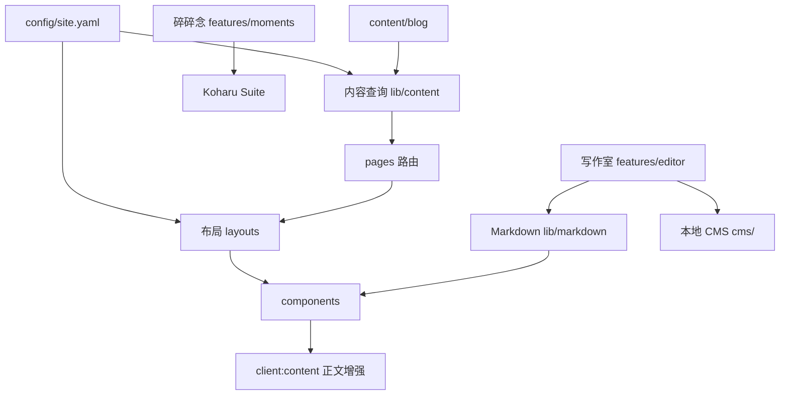
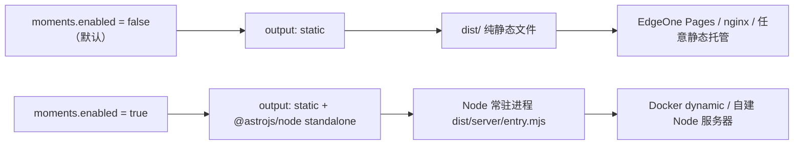
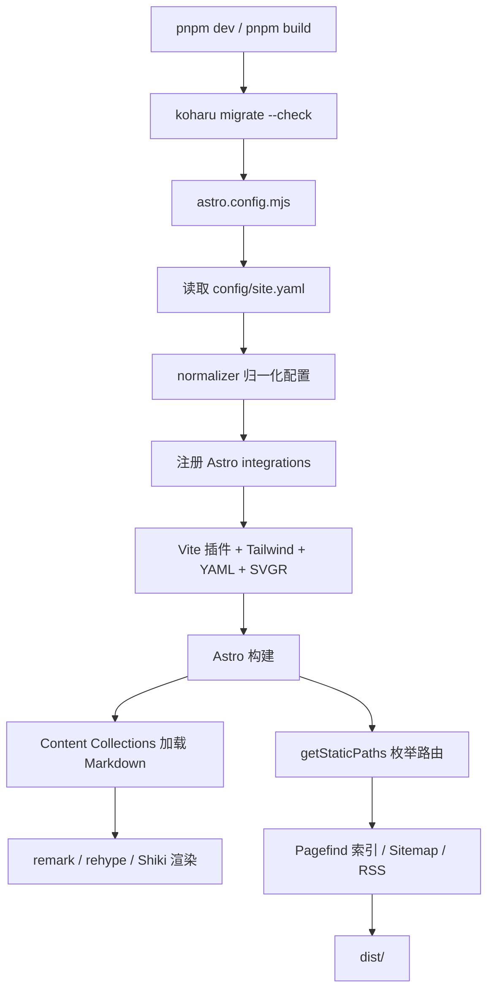

# 01 项目概览

## 1. 项目定位

`astro-koharu` 是一个由 Hexo/Shoka 主题博客迁移而来的 Astro 个人站点。它保留了 Shoka 风格的视觉语言与部分 Markdown 扩展语法，同时把渲染、路由、内容查询和客户端交互重建在 Astro + React 之上。

项目同时承担三种角色：

1. **博客站点**：文章、分类、标签、归档、系列、RSS、搜索、评论。
2. **写作工具链**：`/editor` 写作室、本地 CMS、AI 摘要、语义相似度、LQIP 占位图。
3. **可配置主题**：`config/site.yaml` 驱动几乎全部站点行为，代码层保持模块化与可测试性。

站点当前启用的语言为中文（默认，无 URL 前缀）与 English（`/en/` 前缀）。日语、韩语翻译文件存在但 `enabled: false`，不会生成路由。

## 2. 功能全景

### 2.1 内容与写作

| 能力 | 入口/实现 | 说明 |
| --- | --- | --- |
| Markdown/MDX 文章 | `src/content/blog/` | Astro Content Collections，支持 GFM、数学公式、Mermaid、信息图、链接卡片 |
| 正文增强语法 | `src/lib/markdown/` | 提示块、折叠块、标签页、文字特效、注音、隐藏文字、练习题、音视频、友链卡片 |
| 整篇/局部加密 | `:::encrypted` / frontmatter `password` | 构建期 AES-256-GCM 加密，密码不进入浏览器 |
| 写作室 | `src/features/editor/` | CodeMirror 编辑器 + 实时预览 + 本地草稿 + 导入/导出 |
| 本地 CMS | `cms/` | Hono + Vite，选择文章后复用写作室编辑并写回磁盘 |
| 文章落款 | `colophon:` 配置 + frontmatter | 标注创作方式、阅读提醒，支持归档筛选 |
| 文章操作 | `postActions:` | 复制全文、下载 Markdown、在写作室打开 |

### 2.2 组织与检索

| 能力 | 入口 | 说明 |
| --- | --- | --- |
| 多级分类 | `/categories/**` | `categories` 支持字符串或嵌套数组，映射到 `categoryMap` |
| 标签 | `/tags/**` | 大小写不敏感，`/` 转为 `-` 作为单段参数 |
| 归档 | `/archives` | 年/月分组、热力强度、落款筛选 |
| 分页列表 | `/posts/[page]` | 排除 Featured Series 的文章 |
| 系列 | `/[seriesSlug]` | 基于分类的定期系列，自动解析 `Vol.N` 期号 |
| 全文搜索 | Pagefind | 构建期索引，纯静态 |
| 相关文章 | `similarities.json` | 本地向量模型生成的语义相似度 |

### 2.3 阅读与互动

| 能力 | 实现 | 说明 |
| --- | --- | --- |
| 深浅主题 | `ThemeToggle` + CSS 变量 | localStorage 持久化，`<head>` 内联脚本防闪烁 |
| 目录/阅读进度 | `TableOfContents`、`useReadingProgress` | 侧栏目录、移动端下拉、阅读进度 |
| 评论 | Waline / Twikoo / Giscus / Remark42 | `comment` 配置切换 provider |
| 访问统计 | Umami | 站点级与文章级 PV |
| 音乐 | APlayer 风格播放器 + Meting | 网易云歌单，可自建 Meting API |
| 公告 | `announcements:` | 多公告、优先级、时间窗、按 id 记录已读 |
| 友链 | `friends:` | 分组展示、申请格式 |
| 番剧 | Bangumi API | 可选页面，配置注释后自动隐藏 |
| 碎碎念 | `src/features/moments/` | 动态消息流，依赖外部 Koharu Suite，需 Node 运行时 |
| 圣诞效果 | `christmas:` | 雪花、装饰、帽子等，可按需关闭 |

### 2.4 功能域与代码入口

| 功能域 | 入口 | 关键函数/组件 |
| --- | --- | --- |
| 内容查询 | `src/lib/content.ts` | `getSortedPosts`、`getPostById` |
| 首页聚合 | `src/lib/content/posts.ts` | `getHomePagePosts` |
| 分类/标签 | `src/lib/content/categories.ts`、`tags.ts` | `getCategoryList`、`getAllTags` |
| 路由 | `src/pages/_shared/routes.ts` | `postRoute`、`tagRoute`、`categoryRoute` |
| Markdown | `src/lib/markdown/` | `preprocessShokaSyntax`、`rehypeEncryptedPost` |
| i18n | `src/i18n/utils.ts` | `t`、`localizedPath` |
| 写作室 | `src/features/editor/Editor.tsx` | `renderEditorMarkdown` |
| 碎碎念 | `src/features/moments/lib/data.ts` | `getMomentsChannels` |
| CLI | `scripts/koharu.tsx` | `pnpm koharu` |
| CMS | `cms/server.ts` | `/api/cms/*` |

## 3. 技术栈

| 层次 | 技术 | 版本 | 用途 |
| --- | --- | --- | --- |
| 框架 | Astro | 7.1.3 | 静态生成、文件路由、Content Collections、Islands |
| UI 运行时 | React | 19.2 | 交互岛、编辑器、设置面板 |
| 样式 | Tailwind CSS | 4.3 | 原子化样式，Vite 插件接入 |
| 组件体系 | Radix UI + CVA + shadcn 模式 | — | 无障碍 primitives 与变体管理 |
| 动效 | Motion | 12.43 | 页面过渡、折叠、面板动画 |
| 状态 | Nanostores | 0.11 | 跨岛全局状态 |
| 搜索 | Pagefind | 2.x | 构建期全文索引 |
| 内容渲染 | unified / remark / rehype / Shiki | — | Markdown 解析、扩展语法、代码高亮 |
| 数学 | KaTeX | — | `remark-math` + `rehype-katex` |
| 图表 | Mermaid / AntV Infographic | — | 运行时懒渲染 |
| 日期 | date-fns + date-fns-tz | — | 站点时区安全的格式化与解析 |
| 工具 | es-toolkit、zod、js-yaml | — | 数据处理、校验、YAML 解析 |
| 测试 | node:test + tsx + Playwright | — | 单元/集成/浏览器测试 |
| 代码质量 | Biome、knip、lint-md | — | 格式化、死代码检查、Markdown 规范 |

## 4. 运行模式

项目有两种互斥的构建/运行模式，由 `config/site.yaml` 的 `moments.enabled` 决定：

- **静态模式**：所有页面在构建期生成，搜索索引、RSS、Sitemap 也都在构建期产出。`pnpm build` 后 `dist/` 可直接部署。
- **动态模式**：注入 Moments 路由，使用 `@astrojs/node` 的 `standalone` 适配器与内存缓存；必须提供 `KOHARU_SUITE_URL`，否则构建直接失败。此时不能再部署到纯静态平台。

## 5. 核心设计原则

项目在 `AGENTS.md` 中明确了六条工程原则，代码结构基本遵循：

| 原则 | 落地方式 |
| --- | --- |
| 模块优先 | `src/lib/` 按配置、内容、Markdown、客户端能力拆分；`src/features/` 承载可注入功能 |
| 接口优先 | 每个目录通过 `index.ts` 或明确的 barrel 暴露最小公共 API；类型与实现一起导出 |
| 函数优先 | 内容查询、配置归一化、日期、URL、TOC 等多以纯函数实现，副作用集中在边界 |
| 可测试 | 纯函数配套 `node:test`；浏览器行为用 Playwright 或 `.mjs` 脚本验证 |
| 简单优先 | 不为单次使用创建抽象；`category-path.ts` 等拆分是为了打破循环依赖而非过度设计 |
| 依赖卫生 | 明确依赖方向，`src/lib/**` 禁止导入 `@constants/site-config`；重型依赖按需加载 |

## 6. 关键约束

| 约束 | 原因/表现 |
| --- | --- |
| Node `>= 22.20.0`、pnpm `10.28.2` | `package.json` 的 `engines` 与 `packageManager`；EdgeOne 构建也要求该版本 |
| `config/site.yaml` 修改后需重启或重新构建 | 配置在构建期被读取并缓存，HMR 不会重新解析 |
| `src/lib/**` 不得导入 `@constants/site-config` | 避免 `lib → constants → lib` 循环；配置从 `@lib/config/*` 获取 |
| 默认语言无 URL 前缀 | `prefixDefaultLocale: false`；直接访问 `/zh/...` 会 404 |
| 根页面必须有 `[lang]/` 镜像 | `assertLocaleMirrorsComplete()` 在模块加载时抛出缺失清单 |
| `summaries.json` / `similarities.json` 需提交 | 构建阶段不会自动执行生成脚本 |
| 启用 Moments 必须提供 `KOHARU_SUITE_URL` | `astro.config.mjs` 构建期校验，缺失即抛错 |
| Tailwind 断点是“最大宽度”语义 | `md` 表示 `max-width: 768px`，桌面端规则应使用 `min-[769px]` 等写法 |

## 7. 入口与构建链路

- `pnpm dev` 与 `pnpm build` 都会先执行 `pnpm koharu migrate --check`，扫描并阻止未迁移的旧链接数据。
- `astro.config.mjs` 是唯一的构建入口，负责读取 YAML、决定是否注入编辑器/碎碎念、配置 Markdown 插件顺序与 Vite 行为。
- 页面在构建期通过 `getStaticPaths` 获取数据；内容查询层使用进程内 `memoize` 缓存，避免重复排序/过滤。

## 8. 阅读建议

- 想理解“一个请求如何变成页面”，继续读 [02 整体架构](./02-architecture.md) 与 [06 路由与页面](./06-routing-and-pages.md)。
- 想启动、构建或部署项目，读 [12 项目运行方式](./12-running-guide.md) 与 [09 工具与部署](./09-tooling-and-deployment.md)。
- 想理解“配置如何影响行为”，读 [03 配置系统](./03-configuration.md)。
- 想理解“Markdown 为什么这样渲染”，读 [05 Markdown 管线](./05-markdown-pipeline.md)。
- 想理解“哪些代码可以安全改动”，读 [11 依赖关系图](./11-dependency-map.md)。
