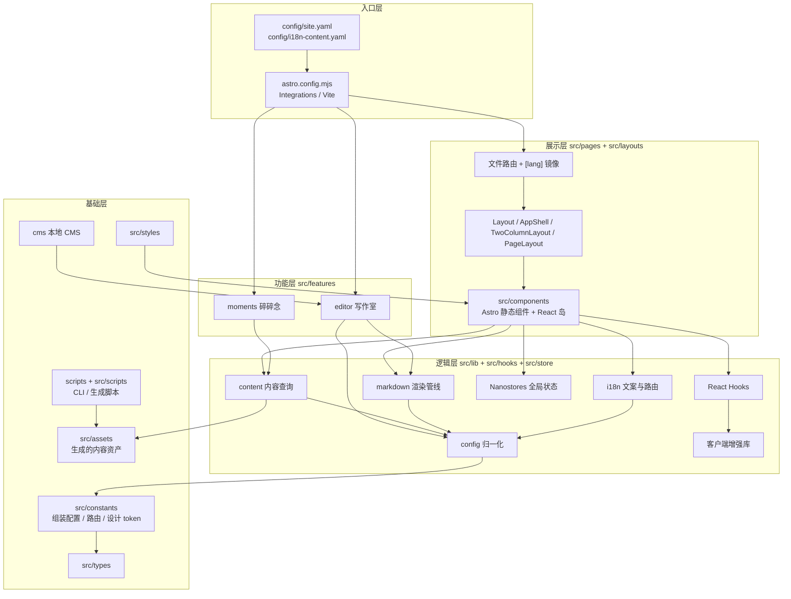
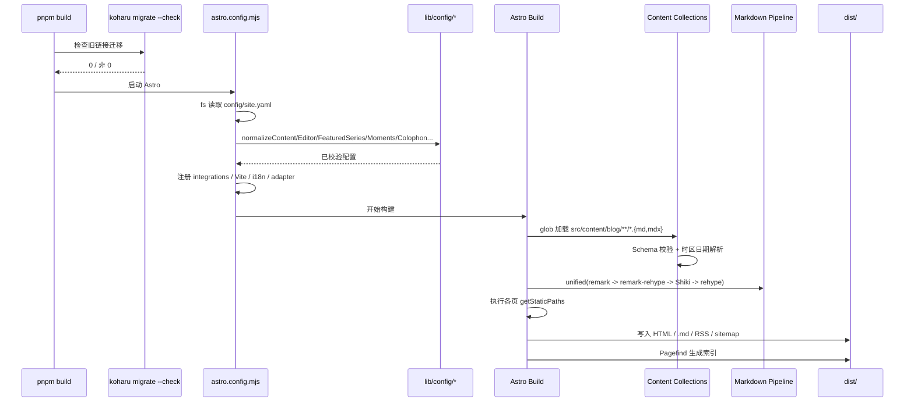
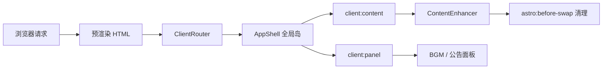

# 02 整体架构

## 1. 架构总览

项目采用“构建期静态生成 + 客户端按需水合”的 Astro Islands 架构。核心逻辑被下沉到 `src/lib/` 的纯函数层，页面与组件只负责组合与展示；可选的写作室与碎碎念通过 Astro Integration 注入，不污染主构建。

## 2. 分层职责

| 层 | 目录 | 职责 | 典型产物 |
| --- | --- | --- | --- |
| 入口/装配 | `astro.config.mjs`、`config/` | 读取 YAML、归一化配置、注册集成与插件 | 构建上下文、插件链 |
| 路由/页面 | `src/pages/` | 声明 URL 空间、`getStaticPaths`、页面级数据获取 | HTML 页面、`.md` 端点、RSS |
| 布局 | `src/layouts/` | HTML 骨架、全局岛、SEO meta、插槽契约 | `Layout`、`AppShell`、`TwoColumnLayout` |
| UI | `src/components/` | 展示与交互；Astro 组件默认零 JS，React 岛承载状态 | 组件树 |
| 功能 | `src/features/` | 可独立注入的完整功能（编辑器、碎碎念） | 路由、React 应用、服务端中间件 |
| 领域逻辑 | `src/lib/` | 配置归一化、内容查询、Markdown 插件、客户端增强、加密、SEO | 纯函数与小型状态机 |
| Hooks/状态 | `src/hooks/`、`src/store/` | 复用交互逻辑、跨岛共享状态 | `useXxx`、Nanostores |
| 国际化 | `src/i18n/` | UI 文案、locale 检测、locale-aware 路径 | `t()`、`localizedPath()` |
| 常量/类型 | `src/constants/`、`src/types/` | 路由表、布局尺寸、设计 token、组装后的站点配置 | `siteConfig`、`Routes` |
| 内容资产 | `src/assets/` | 构建或脚本生成的 JSON | `summaries.json`、`similarities.json`、`lqips.json` |
| 样式 | `src/styles/` | Tailwind 入口、主题变量、Shoka/组件样式 | CSS |
| 工具链 | `scripts/`、`src/scripts/`、`cms/` | CLI、内容资产生成、本地 CMS | CLI/TUI、写文件 API |

依赖方向的基本原则是自上而下：`pages → layouts → components → hooks/store → lib → constants/types`。`src/features/` 与 `src/lib/` 平级但只依赖下层；`src/lib/**` 不允许反向依赖 `src/constants/site-config.ts`。详见 [11 依赖关系图](./11-dependency-map.md)。

## 3. 目录职责速查

| 路径 | 主要内容 | 关键文件 |
| --- | --- | --- |
| `src/pages/_shared/` | locale 路由原语、动态路由参数空间、文章源码端点 | `utils.ts`、`routes.ts`、`post-source.ts` |
| `src/pages/[lang]/` | 所有非默认语言的镜像页面 | `post/[...slug].astro`、`index.astro` 等 |
| `src/layouts/` | HTML 骨架与布局插槽 | `Layout.astro`、`HeadMeta.astro`、`AppShell.astro` |
| `src/components/layout/` | 页头、页脚、导航、搜索、侧栏、目录 | `Header.astro`、`Footer.astro`、`SearchDialog.tsx` |
| `src/components/post/` | 文章卡片、列表、分页、相关推荐、落款 | `PostList.astro`、`SummaryPanel.tsx`、`colophon/` |
| `src/components/markdown/` | 正文增强客户端组件 | `ContentEnhancer.tsx`、`ImageLightbox.tsx`、`QuizBlock.tsx` |
| `src/components/ui/` | shadcn 风格 primitives 与封面组件 | `button.tsx`、`dialog.tsx`、`cover/` |
| `src/lib/config/` | YAML normalizer 与配置类型 | `site.ts`、`content.ts`、`moments.ts` |
| `src/lib/content/` | 文章/分类/标签/系列/落款查询 | `posts.ts`、`categories.ts`、`colophon.ts` |
| `src/lib/markdown/` | remark/rehype/Shiki/链接卡/加密 | `shoka-preprocessor.ts`、`rehype-encrypted-block.ts` |
| `src/lib/crypto/` | 构建期加密与客户端解密 | `encrypt.ts`、`decrypt.ts` |
| `src/features/editor/` | 写作室全栈实现 | `Editor.tsx`、`render.ts`、`server/` |
| `src/features/moments/` | 碎碎念页面、数据访问、路由注入 | `integration/momentsRoutes.ts`、`lib/data.ts` |
| `src/scripts/` | 内容资产生成 | `generateLqips.ts`、`generateSimilarities.ts`、`generateSummaries.ts` |
| `scripts/koharu/` | Ink CLI 子命令 | `backup.tsx`、`update.tsx`、`generate.tsx` |
| `cms/` | 本地 CMS 服务与前端 | `server.ts`、`src/api/write.ts` |

## 4. 构建期生命周期

关键点：

1. `astro.config.mjs` 在 Vite 插件可用之前就用 Node `fs` 读取 YAML，因此它自己不能依赖 `@rollup/plugin-yaml`。
2. 配置 normalizer 是纯函数，既被 `astro.config.mjs` 调用，也被运行时代码调用，保证构建期与页面期使用同一套默认值/校验规则。
3. Content Collection 的 `date` Schema 在构建期把 frontmatter 日期按站点时区解释，避免构建机器时区影响排序。
4. `getStaticPaths` 在构建期执行，内容查询结果通过模块级 `memoize` 缓存，整个构建进程共享。

### 4.1 构建期关键函数

| 阶段 | 关键函数/符号 | 文件 | 作用 |
| --- | --- | --- | --- |
| 读取配置 | `loadConfigForAstro()` | `astro.config.mjs` | 在 Vite 插件可用前用 `fs` 读取 `site.yaml` |
| 内容配置 | `normalizeContentConfig()` | `src/lib/config/content.ts` | 合并默认值，决定 Markdown 插件是否注册 |
| 系列配置 | `normalizeFeaturedSeries()` | `src/lib/config/featured-series.ts` | 校验 slug、保留路由、重复项 |
| Moments 配置 | `normalizeMomentsConfig()` | `src/lib/config/moments.ts` | 校验路径/别名/OG 图片 |
| 编辑器注入 | `editorIntegration()` | `src/features/editor/integration.ts` | 注入 `/editor` 与开发期 OG 中间件 |
| Moments 路由 | `momentsRoutes()` | `src/features/moments/integration/momentsRoutes.ts` | 注入动态路由并检查冲突 |
| 本地化路由 | `localePaths()`、`postRoute` | `src/pages/_shared/` | 生成根页面与 `[lang]` 镜像的参数空间 |
| 内容查询 | `getSortedPosts()` | `src/lib/content/posts.ts` | 读取集合、过滤草稿、排序 |
| 构建缓存 | `memoize()` | `src/lib/content/cache.ts` | 构建进程内复用查询结果 |
| 渲染 | `render(post)` | Astro Content | 产出文章组件与标题树 |

## 5. 运行期生命周期

静态页面与动态页面的共同运行时骨架：

### 5.1 静态页面

1. 浏览器请求 HTML（如 `/post/hello`）。
2. HTML 已包含完整正文、SEO meta、目录锚点；默认不加载 React。
3. `Layout.astro` 注册 `ClientRouter`（View Transitions），`AppShell` 挂载全局岛。
4. `astro:page-load` 后，各客户端脚本初始化：目录滚动、图片灯箱、页头连续动画、樱花/点击粒子、触摸预取等。
5. 正文增强由 `client:content` 指令在内容进入视口附近时懒加载 `ContentEnhancer`；BGM/公告面板由 `client:panel` 在用户首次打开时加载。

### 5.2 动态页面（Moments）

1. 请求进入 Node standalone 服务。
2. Astro 渲染 Moments 页面，调用 `getMomentsChannels()` / `listChannelMessages()`。
3. `requestKoharu()` 通过 `@coszone/koharu-astro` 客户端访问外部 Suite，8 秒超时，慢请求（>2 秒）记录告警。
4. 页面使用 `Astro.cache.set({ maxAge: 300, swr: 30 })` 设置缓存；失败时按 404/429/503 映射状态码与 `Retry-After`。

## 6. 两种构建模式对比

| 维度 | 静态模式 | 动态模式（Moments） |
| --- | --- | --- |
| 触发条件 | `moments.enabled` 缺失/false | `moments.enabled: true` |
| Astro adapter | 无 | `@astrojs/node`，`mode: 'standalone'` |
| 路由 | 仅文件路由 | 文件路由 + `momentsRoutes()` 注入 |
| 缓存 | 构建期 `memoize` | 额外 `memoryCache({ max: 1000 })` + 页面级 `Astro.cache` |
| 构建环境变量 | 不需要 | 必须 `KOHARU_SUITE_URL` |
| 部署 | `dist/` 静态托管 | `dist/server/entry.mjs` Node 进程 |
| 搜索/RSS | 构建期生成 | 静态页面仍构建期生成；Moments RSS 动态输出 |

## 7. 关键架构决策

| 决策 | 实现 | 收益 | 代价 |
| --- | --- | --- | --- |
| 配置集中在单一 YAML | `config/site.yaml` + normalizer | 非开发者也能改站点；配置有默认值与校验 | 修改后需重启/重建 |
| locale 路由“单点声明、双文件消费” | `localePaths()` + `[lang]/` 镜像 | 路由参数空间只写一次，根/镜像一致 | 每个根页面必须有镜像，否则构建失败 |
| 内容查询层 + 构建期缓存 | `src/lib/content/*` + `memoize` | 页面代码简单，重复查询被消除 | dev 模式禁用缓存以避免 HMR 脏数据 |
| Markdown 预处理器 | `shoka-preprocessor.ts` | 兼容 Hexo/Shoka 语法，避免 remark 误解析 | 必须严格处理代码块/数学等保护区 |
| 构建期加密 | `rehype-encrypted-*` + Web Crypto | 明文与密码不进入浏览器 | 密码泄露即内容泄露；加密文章不公开源码 |
| 客户端指令懒水合 | `client:content`、`client:panel` | 首屏几乎零 React 成本 | 指令入口需独立打包，存在 DOM 契约 |
| 功能注入而非硬编码 | `editorIntegration()`、`momentsRoutes()` | 关闭功能即完全不进入构建 | 注入路由需处理冲突与镜像豁免 |
| 内容资产预生成 | LQIP/相似度/摘要脚本 | 构建期无需模型/网络，部署简单 | 资产需随内容提交 |
| CMS 与主站共用编辑器 | `cms/` + 写作室模块 | 编辑体验一致 | CMS 仅本地可用，需额外启动 |
| 静态优先、动态按需 | `moments.enabled` 切换 adapter | 大多数部署零服务器成本 | 两套部署路径需分别验证 |

## 8. 缓存与性能

| 机制 | 位置 | 行为 |
| --- | --- | --- |
| `memoize(namespace, key, fn)` | `src/lib/content/cache.ts` | 生产构建进程内缓存；开发模式直接执行，避免 HMR 陈旧数据 |
| `WeakMap` 阅读时长 | `src/lib/content/posts.ts` | 按文章对象身份缓存 `reading-time` 结果 |
| `WeakMap` 标签统计 | `src/lib/content/tags.ts` | 相同 posts 数组引用复用计数 |
| `WeakMap` slug→post | `src/lib/content/similarities.ts` | 相关文章映射复用 |
| OG 元数据缓存 | `.cache/og-data.json` | 链接卡片构建期抓取结果，TTL 以“天”为单位 |
| Pagefind | `astro-pagefind` | 构建期生成静态索引 |
| 代码分割 | `astro.config.mjs` | `react-runtime` / `motion-runtime` 共享 chunk |
| 条件打包 | `conditionalSnowfall()` | 圣诞雪花关闭时用空组件替换，节省约 879KB |
| 懒加载 | `lazyMermaid`、`client:content` | Mermaid 仅渲染可见图；正文增强按视口加载 |

## 9. 扩展点

| 需求 | 扩展位置 | 注意事项 |
| --- | --- | --- |
| 新增页面 | `src/pages/` + `src/pages/[lang]/` | 必须成对；或加入 `MIRROR_EXEMPT` |
| 新增动态路由 | `src/pages/_shared/routes.ts` | 用 `localePaths()` 声明一次，根/镜像分别导出 `.root` / `.mirror` |
| 新增配置段 | `src/lib/config/` 新 normalizer + `src/constants/site-config.ts` 组装 | 必须配套 node:test；不要让 `lib` 反向依赖 `constants` |
| 新增 Markdown 语法 | `src/lib/markdown/` 新 remark/rehype 插件 | 在 `astro.config.mjs` 中按顺序注册；注意代码块/数学保护区 |
| 新增可注入功能 | `src/features/<name>/` + Integration | 参考 `editorIntegration()` 与 `momentsRoutes()` |
| 新增内容资产 | `src/scripts/` + `src/assets/` | 同步 `scripts/koharu/constants/generate.ts` 注册 CLI |
| 新增 UI 组件 | `src/components/<domain>/` | 优先 Astro；只有需要状态/事件时才用 React 岛 |

## 10. 架构约束与常见反模式

| 反模式 | 正确做法 |
| --- | --- |
| 在 `src/lib/**` 导入 `@constants/site-config` | 从 `@lib/config/site` 或更细的 normalizer 获取配置 |
| 页面里直接 `getCollection('blog')` | 使用 `src/lib/content` 的查询函数，复用过滤/排序/缓存 |
| 在 React 组件里读取 `Astro.url` | 由页面通过 props 传入 `locale`/数据 |
| 为单次使用创建 `src/lib` 工具 | 先内联，出现第三次再抽象 |
| 在 `useEffect` 中同步派生状态 | 直接用 `useMemo` 或渲染期计算 |
| 用 `suppressHydrationWarning` 掩盖水合差异 | 使用 `useIsMounted()` 或服务端稳定初始值 |
| 把大对象（正文、所有文章）作为 props 传给客户端 | 预计算 `wordCount`/`readingTime`/摘要等小字段 |
| 直接修改 `site.yaml` 后只刷新浏览器 | 重启 dev server 或重新 `pnpm build` |
