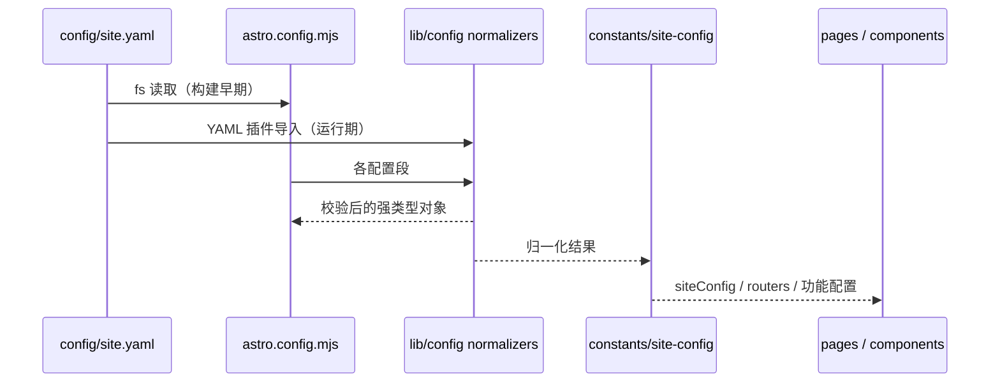
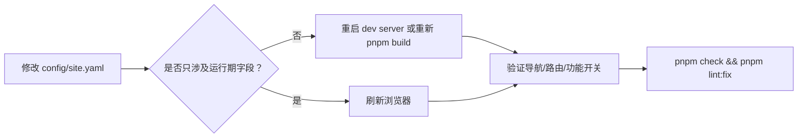

# 03 配置系统

## 1. 配置文件总览

| 文件 | 作用 | 读取时机 |
| --- | --- | --- |
| `config/site.yaml` | 站点唯一主配置：基本信息、导航、功能开关、第三方服务 | 构建期（`astro.config.mjs` 直接 `fs` 读取；运行时代码经 YAML 插件导入） |
| `config/i18n-content.yaml` | 内容级多语言文案：分类名、系列名、精选分类、落款 | 构建期与页面渲染期 |
| `astro.config.mjs` | 构建行为：集成、Markdown 插件、Vite、i18n、adapter | Astro 启动时 |
| `tailwind.config.mjs` | Tailwind 主题、断点、颜色、动画 | Vite/Tailwind 启动时 |
| `tsconfig.json` | 路径别名与严格模式 | 类型检查/构建 |
| `biome.json` | 格式化与 lint 规则 | 开发/提交时 |
| `components.json` | shadcn 组件别名与风格 | 生成 UI 组件时 |
| `knip.json` | 死代码检查入口 | `pnpm knip` |
| `pnpm-workspace.yaml` | Workspace 包（`.` 与 `cms`） | 安装依赖时 |
| `.env` | 本地密钥与可选开关 | 脚本/构建 |

`config/site.yaml` 当前包含 21 个顶层配置段：

```text
site  i18n  categoryMap  featuredCategories  featuredSeries  social
friends  announcements  content  motion  moments  editor  colophon
postActions  navigation  comment  analytics  seo  bgm  christmas  dev
```

`bangumi` 段在当前配置中被整体注释，属于按需启用的可选段。

## 2. 顶层配置段说明

| 配置段 | 关键字段 | 作用 | 主要消费方 |
| --- | --- | --- | --- |
| `site` | `title`、`alternate`、`subtitle`、`name`、`description`、`avatar`、`showLogo`、`author`、`url`、`defaultOgImage`、`startYear`、`startDate`、`timezone`、`keywords`、`breadcrumbHome`、`icp`、`police`、`enableSlugTransliteration` | 站点身份、SEO 默认值、时区、备案、页脚运行天数 | `site-config.ts`、`HeadMeta`、`Footer` |
| `i18n` | `defaultLocale`、`locales[].code/label/enabled` | 语言与路由生成 | `src/i18n/config.ts`、`astro.config.mjs` |
| `categoryMap` | 分类名 → URL slug | 分类路径与系列匹配 | `src/lib/content/categories.ts`、CMS |
| `featuredCategories` | `link`、`label`、`image`、`description` | 首页分类卡片 | `CategoryCards.astro` |
| `featuredSeries` | `slug`、`categoryName`、`label`、`fullName`、`description`、`cover`、`enabled`、`icon`、`links`、`highlightOnHome` | 系列页面、导航、首页高亮 | `normalizeFeaturedSeries`、`[seriesSlug].astro` |
| `social` | 平台键 → `url`、`icon`、`color` | 页脚/个人信息社交链接 | `Social.astro` |
| `friends` | `intro`、`groups[]`、`data[]` | 友链分组、申请说明 | `friends.astro`、`normalizeFriendGroups` |
| `announcements` | `id`、`title`、`content`、`type`、`priority`、`color`、`publishDate`、`startDate`、`endDate`、`link` | 公告弹窗与页脚入口 | `AnnouncementProvider`、`store/announcement` |
| `content` | 20+ 布尔开关、`previewCacheTime`、`postCardImagePosition` | Markdown/代码块/嵌入/Shoka 语法开关 | `normalizeContentConfig`、`astro.config.mjs`、编辑器 |
| `motion` | `level`、`heroPetals`、`clickBurst` | 默认动效强度与装饰效果 | `motionConfig`、`useMotionLevel` |
| `moments` | `enabled`、`path`、`title`、`description`、`ogImage`、`pathAliases`、`channels[]` | 碎碎念功能与路由 | `normalizeMomentsConfig`、`momentsRoutes` |
| `editor` | `enabled` | 写作室与 `/editor` 路由 | `normalizeEditorConfig`、`editorIntegration` |
| `colophon` | `enabled`、`defaults`、`groups`、`marks` | 文章落款字典 | `normalizeColophonConfig`、`resolvePostColophon` |
| `postActions` | `copyMarkdown`、`downloadMarkdown`、`openInEditor` | 文章 Markdown 操作 | `normalizePostActionsConfig`、`PostMarkdownActions` |
| `navigation` | `name`、`nameKey`、`path`、`icon`、`children`、`feature: moments` | 顶部导航 | `routers`、`Navigator`、`NavMenu` |
| `comment` | `provider` 及 provider 子配置 | 评论系统 | `commentConfig`、`Comment.astro` |
| `analytics` | `umami.enabled/id/endpoint/statistics_display` | Umami 统计与页脚 PV | `UmamiAnalytics`、`umamiSiteStatsConfig` |
| `seo` | `robots` | robots.txt 策略 | `astro-robots-txt` |
| `bgm` | `enabled`、`metingApi`、`audio[]` | 全局音乐播放器 | `bgmConfig`、`GlobalBGMPlayer` |
| `christmas` | `enabled`、`features`、`snowfall` | 圣诞主题效果 | `christmasConfig`、`ChristmasEffects` |
| `dev` | `localProjectPath`、`contentRelativePath`、`editors[]` | 开发期“在本地编辑器打开” | `devConfig`、`PostMarkdownActions` |
| `bangumi`（可选） | `userId`、`label`、`icon` | 追番页面与导航 | `bangumiConfig`、`BangumiCollection` |

### 2.1 `content` 段的字段分组

`content` 是影响渲染最大的配置段，按能力可分为四组：

| 分组 | 字段 |
| --- | --- |
| 链接与滚动 | `addBlankTarget`、`smoothScroll`、`addHeadingLevel` |
| 代码块 | `enhanceCodeBlock`、`enableCodeCopy`、`enableCodeFullscreen`、`enableCodeMeta` |
| 嵌入预览 | `enableLinkEmbed`、`enableTweetEmbed`、`enableCodePenEmbed`、`enableOGPreview`、`previewCacheTime`、`lazyLoadEmbeds` |
| Shoka 兼容 | `enableShokaContainers`、`enableShokaAttrs`、`enableShokaEffects`、`enableShokaSpoiler`、`enableShokaRuby`、`enableShokaHexoTags`、`enableMath`、`enableQuiz`、`enableEncryptedBlock` |
| 卡片布局 | `postCardImagePosition`（`alternating` / `left` / `right`） |

### 2.2 `colophon` 段的结构

```yaml
colophon:
  enabled: true
  defaults: [handwritten]
  groups:
    authorship:
      label: 执笔
      exclusive: true
      placement: [meta, seal, card]
  marks:
    handwritten:
      group: authorship
      icon: ri:quill-pen-line
      label: 手写
      description: 每个字都是我自己敲的。
```

- `placement` 可选 `meta`（封面信息行）、`banner`（正文前提示条）、`seal`（文末落款）、`card`（列表卡片图标）。
- 标记优先于分组；都没有时默认 `[meta, seal]`。
- `exclusive` 组一篇文章最多一个标记。
- 图标必须是 `BUNDLED_ICON_SETS` 中的 `set:name`（`gg`、`fa6-regular`、`fa6-solid`、`ri`）。
- 文章 frontmatter 可写 `colophon: []` 显式关闭默认落款。

### 2.3 `navigation` 与功能占位

- 每个导航项可写 `nameKey`，通过 `resolveNavName()` 查 UI 翻译；缺失时回退 `name`。
- `feature: moments` 是特殊占位项；启用 Moments 后会被替换为真实导航项，未写时自动插入到“归档”之后。
- `editor` 关闭时，`resolveEditorNavigation()` 会递归移除 `/editor` 及其子路径，不留下死链。
- `bangumi` 配置存在时自动追加导航项；不存在时页面直接 `Astro.redirect('/404')`。

## 3. 配置归一化模块

所有配置归一化函数都位于 `src/lib/config/`，输入为原始 YAML 片段，输出为带默认值的强类型对象。它们是纯函数，便于测试与在构建期复用。



| 模块 | 主要导出 | 输入 → 输出 | 校验/默认行为 |
| --- | --- | --- | --- |
| `site.ts` | `siteConfig`、`categoryMap`、`friendGroups`、`featuredSeriesList`、`i18nConfig`、`enabledLocaleCodes`、`contentConfig`、`motionConfig`、`editorConfig`、`colophonConfig`、`postActionsConfig`、`siteTimezone` | `config/site.yaml` → 运行时配置 | 时区非法时回退 `DEFAULT_TIMEZONE` 并告警 |
| `content.ts` | `CONTENT_DEFAULTS`、`normalizeContentConfig` | `content` 段 → `ResolvedContentConfig` | 逐字段回退；非法枚举/数值忽略 |
| `motion.ts` | `MOTION_DEFAULTS`、`MOTION_LEVELS`、`normalizeMotionConfig` | `motion` 段 → `ResolvedMotionConfig` | 非法 level 回退 `lively` |
| `editor.ts` | `normalizeEditorConfig`、`resolveEditorNavigation` | `editor` 段 → `{ enabled }` | 非对象/非布尔直接抛错；默认关闭 |
| `featured-series.ts` | `normalizeFeaturedSeries`、`enabledFeaturedSeriesSlugs` | `featuredSeries` → 数组 | 非法形状、空 slug、保留路由、重复 slug 抛错；分类缺失仅告警 |
| `friends.ts` | `normalizeFriendGroups`、`groupFriendLinks` | `friends.groups` → 分组数组 | 非数组/重复 id/保留 id 抛错；未知分组归入“未分组” |
| `moments.ts` | `normalizeMomentsConfig`、`resolveMomentsChannels`、`resolveMomentsNavigation` | `moments` → 归一化配置 | 路径不能与保留路由、locale、系列冲突；非法 OG 图片抛错 |
| `colophon.ts` | `normalizeColophonConfig`、`assertBundledIcon`、`normalizePlacement`、`normalizeTone` | `colophon` → 字典 | 非法字段抛错；图标不在打包集合抛错 |
| `post-actions.ts` | `normalizePostActionsConfig`、`isOpenInEditorAvailable` | `postActions` → 配置 | `openInEditor` 仅 `off/dev/everyone`；默认 `dev` |
| `icon-sets.ts` | `BUNDLED_ICON_SETS`、`isBundledIcon` | — | 只允许四套图标 |
| `reserved-routes.ts` | `RESERVED_ROUTES` | — | 静态页、特殊文件、Astro 内部路径 |

关键函数签名：

| 函数 | 签名 | 说明 |
| --- | --- | --- |
| `normalizeContentConfig` | `(raw?: Partial<ContentConfig> \| null) => ResolvedContentConfig` | 逐字段默认值 |
| `normalizeFeaturedSeries` | `(raw: unknown, context?: FeaturedSeriesContext) => FeaturedSeriesItem[]` | 可注入 `categoryMap`、保留路由、告警出口 |
| `normalizeMomentsConfig` | `(raw: MomentsConfig \| undefined, context?: MomentsValidationContext) => NormalizedMomentsConfig` | 路径/频道/OG 校验 |
| `normalizeColophonConfig` | `(raw: unknown) => ResolvedColophonConfig` | 落款字典 |
| `normalizePostActionsConfig` | `(raw: unknown) => ResolvedPostActionsConfig` | 文章操作开关 |
| `resolveEditorNavigation` | `(items: readonly RouterItem[], config: Required<WritingRoomConfig>) => RouterItem[]` | 关闭编辑器时递归移除入口 |
| `resolveMomentsChannels` | `(config: NormalizedMomentsConfig, suiteChannels: SuiteChannel[], context) => ResolvedMomentsChannel[]` | 合并配置与 Suite 频道 |
| `isOpenInEditorAvailable` | `(config, editorEnabled: boolean, isDev: boolean) => boolean` | 判断“在写作室打开”是否展示 |

### 3.1 三种失败策略

| 策略 | 使用场景 | 示例 |
| --- | --- | --- |
| **抛错（构建失败）** | 配置结构错误会导致路由/安全问题时 | `featuredSeries` slug 冲突、`moments.path` 非法、落款图标不可用 |
| **告警并回退** | 配置可恢复或不影响构建时 | 时区非法回退默认值；系列分类不在 `categoryMap` 中 |
| **逐字段回退** | 大量可选开关时 | `content`、`motion` 的每个布尔字段 |

## 4. 组装层 `src/constants/site-config.ts`

`src/lib/config/site.ts` 负责“归一化”，`src/constants/site-config.ts` 负责“组装并映射到运行时形状”。

| 导出 | 来源 | 说明 |
| --- | --- | --- |
| `siteConfig`、`contentConfig`、`editorConfig`、`i18nConfig`、`motionConfig` | 直接 re-export `@lib/config/site` | 页面与组件最常使用的配置 |
| `socialConfig` | `site.yaml.social` | 社交链接 |
| `icpConfig`、`policeConfig` | `site.icp`、`site.police` | 字符串简写会归一化为 `{ text }` |
| `seoConfig` | 由 `title/alternate/subtitle` 拼装 | `seoConfig.title` 形如 `qinchao = 超超 = 平安喜乐` |
| `defaultCoverList` | `defaultCoverList` 或内置 21 张封面 | 文章未指定封面时使用 |
| `commentConfig`、`analyticsConfig` | `comment`、`analytics` | 原样映射 |
| `umamiSiteStatsConfig`、`createArticleStatsConfig(href)` | 由 Umami 配置计算 | 无 `token` 或开关关闭时返回 `null` |
| `christmasConfig` | `christmas` + 默认值 | 雪花参数有完整默认表 |
| `bgmConfig` | `bgm` | `enabled` 未写时按 `audio.length > 0` 推导 |
| `bangumiConfig` | `bangumi` 或 `null` | 段被注释时为 `null` |
| `momentsConfig` | `normalizeMomentsConfig` | 需要 locale/系列/保留路由上下文 |
| `routers` | `navigation` + 功能导航解析 | 自动注入 Moments/Bangumi |
| `devConfig` | `dev` | 本地编辑器深链 |
| `configuredSeriesSlugs`、`enabledSeriesSlugs` | 系列配置 | 用于路由保留与 Moments 校验 |

**边界规则**：`src/lib/**` 不允许导入 `src/constants/site-config.ts`，否则会形成 `lib → constants → lib` 循环。`lib` 层应直接依赖 `@lib/config/site` 或具体 normalizer。

## 5. 内容级多语言 `config/i18n-content.yaml`

该文件只承载“内容文案”，不承载站点行为。结构：

```yaml
en:
  categories:
    life: Life
  series:
    weekly:
      label: Weekly
      fullName: Weekly Notes
  featuredCategories:
    life:
      label: Life
      description: ...
  colophon:
    groups:
      authorship: Written by
    marks:
      handwritten:
        label: Handwritten
        description: ...
```

访问入口是 `src/i18n/content.ts`：

| 函数 | 用途 |
| --- | --- |
| `getContentCategoryName(locale, slug)` | 分类名翻译（参数是 `categoryMap` 的 slug） |
| `getContentSeriesField(locale, slug, field)` | 系列 `label`/`fullName` 等字段翻译 |
| `getContentFeaturedCategoryField(locale, link, field)` | 首页精选分类翻译 |
| `getContentColophon(locale)` | 落款分组/标记文案翻译 |

未命中时返回 `undefined`，由调用方回退到 `site.yaml` 原始值。

## 6. 环境变量

| 变量 | 必填 | 用途 |
| --- | --- | --- |
| `KOHARU_SUITE_URL` | 启用 Moments 时必填 | 外部 Koharu Suite 的 HTTP(S) origin；构建期校验 |
| `AI_API_KEY` | 运行 `generate:summaries` 时必填 | 火山方舟 API Key |
| `SUMMARY_INTERVAL_MS` | 否 | 摘要请求间隔，默认 `1500` |
| `SUMMARY_RETRY_BASE_MS` | 否 | 429/5xx 退避基数，默认 `15000` |
| `SUMMARY_REGEN_DELAY_MS` | 否 | 残句重生成等待，默认 `15000` |
| `ANALYZE` | 否 | `true` 时启用 Sonda 打包分析 |
| `BLOG_PORT` | 否 | Docker/编辑器部署的宿主机端口映射（不改变 Astro dev 端口） |
| `PUBLIC_EDITOR_OG_ENDPOINT` | 否 | 覆盖写作室 OG 元数据端点，默认 `/api/editor/og` |
| `CMS_API_KEY` | 否 | CMS API 的 Bearer Token；不设置则仅校验 localhost |

`.env.example` 只声明了 `ANALYZE`、`BLOG_PORT`、`KOHARU_SUITE_URL`；AI 相关变量由本地 `.env` 提供，不应提交到仓库。

## 7. 配置修改工作流



重要事实：

- `site.yaml` 在 Astro 启动时被读取并缓存；仅刷新浏览器不会重新解析。
- 修改 `categoryMap`、`featuredSeries`、`editor.enabled`、`moments.enabled`、`colophon` 等构建期字段必须重启/重建。
- 修改文章内容后，`pnpm dev` 可热更新；但新增目录中的文件可能不被长时间运行的 dev server 识别，需要重启。
- 修改 `summaries.json`/`similarities.json` 后无需重启，但生产构建会直接读取这些文件。

## 8. 常见配置陷阱

| 现象 | 原因 | 处理 |
| --- | --- | --- |
| 构建报 YAML 解析错误 | 顶层键缩进、注释符后空格、列表缩进不一致 | 所有顶层键顶格；同层级严格对齐 |
| 系列页面 404 或导航缺失 | `featuredSeries.enabled: false`、slug 与保留路由冲突、分类名不在 `categoryMap` | 检查 normalizer 告警/错误 |
| 分类 URL 不是预期值 | `categoryMap` 缺少该分类名 | 补充映射；未映射时 `encodeSlug(undefined)` 会产生异常路径 |
| `/zh/...` 访问 404 | 默认语言不生成前缀路由 | 使用无前缀 URL |
| 开启 Moments 后构建失败 | 缺少 `KOHARU_SUITE_URL` 或其不是纯 origin | 配置合法的 `https://suite.example.com` |
| 写作室入口消失 | `editor.enabled` 为 false | 设为 true 并重启 |
| 文章操作按钮消失 | `postActions` 全关，或文章加密 | 检查 `copyMarkdown`/`downloadMarkdown`/`openInEditor` |
| 落款图标不显示 | 使用了未打包的 Iconify 集合 | 改用 `ri/fa6-solid/fa6-regular/gg`，或扩展 `BUNDLED_ICON_SETS` |
| 公告更新后访客看不到 | 公告 `id` 未变化，访客本地已记录已读 | 更换新的唯一 `id` |
| 歌单为空 | Meting API 返回字段不是 `name`/`artist` | 检查 API 兼容层或歌单本身 |
