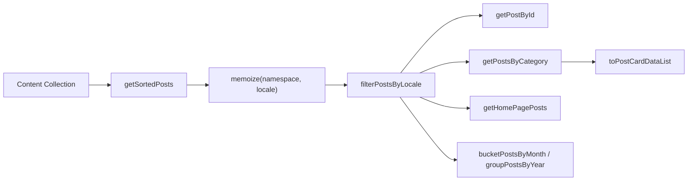
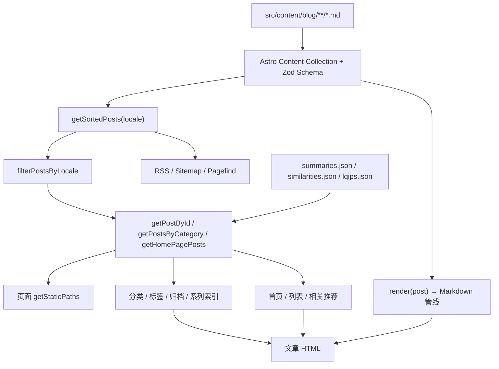

# 04 内容系统

## 1. 内容目录与集合

博客内容位于 `src/content/blog/`，由 Astro Content Collections 管理。

```text
src/content/blog/
├── life/                     # 默认语言（中文）文章
│   └── binhe-greenway-rides.md
├── note/
│   └── front-end/
│       └── react.md
├── weekly/
│   └── weekly-vol-01.md
├── en/                       # English 译文，目录与文件名和中文版一致
│   ├── life/
│   │   └── binhe-greenway-rides.md
│   └── weekly/
│       └── weekly-vol-01.md
└── _drafts/                  # 以下划线开头的目录不会进入集合
```

集合定义在 `src/content.config.ts`：

```ts
const blogCollection = defineCollection({
  loader: glob({ pattern: BLOG_CONTENT_GLOB_PATTERN, base: './src/content/blog' }),
  schema: z.object({ /* ... */ }),
});
```

`BLOG_CONTENT_GLOB_PATTERN`（`src/lib/content/glob.ts`）为：

```ts
['**/*.{md,mdx}', '!**/_*/**', '!**/_*.{md,mdx}']
```

因此：

- 支持 `.md` 与 `.mdx`。
- 任何以下划线开头的目录或文件都会被排除（用于草稿/私有内容）。
- `isBlogContentFile(relativePath)` 提供同一规则的运行时判断，供脚本使用。

## 2. Frontmatter Schema

| 字段 | 类型 | 必填 | 默认 | 作用 |
| --- | --- | --- | --- | --- |
| `title` | `string` | 是 | — | 文章标题 |
| `description` | `string` | 否 | — | 人工摘要/SEO 描述，优先级最高 |
| `link` | `string` | 否 | — | 自定义永久链接；优先于文件路径 |
| `date` | `string \| Date` | 是 | — | 发布时间，按站点时区解析 |
| `updated` | `string \| Date` | 否 | — | 更新时间 |
| `cover` | `string` | 否 | 默认封面 | 封面图 |
| `tags` | `string[]` | 否 | — | 标签 |
| `subtitle` | `string` | 否 | — | Hexo 迁移兼容字段 |
| `catalog` | `boolean` | 否 | `true` | 是否进入分类索引 |
| `categories` | `string[] \| string[][]` | 否 | — | `['笔记','前端']` 或 `[['笔记','前端']]`，只有第一个元素参与分类 |
| `sticky` | `boolean` | 否 | — | 置顶 |
| `draft` | `boolean` | 否 | — | 草稿；生产构建过滤，开发可见 |
| `tocNumbering` | `boolean` | 否 | `true` | 是否给目录标题编号 |
| `excludeFromSummary` | `boolean` | 否 | — | 生成 AI 摘要时跳过 |
| `math` | `boolean` | 否 | — | 单篇覆盖数学公式开关 |
| `quiz` | `boolean` | 否 | — | 单篇覆盖练习题开关 |
| `password` | `string` | 否 | — | 整篇加密密码 |
| `keywords` | `string[]` | 否 | — | SEO 关键词 |
| `colophon` | `(string \| {id,note} \| 一次性对象)[]` | 否 | — | 文章落款标记 |

示例：

```yaml
---
title: 滨河绿道骑行
date: 2026-10-19 08:30:00
updated: 2026-10-20 10:00:00
link: binhe-greenway-rides
categories: ['随笔']
tags: ['骑行', '太原']
description: 三次沿汾河绿道的骑行记录。
cover: /img/cycling.webp
colophon: [handwritten, { id: spoiler, note: 含路线细节 }]
---
```

## 3. 日期与时区

`content.config.ts` 中的 `dateInSiteTimezone` 处理三种输入：

1. **字符串**（如 `"2026-10-19 08:30:00"`）：`parseDateInSiteTimezone()` 用 `date-fns-tz` 的 `toDate(value, { timeZone })` 按站点时区解析。
2. **Date 对象**：gray-matter 会把无时区字符串误当 UTC，`reinterpretUtcAsTimezone()` 把 UTC 字段值重新解释为站点时区。
3. **带偏移的 ISO 字符串**：按偏移正确解析。

站点时区来自 `site.timezone`（当前 `Asia/Shanghai`），非法值回退 `DEFAULT_TIMEZONE`。所有展示、归档分桶、RSS 时间都使用该时区，而不是构建机器时区。

## 4. 语言约定与回退

### 4.1 目录约定

| 内容 | 集合 ID 示例 | 检测结果 |
| --- | --- | --- |
| 默认语言文章 | `life/foo` | `locale = zh`，`localeFreeSlug = life/foo` |
| 英文译文 | `en/life/foo` | `locale = en`，`localeFreeSlug = life/foo` |
| 日语译文（即使禁用） | `ja/life/foo` | `locale = ja`，`localeFreeSlug = life/foo` |
| 单段 slug | `foo` | `locale = zh` |

检测函数是 `getSlugLocaleInfo(slug)`：取第一段路径，若它不是默认语言且存在于 `allKnownLocales`（包含已禁用语言），则视为该语言并剥离前缀；否则视为默认语言。

> 不要使用 `zh/` 目录存放默认语言文章；`zh` 是默认语言，带 `zh/` 前缀的 ID 不会被剥离，slug 会包含 `zh/`。

### 4.2 回退规则

`filterPostsByLocale(posts, locale)`：

- `locale === undefined`：返回全部。
- `locale === defaultLocale`：只返回默认语言文章。
- 其他语言：返回该语言译文 + **没有对应译文的默认语言文章**；按 slug 去重，再按日期降序合并。其他非默认语言的文章被排除。

这意味着英文站永远不会出现“空列表”：未翻译的中文文章会以中文原文兜底，并在文章页显示 `post.fallbackNotice`，同时 canonical 指向中文原文。

### 4.3 Slug 解析

```ts
getPostSlug(post) = post.data.link ?? transliterateSlug(localeFreeSlug)
```

- `link` 优先，用于迁移旧 Hexo 链接或手动固定 URL。
- `transliterateSlug()` 受 `site.enableSlugTransliteration` 控制；开启后中文/日文 slug 会转写为拼音/罗马字。
- `encodeSlug()` 只编码路径段，保留 `/` 作为层级分隔。

## 5. 文章查询 API

全部位于 `src/lib/content/posts.ts`，通过 `src/lib/content.ts` 统一导出。

| 函数 | 签名 | 说明 |
| --- | --- | --- |
| `getSortedPosts` | `(locale?: string) => Promise<BlogPost[]>` | 读取集合、生产环境过滤草稿、按日期降序、按 locale 过滤；带 `memoize` |
| `getPostById` | `(id: string, locale?: string) => Promise<BlogPost \| undefined>` | 基于 id→post Map 的 O(1) 查询 |
| `getPostCount` | `(locale?: string) => Promise<number>` | 复用 `getSortedPosts` |
| `getPostsBySticky` | `(locale?) => Promise<{stickyPosts, nonStickyPosts}>` | 按置顶拆分 |
| `getPostsByCategory` | `(categoryName: string, locale?) => Promise<BlogPost[]>` | 只看 `categories[0]` 是否包含该名称 |
| `getPostLastCategory` | `(post) => {link, name}` | 最深分类的名称与路径 |
| `getRandomPosts` | `(count = 10, locale?) => Promise<BlogPost[]>` | Fisher-Yates 洗牌后截取 |
| `getSeriesPosts` | `(post, locale?) => Promise<BlogPost[]>` | 同最深分类的所有文章 |
| `getAdjacentSeriesPosts` | `(currentPost, locale?) => Promise<{prevPost, nextPost}>` | 系列内上一篇/下一篇（按日期降序，prev 更新） |
| `getEnabledSeries` | `() => FeaturedSeriesItem[]` | 启用的系列配置 |
| `getSeriesBySlug` | `(slug) => FeaturedSeriesItem \| undefined` | slug 小写匹配 |
| `getPostsBySeriesSlug` | `(slug, locale?) => Promise<BlogPost[]>` | 系列分类下的文章 |
| `getFeaturedCategoryNames` | `() => string[]` | 所有启用系列的分类名 |
| `getNonFeaturedPosts` | `(locale?) => Promise<BlogPost[]>` | 排除系列文章，用于 `/posts` 列表 |
| `getHomePagePosts` | `(locale?) => Promise<{highlightedPosts, stickyPosts, regularPosts}>` | 单次遍历产出首页三组数据 |
| `getPostReadingTime` | `(post) => {words, text, minutes}` | `reading-time` + WeakMap 缓存 |
| `getPostDescription` | `(post, locale?, maxLength = 150) => string` | `description` → 加密通用描述 → 正文提取 |
| `getPostSummary` | `(slug) => string \| null` | 从 `summaries.json` 读取，大小写不敏感回退 |
| `getPostDescriptionWithSummary` | `(post, locale?, maxLength = 150) => string` | `description` → 加密描述 → AI 摘要 → 正文提取 |



### 5.1 摘要优先级

文章卡片与详情页的文案优先级并不完全相同：

| 场景 | 优先级 |
| --- | --- |
| `getPostDescription` | frontmatter `description` → 加密文章通用文案 → 正文截取 |
| `getPostDescriptionWithSummary` | frontmatter `description` → 加密文章通用文案 → `summaries.json` → 正文截取 |
| 文章详情页 | `description` → `getPostSummary(slug)` → `extractTextFromMarkdown(body, 200)` |

### 5.2 字段投影函数

| 函数 | 文件 | 输出 | 用途 |
| --- | --- | --- | --- |
| `pickPost(post, keys, locale?)` | `content/transforms.ts` | 字段子集 | 通用投影 |
| `pickPosts(posts, keys, locale?)` | 同上 | 字段子集数组 | 批量投影 |
| `toPostRef(post)` | 同上 | `{ slug, link?, title }` | 导航用的最小引用 |
| `toPostRefWithCategory(post)` | 同上 | `PostRef & { categoryName? }` | 列表展示 |
| `toPostRefs(posts)` | 同上 | `PostRef[]` | 批量引用 |
| `toPostRefsWithCategory(posts)` | 同上 | `PostRefWithCategory[]` | 批量带分类引用 |
| `toPostCardData(post, locale?)` | 同上 | `PostCardData` | 已弃用，保留兼容 |
| `toPostCardDataList(posts, locale?)` | 同上 | `PostCardData[]` | 卡片列表，预计算字数/阅读时长 |

## 6. 分类系统

### 6.1 数据模型

`categories` 支持两种写法：

```yaml
categories: ['笔记', '前端', 'React']   # 层级数组
# 或
categories: [['笔记', '前端', 'React']] # 外层数组的第一项
```

查询层始终只看 `categories[0]`：

- 若它是数组，则按顺序构建多级分类。
- 若它是字符串，则视为单级分类。
- `catalog: false` 的文章不会进入分类列表与计数。

### 6.2 关键函数

| 函数 | 文件 | 说明 |
| --- | --- | --- |
| `getCategoryList(locale?)` | `content/categories.ts` | 返回 `{ categories, countMap }`；递归构建树，`countMap` 按分类名计数 |
| `addCategoryRecursively(root, parentNames, name)` | 同上 | 有副作用地逐级创建分类节点 |
| `getCategoryLinks(categories?, parentLink?)` | 同上 | 递归生成所有分类 URL，slug 来自 `categoryMap` |
| `getCategoryNameByLink(link)` | 同上 | 取 URL 最后一段，反查分类名 |
| `getCategoryByLink(categories, link?)` | 同上 | 在树中按链接查找分类 |
| `getParentCategory(category, categories)` | 同上 | 递归查找父分类 |
| `buildCategoryPath(names)` | `content/category-path.ts` | 由分类名数组生成 `/categories/...` 路径 |
| `getCategoryArr(categories?)` | 同上 | 归一化为分类名数组 |
| `translateCategoryName(name, locale)` | `content/category-translate.ts` | `categoryMap` slug → `i18n-content.yaml` 翻译，失败回退原名 |
| `translateSeriesField(slug, field, fallback, locale)` | `content/categories.ts` | 系列字段翻译 |
| `translateFeaturedCategoryField(link, field, fallback, locale)` | 同上 | 精选分类字段翻译 |

`categoryMap` 是分类系统的外部依赖：没有映射的分类名无法生成稳定 URL。系列配置中的 `categoryName` 也必须是 `categoryMap` 的键。

## 7. 标签系统

| 函数 | 文件 | 行为 |
| --- | --- | --- |
| `normalizeTag(tag)` | `content/tags.ts` | 转小写，大小写不敏感 |
| `tagToSlug(tag)` | 同上 | 小写后把 `/` 替换为 `-`，再 `encodeURIComponent` |
| `buildTagPath(tag)` | 同上 | `/tags/<slug>` |
| `getAllTags(posts)` | 同上 | 统计每个标签出现次数；WeakMap 按数组引用缓存 |

路由层还会用 `toTagParam()` 做同样的 `/ → -` 处理，保证含 `/` 的标签能作为单段动态参数。

## 8. 归档分组

`src/lib/content/index-groups.ts` 提供三个纯函数：

| 函数 | 输出 | 用途 |
| --- | --- | --- |
| `bucketPostsByMonth(posts, timezone)` | `{key, year, month, posts}[]`，按时间倒序 | 归档日历 |
| `groupPostsByYear(posts, timezone)` | `{year, posts}[]` | 年份分组 |
| `monthIntensity(count, peak)` | `0–4` 热力等级 | 月份热度着色 |

分级使用对数尺度，避免某个月份文章特别多时把其他月份压到最浅色。

## 9. 系列系统

系列是“基于分类”的定期内容，不是独立集合。

- 配置在 `site.yaml.featuredSeries`，每个系列有唯一 `slug`、`categoryName`。
- 路由 `/[seriesSlug]` 由 `seriesRoute` 生成。
- 系列文章 = `getPostsByCategory(series.categoryName)`。
- 首页高亮：`highlightOnHome !== false` 的系列各取最新一篇。
- 期号解析：`parseIssueTitle(title)` 支持 `Vol. 35`、`No. 3`、`#12`、`第 1 期`，返回 `{number, headline}`。

`normalizeFeaturedSeries()` 会校验：

- slug 只能包含字母、数字、`-`、`_`，并统一转小写。
- slug 不能与 `RESERVED_ROUTES` 冲突。
- slug 不能重复。
- `categoryName` 不在 `categoryMap` 中只告警，不阻断构建。
- 兼容旧版单对象写法（自动包成数组）。

## 10. 落款（Colophon）

### 10.1 文章侧解析

`resolvePostColophon(entries, config)`（`src/lib/content/colophon.ts`）把 frontmatter 条目解析为展示项：

- 字符串：按字典 id 查找。
- `{ id, note }`：字典标记 + 本篇补充说明。
- 一次性对象 `{ icon, label, description, note, tone, placement }`：不进入字典，不可被归档筛选。

容错策略：

- 未知 id → 生成 warning，不抛错。
- 互斥组冲突 → warning，保留第一个。
- 一次性标记图标不合法 → warning。
- `colophon: []` → 显式不显示任何标记。
- `defaults` 会补齐文章没有的组，并排在文章自身标记之前。

### 10.2 展示与筛选

| 函数 | 文件 | 用途 |
| --- | --- | --- |
| `colophonItemsAt(items, placement)` | `content/colophon.ts` | 取指定位置（meta/banner/seal/card）的标记 |
| `colophonMarkIds(items)` | 同上 | 字典标记 id，用于筛选 |
| `colophonSealRows(items)` | `content/colophon-view.ts` | 文末落款分行 |
| `colophonFilterChips(marks, ids)` | 同上 | 归档页筛选 chips 与计数 |
| `resolveMarkFilter(query)` | 同上 | 解析 `?mark=` 参数 |
| `rowHasMark(row, id)` | 同上 | 筛选判断 |
| `getColophonConfig(locale)` | `content/post-colophon.ts` | 合并 `i18n-content.yaml` 文案 |
| `getPostColophon(post, locale)` | 同上 | 每篇文章解析并去重告警 |

## 11. 相关文章、摘要与 LQIP

| 资产 | 生成脚本 | 运行时读取 | 说明 |
| --- | --- | --- | --- |
| `src/assets/summaries.json` | `generateSummaries.ts` | `getPostSummary` | `Record<slug, {title, summary}>`；仅生成默认语言文章 |
| `src/assets/similarities.json` | `generateSimilarities.ts` | `getRelatedPostSlugs` / `getRelatedPosts` | `Record<slug, {slug,title,similarity}[]>`，Top 5 |
| `src/assets/lqips.json` | `generateLqips.ts` | `src/lib/lqip.ts` | `Record<相对路径, 三个十六进制色值>` |
| `.cache/og-data.json` | 构建期 `remarkLinkEmbed` | `og-cache.ts` | 链接卡片 OG 数据，TTL 以天计，提交到仓库加速构建 |

相关文章查询：

```ts
getRelatedPostSlugs(currentSlug, count = 5) // 纯 slug + 相似度
getRelatedPosts(currentPost, allPosts, count = 5) // 映射为完整文章，保持相似度顺序
hasSimilarityData() // 是否加载到数据
```

相似度文件缺失时只告警并返回空数组，不会阻断构建。

## 12. 加密与源码可见性

### 12.1 加密

- **整篇**：frontmatter `password` → `rehype-encrypted-post` 把整个文章 HAST 序列化后加密。
- **局部**：`:::encrypted{password="..."}` → `remarkEncryptedDirective` 标记 → `rehypeEncryptedBlock` 加密子内容。
- 算法：PBKDF2-SHA256（100,000 次）派生密钥 + AES-256-GCM；salt 16 字节，IV 12 字节。
- 构建后只保留 `data-cipher`、`data-iv`、`data-salt`，密码从 HTML 中删除。
- 加密内容带 `data-pagefind-ignore`，不进入搜索索引。

### 12.2 Markdown 源码端点

每篇文章可生成 `<文章 URL>.md`，由 `src/pages/post/[...slug].md.ts` 与 `[lang]` 镜像提供。

| 函数 | 行为 |
| --- | --- |
| `isPostSourceEnabled(config, editorEnabled, isDev)` | 任一操作（复制/下载/在写作室打开）需要源码时返回 true |
| `isPostSourcePublic(data, body, isProd)` | 有 `password` 或 `:::encrypted` 块 → false；生产环境草稿 → false |
| `getPostSourcePath(path)` | `/post/foo` → `/post/foo.md` |
| `getPostSourceFilename(slug)` | 过滤文件系统非法字符，生成下载文件名 |
| `getLocalEditorHref(editor, dev, relativePath)` | 生成 `vscode://file/...` 等本地深链 |

## 13. 内容数据流



## 14. 缓存与性能

| 缓存 | 作用域 | 失效方式 |
| --- | --- | --- |
| `memoize('sortedPosts', locale)` | 整个构建进程 | dev 模式跳过；构建结束即释放 |
| `memoize('postByIdMap', locale)` | 整个构建进程 | 同上 |
| `memoize('categoryList', locale)` | 整个构建进程 | 同上 |
| `memoize('postsByCat', cat:locale)` | 整个构建进程 | 同上 |
| `WeakMap` 阅读时长 | 文章对象生命周期 | 对象被 GC 时自动释放 |
| `WeakMap` 标签计数 | posts 数组生命周期 | 同上 |
| `WeakMap` slug→post | posts 数组生命周期 | 同上 |

`getSortedPosts` 使用 `toSorted()` 而非 `sort()`，避免原地修改 Astro 内部缓存的数组。

## 15. 内容约定与陷阱

| 约定/陷阱 | 说明 |
| --- | --- |
| 正式文章需中英双版本 | 项目约定所有发布文章在 `en/` 下有同路径译文，且 `link`、`date` 完全一致 |
| 只有 `categories[0]` 参与分类 | 多分类数组不会被全部统计 |
| `catalog: false` | 文章不出现在分类页，但仍可在归档/标签/首页出现 |
| 标签大小写 | 统一转小写，`React` 与 `react` 是同一标签 |
| 标签中的 `/` | URL 中替换为 `-`，避免被当成多段路径 |
| 置顶 | `sticky: true` 只影响首页/列表分组，不影响日期排序 |
| 草稿 | 开发环境可见，生产构建过滤；源码端点在生产也不公开草稿 |
| 摘要 | 人工 `description` 始终优先；AI 摘要只是兜底 |
| 新增目录 | 长时间运行的 dev server 可能不识别新目录，需重启 |
| 正文时间写法 | `11:45` 可能被 remark-directive 当成指令，需写成 `11\:45` |
| 外部 GIF | 必须使用 `https://`，否则 HTTPS 站点会因混合内容被拦截 |
