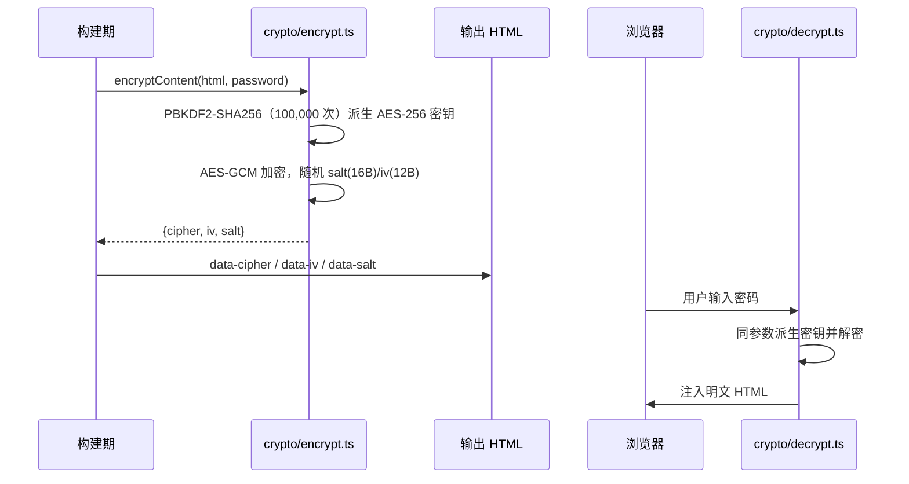
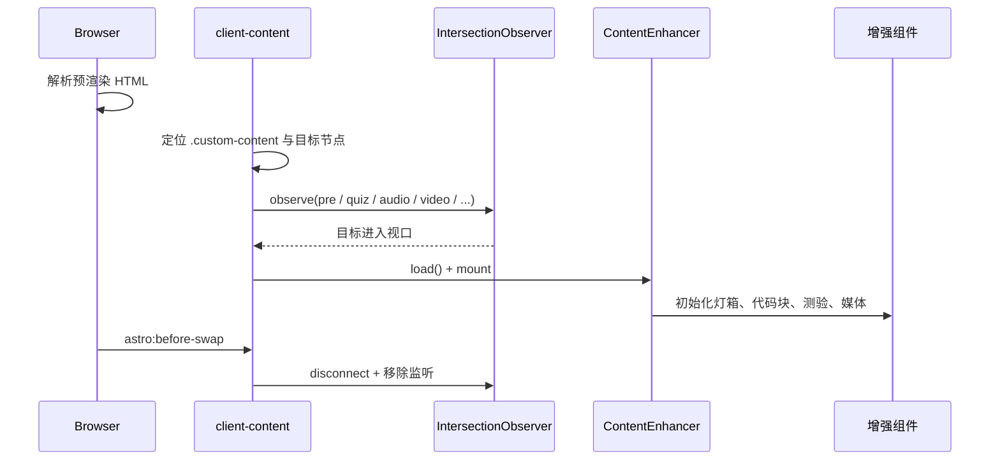

# 05 Markdown 管线

## 1. 管线总览

主站 Markdown 渲染由 `astro.config.mjs` 中的 `markdown.processor` 定义，使用 `@astrojs/markdown-remark` 的 `unified()` 组装插件链。

```mermaid
flowchart LR
    A["原始 Markdown"] --> B["remarkShokaPreprocess<br/>（可重解析）"]
    B --> C["remarkMath"]
    C --> D["remarkShokaSpoiler"]
    D --> E["remarkShokaRuby"]
    E --> F["remarkIns / remarkMark"]
    F --> G["remarkDirective + remarkEncryptedDirective"]
    G --> H["remarkLinkEmbed"]
    H --> I["remark-rehype"]
    I --> Q["Shiki 高亮<br/>meta / collapsible transformers"]
    Q --> J["rehypeSlug"]
    J --> K["rehypeAutolinkHeadings"]
    K --> L["rehypeShokaAttrs"]
    L --> M["rehypeImagePlaceholder"]
    M --> N["rehypeKatex"]
    N --> O["rehypeEncryptedBlock"]
    O --> P["rehypeEncryptedPost"]
    P --> R["HTML"]
```



### 1.1 插件顺序约束

| 顺序 | 约束 | 原因 |
| --- | --- | --- |
| 1 | `remarkShokaPreprocess` 必须最先 | 它读取原始文本并重新解析，修复 `+++`、`~sub~`、`` 等与 GFM 的冲突 |
| 2 | `remarkMath` 必须在 ruby/spoiler/effects 前 | 先把 `$...$` 解析为 math 节点，避免文本扫描插件误伤公式 |
| 3 | `remarkShokaSpoiler` → `remarkShokaRuby` → `remarkIns/Mark` | 各插件只处理 text 节点，顺序影响嵌套语法的匹配 |
| 4 | `remarkDirective` 与 `remarkEncryptedDirective` 同时注册 | 主管线与预处理器重解析管线都需要识别 `:::encrypted` |
| 5 | `remarkLinkEmbed` 靠后 | 独立链接已在 MDAST 中稳定成型 |
| 6 | `rehypeEncryptedBlock` / `rehypeEncryptedPost` 必须最后 | 加密必须在 Shiki、KaTeX 等全部渲染完成后序列化 HTML |
| 7 | `rehypeEncryptedPost` 在 `rehypeEncryptedBlock` 之后 | 整篇加密需要包含已加密的局部块 |

Astro 内部的完整顺序是：

```text
remark-parse → remark-gfm → remark-smartypants → 用户 remark 插件
→ remark-rehype → Shiki（rehypeShiki）→ 用户 rehype 插件
→ rehype-images → rehype-heading-ids → rehype-raw → rehype-stringify
```

因此 Shiki 在**用户 rehype 插件之前**执行，加密插件最后运行时，代码块已经高亮完毕，这正是在加密前序列化 HTML 仍然保留代码高亮的原因。

## 2. Remark 插件

| 插件 | 文件 | 处理的语法 | 行为 |
| --- | --- | --- | --- |
| `remarkShokaPreprocess` | `src/lib/markdown/remark-shoka-preprocess.ts` | 块级 Shoka/Hexo 语法 | 调用 `preprocessShokaSyntax()`，若有变化则用 `remarkParse + remarkGfm + remarkMath (+ remarkDirective)` 重新解析并替换 AST |
| `remarkMath` | 第三方 | `$...$`、`$$...$$` | 生成 inlineMath/math 节点，后续由 KaTeX 渲染 |
| `remarkShokaSpoiler` | `remark-shoka-spoiler.ts` | `!!text!!`、`!!text!!{.blur}` | 默认生成 `<spoiler-span>`；带 `.blur` 时生成 `<span class="spoiler blur">` |
| `remarkShokaRuby` | `remark-shoka-ruby.ts` | `{text^annotation}`、`{text^=annotation}`、`{text^*}` | 生成 `<ruby>/<rt>` 或强调点 `<span style="text-emphasis:...">` |
| `remarkIns` | `remark-shoka-effects.ts` | `++text++` | 生成 `<ins>`，支持尾随 `{.class #id key=value}` |
| `remarkMark` | 同上 | `==text==` | 生成 `<mark>`，支持尾随属性 |
| `remarkDirective` | 第三方 | `:::name` | 生成 directive 节点 |
| `remarkEncryptedDirective` | `remark-encrypted-directive.ts` | `:::encrypted{password="..."}` | 标记为 `div.encrypted-block`，保留 `data-password` 供 rehype 加密 |
| `remarkLinkEmbed` | `remark-link-embed.ts` | 独立链接段落 | Twitter/X、CodePen、通用 URL → 构建期抓取 OG 数据并渲染链接卡 |

### 2.1 预处理器 `shoka-preprocessor.ts`

`preprocessShokaSyntax(source, options)` 在 remark 解析前做三件事：

1. **块级容器与 Hexo 标签**：`:::note`、`+++`、`;;;`、``、`` 转为 HTML 块。
2. **转义分隔符**：`\++`、`\==`、`\!!` 以及逐字符写法 `\+\+` 转为 `+<!-- -->+`，避免被后续插件配对。
3. **行内上下标**：`~sub~`、`^sup^` 在保护区域之外替换为 `<sub>`/`<sup>`。

保护区域包括：

- 围栏代码块（``` 与 ~~~，长度匹配）
- 行内代码 `` `...` ``
- 数学 `$$...$$`、`$...$`
- Ruby 语法（仅上下标处理时保护，确保 `{文字^注音}` 不被当作上标）

容器递归深度上限为 10，避免恶意/意外嵌套导致栈溢出。

## 3. Rehype 插件

| 插件 | 文件 | 行为 |
| --- | --- | --- |
| `rehypeSlug` | 第三方 | 为标题生成 id |
| `rehypeAutolinkHeadings` | 第三方 | 在标题后追加 `anchor-link` 锚点链接 |
| `rehypeShokaAttrs` | `rehype-shoka-attrs.ts` | 处理 `[text]{.class #id key=value}` 属性语法 |
| `rehypeImagePlaceholder` | `rehype-image-placeholder.ts` | 为图片注入 LQIP 占位样式/属性 |
| `rehypeKatex` | 第三方 | 把 math 节点渲染为 KaTeX HTML |
| `rehypeEncryptedBlock` | `rehype-encrypted-block.ts` | 加密 `.encrypted-block` 的子 HTML |
| `rehypeEncryptedPost` | `rehype-encrypted-post.ts` | 加密整篇文章 HAST |

## 4. 自定义语法速查

### 4.1 块级容器

| 语法 | 输出 | 说明 |
| --- | --- | --- |
| `:::note` …… `:::` | `<div class="note-block note-note">` | 支持任意样式名（note/warning/danger/success/info 等由 CSS 定义） |
| `:::warning no-icon` …… `:::` | `<div class="note-block note-warning no-icon">` | `no-icon` 关闭图标 |
| `+++note 标题` …… `+++` | `<details class="collapse-block collapse-note"><summary>标题</summary>…` | 内部 Markdown 会被递归处理并重新解析 |
| `;;;group 标签名` …… `;;;` | `<div class="tab-group" data-tab-group="group">…` | 连续相同 group 的块合并为一组标签页 |
| `` YAML `` | 友链网格 HTML | YAML 数组字段：`site`、`url`、`owner`、`desc`、`image`、`color` |
| `` YAML `` | 音频播放器 | YAML 项：`title`、`list[]`（也接受单个 `url`） |
| `` YAML `` | 视频播放器 | YAML 项：`name`、`url` |

示例：

```markdown
:::warning
这是一条提醒。
:::

+++note 点击展开
折叠块内部的 **Markdown** 仍会正常渲染。
+++

;;;demo 第一页
第一页内容
;;;

;;;demo 第二页
第二页内容
;;;
```

> 折叠块请使用 `+++` 而不是原生 `<details>`。原生 `<details>` 内部的 Markdown 不会被解析，图片语法会变成纯文本。

### 4.2 行内语法

| 语法 | 输出 | 备注 |
| --- | --- | --- |
| `++下划线++` | `<ins>下划线</ins>` | 不能嵌套；开头/结尾不能是空格 |
| `==高亮==` | `<mark>高亮</mark>` | 支持 `{.class}` 等尾随属性 |
| `~下标~` | `<sub>下标</sub>` | 单波浪线；`~~删除线~~` 仍是 GFM |
| `^上标^` | `<sup>上标</sup>` | 在代码/数学/Ruby 中不处理 |
| `{汉字^かんじ}` | `<ruby>汉字<rt>かんじ</rt></ruby>` | 注音 |
| `{文字^=拼音}` | 整词注音 | `^=` 形式 |
| `{文字^*}` | 强调点 | `text-emphasis: filled circle` |
| `!!隐藏!!` | `<spoiler-span>` | spoilerjs Web Component |
| `!!隐藏!!{.blur}` | `<span class="spoiler blur">` | CSS 模糊 |
| `[文字]{.red #id}` | 带属性的 `<span>` | `rehypeShokaAttrs` |
| `:::encrypted{password="..."}` | AES-256-GCM 加密块 | 需 `content.enableEncryptedBlock: true` |

### 4.3 代码块 meta

启用的 Shiki transformer：

| Transformer | 触发配置 | 能力 |
| --- | --- | --- |
| `shokaMetaTransformer` | `content.enableCodeMeta` | 解析 `title="..."`、`url="..."`、`linkText="..."`、`mark:1,3-5`、`command:("$":1-3)`，写入 `data-title/data-url/data-mark/data-command` |
| `collapsibleCodeTransformer` | `content.enhanceCodeBlock` | 为长代码块生成可折叠 wrapper、工具栏与标题占位 |

示例：

````markdown
```js title="hello.js" url="https://example.com" linkText="Source" mark:1,3-5
console.log("hello");
```
````

### 4.4 链接嵌入

`remarkLinkEmbed` 通过 `classifyLink()` 识别：

- Twitter/X 状态链接 → `react-tweet` 岛
- CodePen 链接 → 嵌入 iframe
- 其他独立链接 → OG 预览卡片

OG 数据抓取与缓存：

- 网络层：`og-fetcher.ts`（`metascraper` 系列）
- 缓存层：`og-cache.ts`，默认写入 `.cache/og-data.json`
- 模板层：`link-card-template.ts`
- `previewCacheTime` 单位是**天**；大于 365 会告警，提示旧版“秒”配置需要迁移
- `.cache/og-data.json` 被提交到 Git，用于加速构建

### 4.5 Mermaid

- `lazyMermaid()` 集成在 `astro.config.mjs` 中注册，`excludeLangs: ['mermaid']` 让 Mermaid 不经过 Shiki。
- 客户端通过 `lazy-mermaid.ts` 使用 `IntersectionObserver` 仅在图表接近视口时渲染。
- 支持自动主题与 `mermaidThemeCSS`，并处理 Astro 页面切换后的重复/过期渲染。
- 图表工具栏提供全屏、缩放、导出（`diagram-export.ts`、`zoom-pan.ts`）。

## 5. 加密设计



| 项 | 值/行为 |
| --- | --- |
| 算法 | AES-256-GCM |
| 密钥派生 | PBKDF2-SHA256，100,000 次 |
| Salt / IV | 16 字节 / 12 字节，随机生成 |
| 构建期模块 | `src/lib/crypto/encrypt.ts`（使用 Node `Buffer`，禁止客户端导入） |
| 客户端模块 | `src/lib/crypto/decrypt.ts`（Web Crypto） |
| 密码处理 | `rehype-encrypted-*` 删除 `data-password`，密码不进入最终 HTML |
| 搜索 | 加密内容带 `data-pagefind-ignore` |
| 源码 | 加密文章不提供 `.md` 源文件 |

## 6. 客户端增强

### 6.1 `client:content` 指令

`src/lib/markdown/client-content.ts`：

1. 找到岛前面的 `.custom-content` 容器。
2. 查询需要增强的目标：`pre`、`li.quiz`、`.friend-links-grid[data-links]`、`[data-audio-player]`、`[data-video-player]`、`.note-block:not(.no-icon)`、`.encrypted-post[data-cipher]`、`.encrypted-block[data-cipher]`、`details.collapse-block`。
3. 使用 `IntersectionObserver`（`rootMargin: 800px`）懒加载 `ContentEnhancer`。
4. 页面切换时 `astro:before-swap` 清理 observer 与监听。

加载后的组件负责：

| 组件 | 职责 |
| --- | --- |
| `ContentEnhancer` | 统一编排正文增强 |
| `ImageLightbox` | 图片灯箱、手势缩放 |
| `CodeBlockToolbar` / `CodeBlockFullscreen` | 复制、折叠、全屏 |
| `QuizBlock` + quiz 组件 | 单选、多选、判断、填空 |
| `AudioPlayer` / `VideoPlayer` | 自定义媒体播放器、播放列表、歌词 |
| `FriendLinksGrid` | 友链卡片网格 |
| `EncryptedBlock` / `EncryptedPost` | 密码输入与解密 |
| `NoteBlockIcon` | 提示块图标 |
| `MermaidToolbar` / `DiagramFullscreen` | 图表工具栏与全屏 |



### 6.2 `client:panel` 指令

`src/lib/client-panel.ts` 服务于全局面板（BGM、公告）：

1. 监听 `koharu:<panel>-open` 事件。
2. 首次打开时才 `load()` 对应 React 岛。
3. 派发 `koharu:<panel>-ready` 事件，避免指令入口与 React 组件各自打包一份 Nanostores。
4. 在 `astro:unmount` / `astro:hydrate` / hydration error 时清理或重试。

### 6.3 写作室预览管线

`src/features/editor/render.ts` 复用同一套 Markdown 插件，但为浏览器环境做了裁剪：

- `unified + remarkParse + remarkGfm + remarkMath + remarkRehype + rehypeRaw`
- 同样的 Shoka 预处理、Ruby、Spoiler、Ins/Mark、Encrypted Directive、Katex、Shiki
- 输出 HAST 后经过标签/属性白名单 `sanitizeTree()`，再由 `hast-util-to-html` 序列化
- 预览端再用 DOMPurify 防护
- 可通过 Worker（`render.worker.ts`）在后台线程渲染，避免阻塞输入
- 加密内容在编辑器中使用 `encryptEditorContent()` 单独处理

### 6.4 关键函数签名

| 函数 | 文件 | 签名/作用 |
| --- | --- | --- |
| `preprocessShokaSyntax` | `lib/markdown/shoka-preprocessor.ts` | `(source, options?) => string`：块级/行内 Shoka 预处理 |
| `remarkShokaPreprocess` | `lib/markdown/remark-shoka-preprocess.ts` | `(options?) => remark plugin`：必要时重解析 |
| `remarkShokaRuby` / `remarkShokaSpoiler` | `remark-shoka-ruby.ts` / `remark-shoka-spoiler.ts` | `() => remark plugin` |
| `remarkIns` / `remarkMark` | `remark-shoka-effects.ts` | `remark plugin`：`++ins++` / `==mark==` |
| `rehypeEncryptedBlock` / `rehypeEncryptedPost` | `rehype-encrypted-*.ts` | `() => rehype plugin`：AES-256-GCM 加密 |
| `encryptContent` | `lib/crypto/encrypt.ts` | `(plaintext, password) => Promise<{cipher, iv, salt}>` |
| `decryptContent` | `lib/crypto/decrypt.ts` | 客户端解密 |
| `encryptEditorContent` | `features/editor/crypto.ts` | 编辑器内的加密辅助 |
| `readMermaidSource` | `lib/mermaid-source.ts` | `(pre: HTMLElement) => string` |
| `renderFriendLinks` / `renderAudioMedia` / `renderVideoMedia` | `lib/markdown/shoka-renderers.ts` | 块级语法 → HTML |
| `enhanceLinkPreviews` | `lib/link-preview-enhancer.ts` | `(container: Element) => void` |

## 7. 常见问题

| 现象 | 原因 | 处理 |
| --- | --- | --- |
| `11:45` 这类时间消失/被吞 | `remark-directive` 把 `:45` 当作指令 | 写成 `11\:45` |
| 折叠块里的图片不渲染 | 使用了原生 `<details>` | 改用 `+++style 标题` |
| 公式被上下标/注音破坏 | 插件顺序或保护区域失效 | 确认 `remarkMath` 在文本扫描插件之前 |
| 加密块内容仍出现在搜索 | 缺少 `data-pagefind-ignore` | 确认使用标准 `:::encrypted` 或 frontmatter `password` |
| 加密文章仍能下载源码 | 源码端点未过滤 | `isPostSourcePublic()` 会拒绝 `password`/`:::encrypted` |
| 链接卡不更新 | OG 缓存未过期 | 调整 `previewCacheTime`，或清理 `.cache/og-data.json` 中对应条目 |
| Mermaid 重复渲染/闪烁 | 页面切换后旧实例未清理 | 使用 `lazy-mermaid.ts` 的 swap 处理，不要自行再初始化 |
| 构建报 Shiki 语言错误 | 代码块语言不在 Shiki 支持列表 | 检查 `/mermaid` 等特殊语言是否被排除 |
| 外部 GIF 不显示 | HTTPS 页面加载 HTTP 资源被拦截 | 使用 `https://` 地址 |
