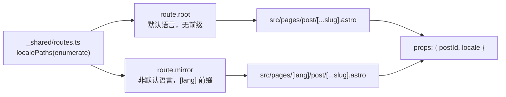
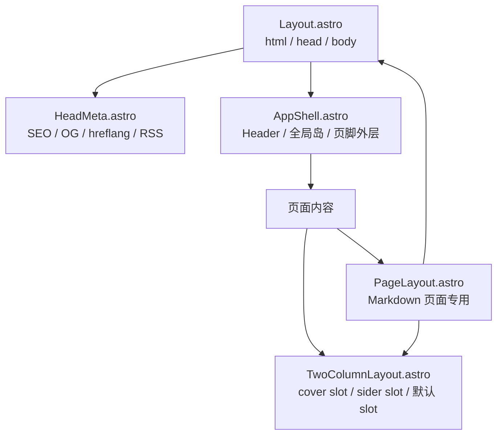
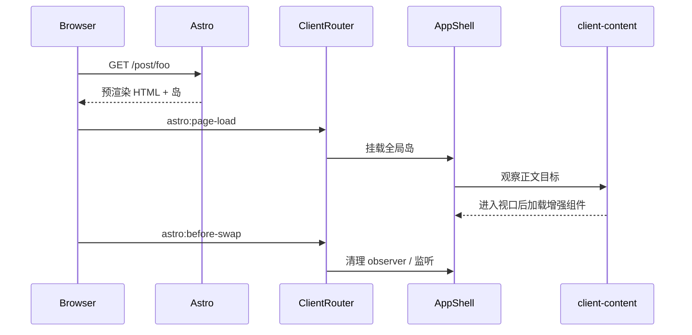
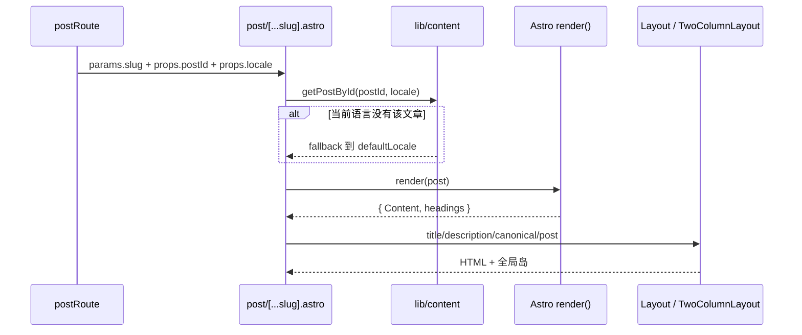

# 06 路由与页面

## 1. 路由模型

项目使用 Astro 文件路由，并约定“每个本地化页面存在两份文件”：

- **根页面**：`src/pages/xxx.astro`，只服务默认语言（`zh`），无 URL 前缀。
- **镜像页**：`src/pages/[lang]/xxx.astro`，服务所有非默认启用语言（当前 `en`），URL 形如 `/en/xxx`。

动态路由的参数空间只在 `src/pages/_shared/routes.ts` 中声明一次，根页面导出 `.root`，镜像页导出 `.mirror`。见 [02 架构](./02-architecture.md) 与 [04 内容系统](./04-content-system.md)。



## 2. 路由表

### 2.1 页面路由

| URL 模式 | 源文件 | 渲染 | 说明 |
| --- | --- | --- | --- |
| `/` | `src/pages/index.astro` | 静态 | 首页：高亮系列、置顶、普通文章、分类卡片 |
| `/posts`、`/posts/[page]` | `src/pages/posts/[...page].astro` | 静态 | 非系列文章分页列表，`pageSize = 10` |
| `/post/[...slug]` | `src/pages/post/[...slug].astro` | 静态 | 文章详情 |
| `/post/[...slug].md` | `src/pages/post/[...slug].md.ts` | 静态 | 文章 Markdown 源文件端点 |
| `/categories` | `src/pages/categories/index.astro` | 静态 | 分类总览 |
| `/categories/[...slug]` | `src/pages/categories/[...slug].astro` | 静态 | 某个分类下的文章 |
| `/tags` | `src/pages/tags/index.astro` | 静态 | 标签云 |
| `/tags/[tag]` | `src/pages/tags/[tag].astro` | 静态 | 某个标签下的文章 |
| `/archives` | `src/pages/archives.astro` | 静态 | 年/月归档、落款筛选 |
| `/friends` | `src/pages/friends.astro` | 静态 | 友链分组与申请说明 |
| `/bangumi` | `src/pages/bangumi.astro` | 静态 | 追番；配置缺失时重定向 404 |
| `/about` | `src/pages/about.md` | 静态 | Markdown 页面，使用 `PageLayout` |
| `/music` | `src/pages/music.md` | 静态 | 歌单页面，正文含 `` |
| `/[...seriesSlug]` | `src/pages/[seriesSlug].astro` | 静态 | 系列页，slug 来自 `featuredSeries` |
| `/rss.xml` | `src/pages/rss.xml.ts` | 静态 | 默认语言 RSS，最多 20 篇 |
| `/rss/feed.xsl` | `src/pages/rss/feed.xsl.ts` | 静态 | RSS 的 XSLT 样式表 |
| `/404` | `src/pages/404.astro` | 静态 | 单份 404.html，运行时按 URL 本地化 |
| `/editor` | `src/features/editor/pages/index.astro` | 静态（按需注入） | 写作室，`editor.enabled: true` 时注入 |
| `/editor/preview` | `src/features/editor/pages/preview.astro` | 静态（按需注入） | 写作室预览帧 |

### 2.2 语言镜像

| URL 模式 | 源文件 | 说明 |
| --- | --- | --- |
| `/en/` | `src/pages/[lang]/index.astro` | 英文首页 |
| `/en/posts`、`/en/posts/[page]` | `src/pages/[lang]/posts/[...page].astro` | 英文分页 |
| `/en/post/[...slug]` | `src/pages/[lang]/post/[...slug].astro` | 英文文章（含中文兜底） |
| `/en/post/[...slug].md` | `src/pages/[lang]/post/[...slug].md.ts` | 英文源码端点 |
| `/en/categories/**` | `src/pages/[lang]/categories/**` | 英文分类 |
| `/en/tags/**` | `src/pages/[lang]/tags/**` | 英文标签 |
| `/en/archives` | `src/pages/[lang]/archives.astro` | 英文归档 |
| `/en/friends` | `src/pages/[lang]/friends.astro` | 英文友链 |
| `/en/bangumi` | `src/pages/[lang]/bangumi.astro` | 英文追番 |
| `/en/about` | `src/pages/[lang]/about.astro` | 包装 `about.md` |
| `/en/music` | `src/pages/[lang]/music.astro` | 包装 `music.md` |
| `/en/[seriesSlug]` | `src/pages/[lang]/[seriesSlug].astro` | 英文系列页 |
| `/en/rss.xml` | `src/pages/[lang]/rss.xml.ts` | 英文 RSS |

`MIRROR_EXEMPT` 中的路由不要求镜像：

| 路由 | 原因 |
| --- | --- |
| `404` | 静态托管只有一份 `/404.html`，页面运行时根据 pathname 切换文案 |
| `rss/feed.xsl` | 与语言无关的样式表 |
| `editor/index`、`editor/preview` | 写作室是共享的中文工作台 |

`assertLocaleMirrorsComplete()` 在 `_shared/utils.ts` 模块加载时执行：若某个根页面缺少镜像，构建直接失败并列出所有缺失路由。

### 2.3 注入路由

| 功能 | 路由 | 渲染 | 注入点 |
| --- | --- | --- | --- |
| 写作室 | `/editor`、`/editor/preview` | 预渲染 | `editorIntegration()` |
| 碎碎念 | `/<path>`、`/<path>/search`、`/<path>/rss.xml`、`/<path>/[channel]`、`/<path>/[channel]/rss.xml`、`/<path>/[channel]/[message]` | 动态（`prerender: false`） | `momentsRoutes()` |
| 碎碎念别名 | `pathAliases` 与频道 aliases 对应的路径 | 动态重定向 | `momentsRoutes()` |

Moments 注入时会检查路由冲突：同一 pattern 重复注入或与现有 Astro 路由冲突都会在构建期抛错。

### 2.4 路由函数表

| 函数/导出 | 文件 | 作用 |
| --- | --- | --- |
| `localePaths(enumerate)` | `pages/_shared/utils.ts` | 一次声明参数空间，返回 `{ root, mirror }` |
| `getLocaleStaticPaths` | 同上 | 静态页的 `[lang]` 镜像 `getStaticPaths` |
| `assertLocaleMirrorsComplete()` | 同上 | 构建期检查根页面是否缺少镜像 |
| `postRoute` | `pages/_shared/routes.ts` | 文章 slug → `{ postId, locale }` |
| `postSourceRoute` | 同上 | 文章 `.md` 源码端点 |
| `tagRoute` | 同上 | 标签参数与文章过滤 |
| `categoryRoute` | 同上 | 分类路径解析 |
| `seriesRoute` | 同上 | 启用系列 slug |
| `postListRoute` | 同上 | 非系列文章分页 |

## 3. 布局层级



### 3.1 `Layout.astro`

| Props | 类型 | 默认 | 作用 |
| --- | --- | --- | --- |
| `title` | `string` | `seoConfig.title` | 页面标题 |
| `description` | `string` | `seoConfig.description` | 描述 |
| `locale` | `string` | 从 URL 推断 | 页面语言 |
| `siderType` | `HomeSiderType` | — | 侧栏类型 |
| `articleTools` | `boolean` | `true` | 是否加载文章全屏查看器等工具 |
| `post` | `BlogPost` | — | 当前文章，用于封面/目录编号/移动端头 |
| 其余 | `PageMetaProps` | — | canonical、keywords、openGraph、robots、rssFeeds、heroImage、includeLocaleAlternates |

职责：

- 输出 `<!doctype html>`、`<html lang>`、`<head>`、`<body>`。
- 挂载 `ClientRouter`（View Transitions）、Umami、加载指示器、Tooltips、`BootScripts`。
- 提供 `slot="head"` 供页面插入 JSON-LD 等额外 head 内容。
- 把内容交给 `AppShell`。

### 3.2 `HeadMeta.astro`

| 能力 | 实现 |
| --- | --- |
| 基础 meta | charset、viewport、favicon、generator |
| SEO | `astro-seo` 管理 title/description/canonical/OG/Twitter |
| keywords | 手动输出（`astro-seo` 不支持） |
| robots | 页面传入时输出 |
| RSS alternate | 页面可覆盖；默认指向当前语言的 `/rss.xml` |
| hreflang | 多语言启用时输出所有启用语言 + `x-default` |
| 头图预加载 | 根据 `heroImage` 生成 AVIF `srcset` 与 `preload` |
| 字体 | `RoundedFonts` 按 locale 加载 |

`page-meta.ts` 定义了页面与布局之间的元数据契约：页面只描述“这是什么页面”，`HeadMeta` 负责推导 canonical、OG 图片回退链、hreflang 与 RSS 链接。

### 3.3 `AppShell.astro`

| 区域 | 组件 | 水合方式 |
| --- | --- | --- |
| 页头 | `Header` | Astro + React 子组件 |
| 全局音乐 | `GlobalBGMPlayer` | `client:panel="bgm"` |
| 浮动按钮组 | `FloatingGroup` | `client:only="react"` |
| 设置面板 | `SettingsPanel` | `client:idle` |
| 移动端抽屉 | `MobileDrawer` | Astro |
| 搜索 | `SearchDialog` + `SearchPortal` | `client:idle` |
| 文章查看器 | `ArticleViewers` | `client:idle` |
| Toast | `Toaster` | `client:idle` |
| 公告 | `AnnouncementProvider` | Astro + 按需岛 |
| CodePen 脚本 | `CodePenEmbed` | Astro |
| 圣诞效果 | `ChristmasEffects` | 条件渲染 |

`AppShell` 的内联脚本还会初始化：页面形变过渡、页头连续性、入场渲染、滚动浮现、滚动条活动、触摸预取、点击花瓣。

### 3.4 `TwoColumnLayout.astro`

| Slot | 用途 |
| --- | --- |
| `cover` | 封面/系列封面/紧凑标题封面 |
| `sider` | 侧栏（`HomeSider`） |
| 默认 slot | 主内容区 |

主内容区之后会自动追加 `PostFooter`（可关闭）与 `Footer`。桌面端会为侧栏预留整屏高度，避免侧栏跟随动画压缩短页面。

### 3.5 `PageLayout.astro`

用于 `about.md`、`music.md` 等 Markdown 页面：

- 从 frontmatter 读取 `title`、`description`、`coverTitle`、`comments`。
- 组合 `Layout + TwoColumnLayout + Cover + HomeSider + CustomContent + Comment`。
- 正文放在 `data-pagefind-body` 中，自动进入搜索索引。

### 3.6 运行时渲染时序



## 4. 页面数据流

### 4.1 文章页



文章页还负责：

- JSON-LD：`BlogPosting`（headline/description/keywords/author/datePublished/dateModified/image）+ `BreadcrumbList`。
- 摘要：`description` → `getPostSummary(slug)` → 正文截取。
- 目录、封面、摘要面板、评论区、上一篇/下一篇、Markdown 操作。
- 回退文章显示 `post.fallbackNotice`，canonical 指向默认语言原文。

### 4.2 首页

`getHomePagePosts(locale)` 单次遍历产出：

- `highlightedPosts`：每个启用且 `highlightOnHome !== false` 的系列取最新一篇。
- `stickyPosts`：非系列置顶文章。
- `regularPosts`：其余文章。

首页手工构造 `Page<BlogPost>` 对象（`url.current/next/first/last`），复用 `PostList` 与 `Paginator` 的分页 UI，但首页不是真实分页路由。

### 4.3 列表/分类/标签/归档/系列

| 页面 | 数据函数 | 关键组件 |
| --- | --- | --- |
| `/posts/[page]` | `getNonFeaturedPosts` + `paginate` | `PostList`、`Paginator` |
| `/categories` | `getCategoryList`、`getCategoryLinks`、`getSortedPosts` | `CategoryList` |
| `/categories/[...slug]` | `getSortedPosts` + `categoryAtPath` | `CategoryPostList` |
| `/tags` | `getAllTags` + `tierTags` | `TagItem`、标签过滤 |
| `/tags/[tag]` | `getSortedPosts` + `normalizeTag` 过滤 | `PageIntro`、`PostYears` |
| `/archives` | `bucketPostsByMonth`、`groupPostsByYear`、落款解析 | 归档日历、`PostYears`、筛选 chips |
| `/[...seriesSlug]` | `getPostsByCategory` + `toPostCardDataList` | `SeriesCover`、`SeriesIssues` |

### 4.4 分页

`postListRoute` 使用 Astro `paginate()`：

```ts
paginate(posts, {
  pageSize: PAGINATION.pageSize, // 10
  params: localeParams,           // 镜像页注入 { lang }
});
```

根页面生成 `/posts/2`……，镜像生成 `/en/posts/2`……。

## 5. SEO、RSS 与站点地图

### 5.1 Canonical 与 hreflang

- 默认 canonical 为 `Astro.url.href`。
- 回退文章显式覆盖 canonical 到默认语言原文，避免重复内容。
- 多语言启用时输出 `<link rel="alternate" hreflang>`（使用 `getHtmlLang()`，如 `zh-CN`），并输出 `x-default`。
- `includeLocaleAlternates={false}` 用于不按语言重复的页面（如 Moments）。

### 5.2 Open Graph / Twitter

- 图片回退链：`openGraph.image` → `getOgImageUrl(coverImage, site)` → 站点默认 OG → 头像。
- `openGraph.type` 默认 `website`，文章页可设为 `article`。
- Twitter card 根据是否有图选择 `summary_large_image` 或 `summary`。

### 5.3 RSS

| 端点 | 内容 | 说明 |
| --- | --- | --- |
| `/rss.xml` | 默认语言最新 20 篇 | `stylesheet: '/rss/feed.xsl'` |
| `/en/rss.xml` | 英文站最新 20 篇 | `customData` 写入 `<language>` |
| Moments RSS | 由 `global-rss.ts` / `channel-rss.ts` 输出 | 仅动态模式 |

RSS 细节：

- `guid isPermaLink="false"`，值为 `${lang}:${postSlug}`，避免不同语言同 slug 冲突。
- 分类与标签以 `category:` / `tag:` 前缀写入 `categories`。
- 链接使用 `localizedPath('/post/' + encodeSlug(slug), lang)`。
- 强制 `Content-Type: application/xml; charset=utf-8`。

### 5.4 Sitemap 与 robots

- `@astrojs/sitemap` 在构建期生成 `sitemap-index.xml` 与分片。
- `astro-robots-txt` 根据 `seo.robots` 生成 `robots.txt`；未配置策略时允许所有爬虫。
- Moments 分页参数 `?cursor=` 页面设置 `noindex,follow`，避免重复索引。

## 6. 404 页面

`src/pages/404.astro` 是单份页面：

- 构建期只输出默认语言文案。
- 页面内嵌所有启用语言的文案表与路由表。
- 浏览器加载后根据 `location.pathname` 的语言前缀重新本地化标题、文案与链接。
- 静态托管只需要一份 `/404.html`，因此该路由在 `MIRROR_EXEMPT` 中。

## 7. 构建与路由相关配置

| 配置 | 值 | 影响 |
| --- | --- | --- |
| `output` | `static` | 默认纯静态；Moments 开启时仍为 static + Node adapter |
| `trailingSlash` | `ignore` | 尾斜杠不影响匹配 |
| `compressHTML` | `true` | 构建期压缩 HTML |
| `prefetch.prefetchAll` | `true` | 所有链接可预取 |
| `prefetch.defaultStrategy` | `hover` | 悬停预取，避免与首屏竞争 |
| `i18n.routing.prefixDefaultLocale` | `false` | 默认语言无前缀 |
| `devToolbar.enabled` | `true` | 开发工具条 |

> **不要启用 Astro 的 `fallback` 路由**。它会把未知路径重写到默认语言页面，破坏 `[seriesSlug].astro` 等动态路由的匹配顺序。

## 8. 路由与页面陷阱

| 现象 | 原因 | 处理 |
| --- | --- | --- |
| `/en/xxx` 404 | 根页面缺少 `[lang]/xxx` 镜像 | 补镜像，或加入 `MIRROR_EXEMPT` |
| 直接访问 `/zh/...` 404 | 默认语言不生成前缀路由 | 使用无前缀 URL |
| 系列页与静态页冲突 | 系列 slug 命中 `RESERVED_ROUTES` | 修改 slug；normalizer 会在构建期抛错 |
| 标签页 404 | 标签包含 `/` 或 `#` 未正确编码 | 使用 `toTagParam()` / `tagToSlug()` |
| 文章 canonical 指向英文页 | 文章是中文兜底内容 | 回退文章应把 canonical 指向默认语言 |
| Moments 页面被静态缓存 | 忘记 `prerender: false` | 使用 `momentsRoutes()` 注入 |
| 页面切换后事件重复绑定 | 未监听 `astro:page-load` / `astro:before-swap` | 参考 `client-content.ts` 与 `AppShell` 的清理模式 |
| 搜索结果缺失某页 | 页面未带 `data-pagefind-body` | 正文区域添加该属性 |
