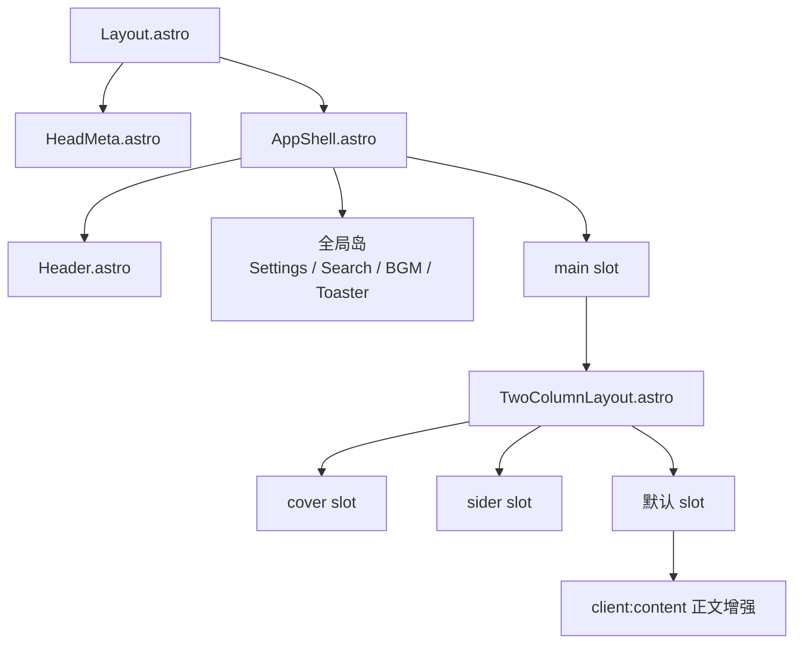
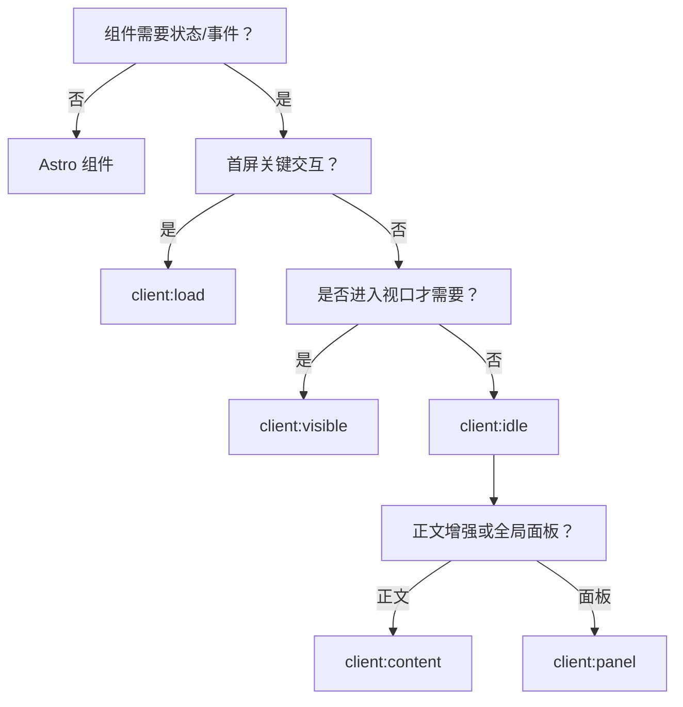

# 07 组件与 UI

## 1. 组件分层

项目把 UI 分为三类：

| 类型 | 技术 | 何时使用 | 示例 |
| --- | --- | --- | --- |
| 结构组件 | `.astro` | 无状态布局、列表、SEO 块 | `Layout.astro`、`PostItemCard.astro`、`Footer.astro` |
| 交互岛 | `.tsx` | 需要状态、事件、浏览器 API | `SearchDialog.tsx`、`SettingsPanel.tsx`、`Editor` |
| 增强组件 | `.tsx` + 客户端指令 | 正文内的媒体、代码、测验、灯箱 | `ContentEnhancer.tsx`、`ImageLightbox.tsx` |

设计原则：

- **默认 Astro**：只有需要 React 状态/事件时才引入 React 岛。
- **最小水合**：首屏关键用 `client:load`；次级交互用 `client:idle`；正文增强用自定义 `client:content` 按视口加载；面板用 `client:panel` 首次打开时加载。
- **插槽组合**：布局通过 `cover` / `sider` / 默认 slot 组合，而不是大量布尔 props。
- **无大 props**：不把正文、完整文章数组传给客户端岛；预计算 `wordCount`、`readingTime`、摘要等小字段。

## 2. 组件目录职责

| 目录 | 职责 | 代表组件 |
| --- | --- | --- |
| `components/layout/` | 全局外壳：页头、页脚、导航、搜索、侧栏、目录、移动端 | `Header.astro`、`Footer.astro`、`NavMenu.tsx`、`Navigator.tsx`、`SearchDialog.tsx`、`HomeSider.astro`、`FloatingGroup.tsx`、`TableOfContents/`、`MobilePostHeader/` |
| `components/post/` | 文章卡片、列表、分页、系列、相关推荐、摘要、落款 | `PostList.astro`、`PostItemCard.astro`、`Paginator.astro`、`PostPagination.astro`、`PostFooter.astro`、`RelatedPostList.tsx`、`RandomPostList.tsx`、`SeriesPostList.astro`、`SeriesProgress.astro`、`SummaryPanel.tsx`、`PostMarkdownActions.tsx`、`colophon/` |
| `components/markdown/` | 正文增强与媒体 | `ContentEnhancer.tsx`、`ImageLightbox.tsx`、`CodeBlockToolbar.tsx`、`CodeBlockFullscreen.tsx`、`QuizBlock.tsx`、`AudioPlayer.tsx`、`VideoPlayer.tsx`、`EncryptedBlock.tsx`、`EncryptedPost.tsx`、`FriendLinksGrid.tsx`、`MermaidToolbar.tsx`、`DiagramFullscreen.tsx`、`ArticleViewers.tsx` |
| `components/ui/` | shadcn 风格 primitives 与封面 | `button.tsx`、`dialog.tsx`、`dropdown-menu.tsx`、`switch.tsx`、`input.tsx`、`badge.tsx`、`popover.tsx`、`divider.tsx`、`segmented.tsx`、`sonner.tsx`、`ModalLayer.tsx`、`ScrollableRow.tsx`、`cover/` |
| `components/common/` | 跨模块复用 | `ErrorBoundary.tsx`、`CustomContent.astro`、`ResponsiveImage.astro`、`PostRow.astro`、`PageIntro.astro`、`PostYears.astro`、`LazyMotionProvider.tsx`、`RoundedFonts.astro` |
| `components/settings/` | 设置面板 | `SettingsPanel.tsx`、`SettingsPanelContent.tsx`、`registry.ts`、`NumberField.tsx`、`LocalFontPicker.tsx` |
| `components/comment/` | 评论 provider 适配 | `Comment.astro`、`Waline.tsx`、`Twikoo.tsx`、`Giscus.tsx`、`Remark42.astro`、`DeferredComment.tsx` |
| `components/announcement/` | 公告入口、列表弹窗、Toast | `AnnouncementProvider.astro`、`FooterAnnouncementEntry.tsx`、`AnnouncementToaster.tsx`、`AnnouncementListPopup.tsx` |
| `components/analytics/` | 统计 | `UmamiAnalytics.astro`、`components/umami/UmamiPVSpan.tsx` |
| `components/bgm/` | 全局音乐播放器 | `GlobalBGMPlayer.tsx` |
| `components/bangumi/` | 追番集合 | `BangumiCollection.tsx`、`BangumiCard.tsx` |
| `components/moments/` | 碎碎念展示 | `MomentsShell.astro`、`MessageTimeline.astro`、`MessageCard.astro`、`ChannelSwitcher.astro`、`CursorPagination.astro`、`SearchFilters.tsx` |
| `components/friends/` | 友链 | `FriendsContent.astro`、`FriendsGrid.astro`、`FriendCard.astro`、`FriendRequestForm.tsx` |
| `components/category/` | 分类索引 | `CategoryList.astro`、`CategoryPostList.astro` |
| `components/tag/` | 标签云 | `TagItem.astro` |
| `components/series/` | 系列期号 | `SeriesIssues.astro` |
| `components/christmas/` | 圣诞效果 | `ChristmasEffects.astro`、`SnowfallCanvas.tsx`、`ChristmasHat.astro`、`ChristmasLights.astro` |
| `components/embed/` | 外部嵌入 | `TweetEmbed.tsx`、`CodePenEmbed.astro`、`EmbedHydrator.tsx` |
| `components/theme/` | 主题切换 | `ThemeToggle.tsx`、`theme-toggle.css` |
| `components/svg/` | 内联 SVG | `SakuraSvg.tsx`、`MingcuteAiFillSvg.tsx`、`EmptySvg.tsx` |

## 3. 全局岛与挂载点

`AppShell.astro` 是全局 UI 的挂载中心：

| 组件 | 指令 | 说明 |
| --- | --- | --- |
| `GlobalBGMPlayer` | `client:panel="bgm"` | 首次打开 BGM 面板时加载；`transition:persist` 跨页保持播放 |
| `FloatingGroup` | `client:only="react"` | 浮动按钮组，仅客户端渲染 |
| `SettingsPanel` | `client:idle` | 设置面板；延迟到主线程空闲 |
| `SearchDialog` | `client:idle` | 搜索对话框 |
| `ArticleViewers` | `client:idle` | 文章图片/图表全屏查看器 |
| `Toaster` | `client:idle` | 全局 Toast |
| `MobileDrawer` | Astro | 移动端导航抽屉 |
| `AnnouncementProvider` | Astro + 按需岛 | 公告数据注入与弹窗触发 |
| `SearchPortal` | Astro | 搜索结果的 portal 容器 |

`AppShell` 还会注册全局客户端行为：

```ts
setupMorphTransitions();
setupHeaderContinuity();
setupArrivalRender();
setupScrollReveal();
setupScrollbarActivity();
setupTouchPrefetch();
if (motionConfig.clickBurst) setupPetalBurst();
```

这些函数都遵循 `astro:page-load` / `astro:before-swap` 生命周期，页面切换后不会重复绑定。

### 3.1 组件层级与水合策略





## 4. 关键组件说明

### 4.1 布局组件

| 组件 | 关键 Props / 行为 |
| --- | --- |
| `Layout.astro` | `title`、`description`、`locale`、`siderType`、`articleTools`、`post` + `PageMetaProps`；输出 HTML 骨架与 `slot="head"` |
| `AppShell.astro` | `post`、`siderType`、`isPostPage`、`articleTools`；挂载全局岛 |
| `TwoColumnLayout.astro` | `post`、`showPostFooter`；`cover` / `sider` / 默认 slot |
| `PageLayout.astro` | Markdown 页面 frontmatter：`title`、`description`、`coverTitle`、`comments` |
| `Header.astro` | `isPostPage`、`tocNumbering`；页头导航与移动端目录入口 |
| `HomeSider.astro` | 侧栏个人信息、社交链接、精选分类、随机文章等 |
| `MobileDrawer.astro` | `type`、`post`；移动端导航与文章目录 |

### 4.2 文章组件

| 组件 | 作用 |
| --- | --- |
| `PostList.astro` | 文章列表 + 分页入口 |
| `PostItemCard.astro` | 文章卡片：封面位置、分类、标签、阅读时长、落款图标 |
| `Paginator.astro` / `PostPagination.astro` | 列表分页 / 文章上一篇下一篇 |
| `SummaryPanel.tsx` | AI 摘要面板，`client:visible` 懒加载 |
| `PostMarkdownActions.tsx` | 复制/下载 Markdown、在写作室打开；`client:idle` |
| `RelatedPostList.tsx` / `RandomPostList.tsx` | 相关文章、随机文章 |
| `SeriesPostList.astro` / `SeriesProgress.astro` | 系列文章列表与进度 |
| `PostFooter.astro` / `PostFooterLists.tsx` | 文末区域 |
| `colophon/ColophonBanner.astro` | 正文前阅读提示 |
| `colophon/ColophonSeal.astro` | 文末落款印章 |
| `colophon/ColophonMeta.astro` | 封面信息行标记 |

### 4.3 正文增强组件

| 组件 | 触发目标 |
| --- | --- |
| `ContentEnhancer.tsx` | 统一入口，按 DOM 特征挂载其它增强组件 |
| `ImageLightbox.tsx` | 图片点击、手势缩放 |
| `CodeBlockToolbar.tsx` / `CodeBlockFullscreen.tsx` | 代码复制、折叠、全屏 |
| `QuizBlock.tsx` + `quiz/*` | 单选、多选、判断、填空 |
| `AudioPlayer.tsx` + `audio-player/*` | 音频、播放列表、LRC 歌词 |
| `VideoPlayer.tsx` + `video-player/*` | 视频、播放列表、控制条 |
| `EncryptedBlock.tsx` / `EncryptedPost.tsx` | 密码输入与解密 |
| `FriendLinksGrid.tsx` | `` 输出的友链网格 |
| `MermaidToolbar.tsx` / `DiagramFullscreen.tsx` | 图表工具栏与全屏 |
| `NoteBlockIcon.tsx` | 提示块图标 |
| `ArticleViewers.tsx` | 图片/图表全屏查看器 |

## 5. 设计系统

### 5.1 shadcn 模式

- Radix UI primitives：`dialog`、`dropdown-menu`、`switch`、`slot`、`popover`。
- `class-variance-authority` 管理变体（`button.tsx` 等）。
- `cn()`（`clsx + tailwind-merge`）合并类名。
- `components.json` 定义别名与风格，便于继续生成 shadcn 组件。

### 5.2 样式组织

```text
src/styles/
├── index.css                 # 总入口
├── global/
│   ├── tailwind.css          # @import "tailwindcss" + 全局基础
│   ├── reset.css             # 重置
│   ├── utils.css             # 工具类/自定义 utilities
│   ├── scrollbar.css         # 滚动条
│   ├── motion.css            # 动效基础
│   └── animate.css           # 关键帧
├── theme/
│   ├── index.css             # 主题入口
│   ├── shadcn.css            # shadcn CSS 变量
│   ├── markdown.css          # 正文排版
│   ├── shoka-*.css           # Shoka 容器/标签/媒体/播放器/测验
│   ├── encrypted-block.css
│   └── theme-transition.css
├── components/               # 组件级样式（post/toc/header/cover/bgm/bangumi...）
└── christmas/christmas-theme.css
```

主题切换通过 `<html class="dark">` + CSS 变量实现，`darkMode: ['class']`。

### 5.3 Tailwind 断点（反约定）

```js
screens: {
  xs:     { max: '480px' },
  md:     { max: '768px' },
  lg:     { max: '1440px' },
  tablet: { max: '992px' },
  desktop:{ min: '1480px' },
}
```

- `md:` 表示 **≤768px**，不是常见的 ≥768px。
- 需要桌面端专属规则时使用 `min-[769px]` 或 `desktop:`。
- `tablet:` 是 ≤992px，常用于两栏布局折叠。

### 5.4 设计 token 与字体

- `src/constants/design-tokens.ts` 导出颜色、圆角、阴影、动画时长/缓动。
- `tailwind.config.mjs` 把 token 映射为 Tailwind 主题。
- 字体栈：`寒蝉全圆体`、`-apple-system` 等；`RoundedFonts.astro` 按 locale 加载自定义字体。
- 站点标题样式由 `.logo-text` 控制；`site.showLogo: true` 时会改用 `src/assets/svg/logo.svg`。

## 6. Hooks

`src/hooks/` 共 32 个文件，按用途分组：

| 分组 | Hooks |
| --- | --- |
| 视口/挂载 | `useMediaQuery`、`useIsMounted`、`useRetainedValue`、`useElementVisibility` |
| 目录/标题 | `useTocController`、`useTocGlide`、`useHeadingTree`、`useCurrentHeading`、`useActiveHeading`、`useHeadingClickHandler`、`useGlideIndicator`、`useReadingProgress`、`headingObserverStore` |
| 媒体/图表 | `useAudioPlayer`、`useVideoPlayer`、`useMediaPlayer`、`usePlaybackTime`、`useZoomPan`、`useDiagramScale`、`useImageLightboxGestures` |
| 交互/UI | `useFloatingUI`、`useControlledState`、`useExpandedState`、`useCopyToClipboard`、`useKeyboardShortcut`、`useScrollTrigger`、`useRetimer`、`useMotionLevel`、`useIsDarkTheme` |
| 业务 | `useTranslation`、`useBangumiData` |

关键 Hook 函数表：

| Hook | 返回/作用 | 说明 |
| --- | --- | --- |
| `useTranslation()` | `{ t, locale }` | 读取 locale store 与翻译函数 |
| `useMediaQuery(query)` | `boolean` | 统一媒体查询 |
| `useIsMounted()` | `boolean` | 避免客户端专属值造成水合差异 |
| `useRetainedValue(value)` | 保留值 | 退出动画期间保持旧值 |
| `useTocController()` | 目录状态与操作 | 桌面目录控制 |
| `useTocGlide()` | 滑动指示状态 | 目录指示器 |
| `useCurrentHeading()` | 当前标题 id | `useSyncExternalStore` |
| `useReadingProgress()` | 阅读进度 | 文章页进度 |
| `useAudioPlayer()` / `useVideoPlayer()` | 播放器控制 | 媒体状态与事件 |
| `useZoomPan()` / `useDiagramScale()` | 缩放/平移状态 | 图表交互 |
| `useMotionLevel()` | 当前动效等级 | 响应设置与系统偏好 |
| `useCopyToClipboard()` | 复制函数/状态 | 代码块等复制 |

约定：

- 媒体查询统一用 `useMediaQuery`，不要在各组件里重复 `window.matchMedia`。
- 滚动事件优先 `useSyncExternalStore`（如 `useCurrentHeading`），避免高频 `setState`。
- 仅当回调传给 memo 子组件时才使用 `useCallback`。

## 7. Stores

| Store | 文件 | 作用 |
| --- | --- | --- |
| `locale` | `src/store/locale.ts` | 当前 locale，页面切换时同步；`useTranslation()` 读取 |
| `settings` | `src/store/settings.ts` | 设置面板状态与偏好（动效强度、字体等） |
| `settings-constants` | `src/store/settings-constants.ts` | 设置项常量/默认值 |
| `player` | `src/store/player.ts` | 通用播放器状态 |
| `bgm` | `src/store/bgm.ts` | 全局 BGM 面板与播放状态 |
| `announcement` | `src/store/announcement.ts` | 公告已读 id（`announcement-read-ids:v1`）与弹窗状态 |
| `modal` | `src/store/modal.ts` | 全局模态层（图片灯箱、设置、搜索等） |
| `christmas` | `src/store/christmas.ts` | 圣诞效果开关 |
| `app` | `src/store/app.ts` | 应用级 UI 状态 |

Nanostores 的优势是跨岛共享：页头、搜索、设置、BGM 等独立 React 岛可以读写同一份状态，而不需要 Context 嵌套。

## 8. 客户端指令与生命周期

| 指令 | 入口 | 用途 |
| --- | --- | --- |
| `client:content` | `src/lib/markdown/client-content.ts` | 正文增强按视口懒加载 |
| `client:panel` | `src/lib/client-panel.ts` | BGM/公告面板首次打开时加载 |
| `client:load` | Astro 内置 | 首屏必须立即交互的岛 |
| `client:idle` | Astro 内置 | 次级交互，主线程空闲后加载 |
| `client:visible` | Astro 内置 | 进入视口后加载（如 `SummaryPanel`） |
| `client:only="react"` | Astro 内置 | 跳过 SSR 的纯客户端组件（如 `FloatingGroup`） |

自定义指令都在 `astro.config.mjs` 的 `content-hydration` 集成中注册：

```ts
addClientDirective({ name: 'content', entrypoint: path.resolve('src/lib/markdown/client-content.ts') });
addClientDirective({ name: 'panel', entrypoint: path.resolve('src/lib/client-panel.ts') });
```

## 9. 组件开发规范

| 规范 | 说明 |
| --- | --- |
| 先选 Astro | 静态展示、列表、SEO 块优先 `.astro` |
| 再选 React | 有状态、事件、浏览器 API 时才用 `.tsx` |
| 水合指令 | 首屏 `load`，次级 `idle`，折叠区 `visible`，正文 `content`，面板 `panel` |
| 错误边界 | 交互区块用 `ErrorBoundary` 包裹，避免整页崩溃 |
| 水合一致性 | 客户端专属值用 `useIsMounted()`，禁止 `suppressHydrationWarning` |
| 类名合并 | 统一用 `cn()`；条件类用 `class:list` |
| Props 尺寸 | 不传大数组/正文；传预计算字段 |
| 事件清理 | 页面切换监听 `astro:before-swap`；全局脚本监听 `astro:page-load` |
| 动效 | 使用 `useMotionLevel()` / Motion 的 `useReducedMotion()`，尊重 `prefers-reduced-motion` |
| 可访问性 | 交互元素必须有可读标签、键盘操作与焦点样式 |

## 10. 常见问题

| 现象 | 原因 | 处理 |
| --- | --- | --- |
| 组件在移动端样式错乱 | 把 `md:` 当成桌面断点 | 使用 `tablet:` / `min-[769px]` |
| 首屏 JS 过大 | 给非关键组件用了 `client:load` | 改为 `idle` / `visible` / `content` |
| 切页后事件触发两次 | 未清理旧监听 | 使用 `astro:before-swap` 清理，或 `astro:page-load` 重新初始化 |
| 水合警告 | 服务端/客户端首帧不一致 | `useIsMounted()` 或稳定初始值 |
| 设置面板打开但状态不同步 | 各岛各自持有状态 | 使用共享 Nanostore |
| 搜索框打不开 | dev server 预构建缓存失效（504） | 重启 dev server |
| 主题切换闪烁 | 缺少 `<head>` 内联主题脚本 | 保留 `BootScripts` 的主题初始化 |
