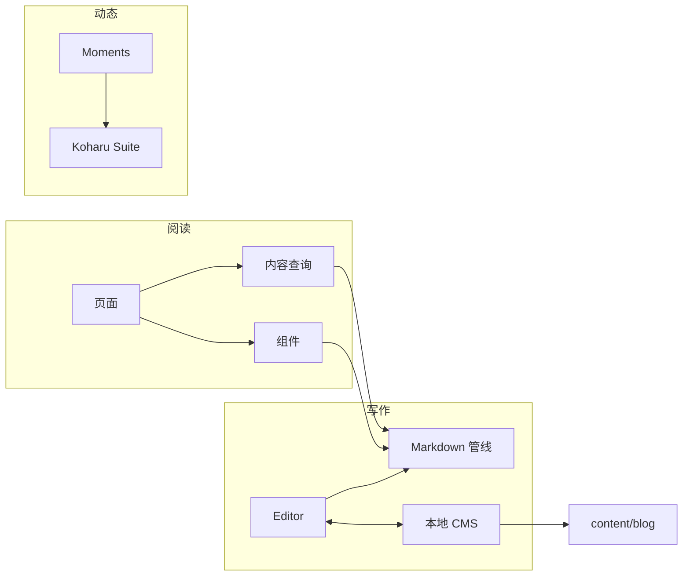
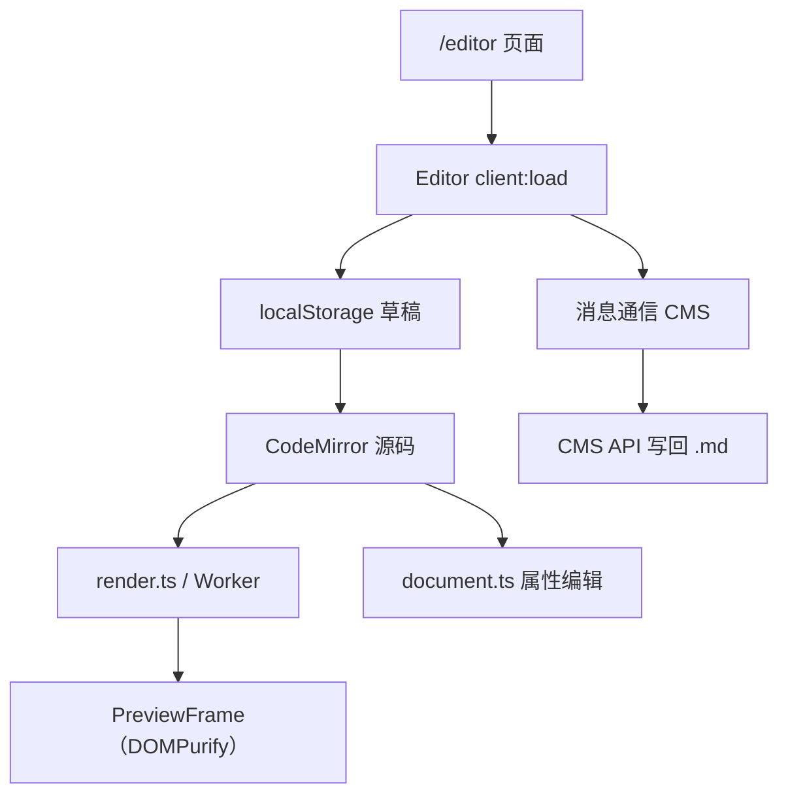

# 08 功能模块

## 1. 功能矩阵

| 功能 | 开关/配置 | 代码位置 | 运行依赖 |
| --- | --- | --- | --- |
| 写作室 `/editor` | `editor.enabled` | `src/features/editor/` | 浏览器 + 可选 CMS |
| 本地 CMS | `editor.enabled` + `pnpm cms` | `cms/` | Node，本地 4322 端口 |
| 碎碎念 Moments | `moments.enabled` + `KOHARU_SUITE_URL` | `src/features/moments/` | 外部 Koharu Suite + Node standalone |
| 全文搜索 | 默认启用 | `astro-pagefind`、`components/layout/Search*` | 构建期索引 |
| 评论 | `comment.provider` | `components/comment/` | 对应评论服务 |
| Umami 统计 | `analytics.umami` | `components/analytics/`、`lib/umami-stats.ts` | Umami 服务 |
| 全局音乐 | `bgm.enabled` / `bgm.audio` | `components/bgm/`、`lib/meting.ts` | Meting API |
| 公告 | `announcements` | `components/announcement/`、`store/announcement` | 无 |
| 友链 | `friends` | `components/friends/`、`pages/friends.astro` | 无 |
| 追番 | `bangumi` | `components/bangumi/`、`lib/bangumi/` | Bangumi API |
| 圣诞效果 | `christmas.enabled` | `components/christmas/` | 无 |
| 落款 | `colophon.enabled` | `lib/content/colophon*`、`components/post/colophon/` | 无 |
| 文章操作 | `postActions` | `pages/post/[...slug].md.ts`、`PostMarkdownActions` | 无 |
| 加密 | `content.enableEncryptedBlock` / frontmatter `password` | `lib/markdown/rehype-encrypted-*`、`lib/crypto/` | 浏览器 Web Crypto |
| 链接卡片 | `content.enableLinkEmbed` 等 | `lib/markdown/remark-link-embed.ts` | 构建期网络（可缓存） |
| 目录/阅读进度 | 默认启用 | `components/layout/TableOfContents/`、`hooks/useReadingProgress` | 无 |



## 2. 写作室（Editor）

### 2.1 模块结构

```text
src/features/editor/
├── Editor.tsx                 # 主 React 应用：草稿、面板、预览、CMS 通信
├── components/
│   ├── CodeEditor.tsx         # CodeMirror 封装
│   ├── PreviewFrame.tsx       # 预览 iframe / 容器
│   ├── ArticleProperties.tsx  # 文章属性编辑（YAML）
│   ├── SyntaxPanel.tsx        # 语法手册
│   ├── ViewSwitch.tsx         # 编辑/预览/分屏切换
│   ├── LinkPreviewSettings.tsx
│   └── SheetHandle.tsx
├── pages/
│   ├── index.astro            # /editor 页面入口
│   └── preview.astro          # /editor/preview 预览帧
├── server/
│   ├── http.ts                # 开发期 OG 元数据中间件
│   ├── og-service.ts          # OG 抓取与缓存
│   └── public-url.ts
├── render.ts                  # Markdown → HTML 预览管线
├── render.worker.ts           # 后台线程渲染
├── document.ts                # frontmatter 解析与无损编辑
├── storage.ts                 # 浏览器草稿存储
├── import-source.ts           # 从本站 .md 导入
├── link-service.ts            # OG 服务地址配置
├── link-request-pool.ts       # 请求并发控制
├── link-metadata.ts           # 链接元数据
├── formatting.ts              # 工具栏格式化
├── editor-history.ts          # 撤销/重做辅助
├── colophon.ts                # 落款编辑模型
├── colophon-dictionary.ts     # 构建期序列化落款字典
├── crypto.ts                  # 编辑器内加密
├── clipboard.ts               # 复制
└── syntax.ts                  # 语法条目
```

### 2.2 数据流



关键函数：

| 函数 | 文件 | 作用 |
| --- | --- | --- |
| `listDrafts` / `readDraft` / `writeDraft` / `activeDraft` / `removeDraft` | `storage.ts` | 草稿索引与单篇草稿 CRUD |
| `parseEditorDocument` / `updateEditorProperty` / `updateEditorList` | `document.ts` | frontmatter 与正文解析、无损编辑 |
| `documentTitle` / `markdownFilename` / `createEditorSource` | `document.ts` | 标题、文件名与新文章模板 |
| `renderEditorMarkdown` | `render.ts` | Markdown → 预览 HTML |
| `fetchMarkdownSource` / `parseImportSource` / `findImportedDraft` | `import-source.ts` | 从本站 `.md` 导入 |
| `normalizeOGEndpoint` / `readOGEndpoint` / `saveOGEndpoint` | `link-service.ts` | 链接预览服务地址 |
| `editorIntegration` | `integration.ts` | 注入写作室路由与 OG 中间件 |
| `handleEditorOGRequest` | `server/http.ts` | 开发期 OG 元数据端点 |

### 2.3 草稿存储

`src/features/editor/storage.ts`：

| Key | 内容 |
| --- | --- |
| `koharu-editor:drafts:v1` | 草稿摘要数组（`id`、`title`、`updated`、`filename`、`importedFrom`） |
| `koharu-editor:active:v1` | 当前激活草稿 id |
| `koharu-editor:draft:<id>` | 单个草稿完整源码 |

行为：

- 输入后 600ms 防抖保存。
- 页面隐藏（`visibilitychange`）与 `pagehide` 时立即落盘。
- 存储不可用或已满时提示用户复制/下载，不静默丢失内容。
- 草稿时间戳非法时显示“时间未知”，避免 `Intl` 抛错导致编辑器卸载。

### 2.4 Frontmatter 无损编辑

`document.ts` 使用 `yaml` 的 `Document` API：

- 解析 frontmatter 与正文，保留原始 YAML 注释与样式。
- `updateEditorProperty(source, key, value)` 修改单个属性；空值删除该键。
- `updateEditorList(source, key, {remove, insert})` 按索引编辑列表，未改动项保持原格式。
- `documentTitle()`、`markdownFilename()`、`createEditorSource()` 提供标题、文件名与新文章模板。

### 2.5 预览

- `render.ts` 使用 unified + remark/rehype + Shiki，复用主站插件。
- 输出 HAST 经过允许标签/URL 协议白名单 `sanitizeTree()`，再由 `hast-util-to-html` 序列化。
- `PreviewFrame` 再用 DOMPurify 防护，预览在隔离容器中运行。
- `render.worker.ts` 可把渲染放到 Worker，避免长文输入卡顿。
- 预览还会处理链接卡片、代码高亮、Shoka 容器、加密块等。

### 2.6 导入与导出

- `/editor?from=/post/foo.md` 可导入本站文章原文。
- `import-source.ts` 只接受同源路径，限制文件大小（`MAX_MARKDOWN_BYTES`），并去除导入参数。
- 若同一来源已导入过，会提示恢复已有草稿（按 `importedFrom` 去重）。
- 支持复制全文、下载 `.md`、查看源码。

### 2.7 CMS 协同

写作室嵌入 CMS 时通过 `window.postMessage` 通信，双方限定 localhost:4322：

| 消息 | 方向 | 作用 |
| --- | --- | --- |
| `koharu-cms-open` | CMS → 编辑器 | 打开指定文章源码（含 `postId`、`source`、可选 `restoreDraftId`） |
| `koharu-cms-opened` | 编辑器 → CMS | 确认已打开（返回 `draftId`） |
| `koharu-cms-result` | CMS → 编辑器 | 保存结果（`requestId`、成功/错误） |
| `koharu-cms-detach` | 编辑器 → CMS | 解除绑定（草稿与文章不匹配/用户切换） |
| `koharu-editor-ready` | 编辑器 → 父窗口 | 非敏感的就绪广播 |

编辑器本身**不直接写文件**；所有落盘都经由 CMS API。

### 2.8 路由注入与服务端

`editorIntegration()`：

- `astro:config:setup` 注入 `/editor`、`/editor/preview`，`prerender: true`。
- `astro:server:setup` 挂载 `/api/editor/og` 中间件，用于开发期抓取链接 OG 元数据。
- 页面可用 `PUBLIC_EDITOR_OG_ENDPOINT` 覆盖端点。

## 3. 本地 CMS

### 3.1 架构

`cms/` 是一个独立的 Vite + React 应用，由 Hono 提供服务：

```text
cms/
├── server.ts              # Hono + Vite middleware
├── src/api/               # list/read/write/source/create/toggle/og
├── src/components/        # SourcePostEditor、CreatePostDialog 等
├── src/lib/               # 路径、校验、frontmatter、分类
└── src/api/source.ts      # 源码读写（带并发/安全校验）
```

启动：

```bash
pnpm cms:install   # 首次
pnpm cms           # http://localhost:4322
```

### 3.2 API 路由

| 方法 | 路径 | 作用 |
| --- | --- | --- |
| GET | `/api/cms/list` | 列出文章 |
| GET | `/api/cms/read` | 读取文章 |
| POST | `/api/cms/write` | 写入 frontmatter + 正文 |
| GET | `/api/cms/source` | 读取完整 Markdown 源文件 |
| POST | `/api/cms/source` | 保存完整源文件（乐观锁） |
| POST | `/api/cms/create` | 创建文章 |
| POST | `/api/cms/toggle-draft` | 切换草稿 |
| POST | `/api/cms/toggle-sticky` | 切换置顶 |
| GET | `/api/cms/og-data` | 获取 OG 数据 |
| GET | `/api/cms/og-cache` | 读取 OG 缓存 |
| GET | `/api/cms/config` | 返回项目路径、内容目录、分类映射 |

### 3.3 安全模型

| 措施 | 实现 |
| --- | --- |
| 仅本机 | `/api/*` 校验 `Host` 必须是 localhost/127.0.0.1/::1 |
| 可选鉴权 | 设置 `CMS_API_KEY` 时校验 `Authorization: Bearer` |
| 来源校验 | 源码接口只接受 `http://localhost:4322` / `http://127.0.0.1:4322` 的 Origin |
| 路径安全 | `postId` 禁止 `..`、反斜杠、空字节；`realpath` 后必须仍在内容目录内 |
| 符号链接 | 打开文件使用 `O_NOFOLLOW`，写入使用临时文件 + `rename` |
| 大小限制 | 源文件 5 MiB；请求体按 JSON 转义上限计算 |
| 编码 | 只接受 UTF-8；拒绝孤立代理项，避免字符损坏 |
| 并发 | `expectedSource` 乐观锁 + 每文件 Promise 串行锁；保存前再次校验 |
| 原子性 | 写入临时文件、`fsync`、校验、`rename` |

### 3.4 写入流程

`POST /api/cms/write`：

1. Zod 校验 `postId`、`frontmatter`、`content`。
2. 校验路径与 `.md`/`.mdx` 扩展名。
3. 把 `date`/`updated` 从 `yyyy-MM-dd HH:mm:ss` 或 ISO 解析为 `Date`。
4. `serializeFrontmatter()` 规范化字段顺序与格式。
5. `gray-matter` 生成文件，YAML 使用 `flowLevel: 2`、单引号、不换行。
6. 新增分类映射时同步更新 `categoryMap`。

`POST /api/cms/source` 则保留完整原文（包括 frontmatter 注释），只做“原文快照比对 + 原子替换”。

## 4. 碎碎念（Moments）

### 4.1 架构

Moments 是唯一需要动态运行时的功能：

```text
src/features/moments/
├── integration/momentsRoutes.ts  # 注入路由 + 冲突检查
├── pages/                        # index / channel / message / search / RSS / redirect
├── lib/
│   ├── data.ts                   # 频道、消息、搜索、上下文
│   ├── runtime.ts                # Suite 客户端、超时、错误映射
│   ├── view-models.ts            # 页面 ViewModel
│   ├── urls.ts                   # 路径生成
│   ├── labels.ts                 # 文案
│   ├── metadata.ts               # OG 元数据
│   ├── message-groups.ts         # 消息分组
│   └── rss.ts                    # RSS 输出
└── 组件位于 src/components/moments/
```

### 4.2 运行条件

| 条件 | 说明 |
| --- | --- |
| `moments.enabled: true` | 注入路由并使用 Node adapter |
| `KOHARU_SUITE_URL` | 必须是纯 HTTP(S) origin，不能带凭据/查询/fragment |
| `@astrojs/node` | `mode: 'standalone'` |
| `memoryCache({ max: 1000 })` | Astro 缓存提供者 |
| 外部 Suite | 通过 `@coszone/koharu-astro` 客户端访问 |

### 4.3 数据访问

`lib/data.ts`：

| 函数 | 作用 |
| --- | --- |
| `getMomentsChannels()` | `getLiveCollection('koharuChannels')` + 配置解析，返回 `all/visible/primary` |
| `findChannel(channels, slug)` | 按 slug 查找可见频道 |
| `listChannelMessages(channelId, cursor?, limit = 20)` | 频道消息分页 |
| `latestMessages(channelIds, limit = 20)` | 多频道最新消息 |
| `getMessageContext(messageId)` | 单条消息上下文 |
| `searchMessages({channelIds, cursor, query, sort})` | 消息搜索 |

`lib/runtime.ts`：

- `readKoharuSuiteUrl()`：读取并校验 `KOHARU_SUITE_URL`。
- `getKoharuClient()`：缓存客户端实例，超时 8 秒。
- `requestKoharu(operation, fn)`：记录慢请求（>2 秒）与失败详情。
- `toMomentsHttpError()`：把错误映射为 `404 not-found` / `429 rate-limited` / `503 unavailable`。
- `isKoharuNotFound()`：判断 404。

### 4.4 页面与缓存

- `/moments` 首页：`Astro.cache.set({ maxAge: 300, swr: 30 })`，失败时取消缓存并设置状态码/`Retry-After`。
- `?cursor=` 页面设置 `robots: 'noindex,follow'`，避免分页被索引。
- `includeLocaleAlternates={false}`，因为 Moments 不按语言生成镜像。
- 频道别名、路径别名由 `momentsRoutes()` 注入重定向。

### 4.5 路由

```text
/moments
/moments/search
/moments/rss.xml
/moments/[channel]
/moments/[channel]/rss.xml
/moments/[channel]/[message]
```

以及 `pathAliases` 和频道 `aliases` 对应的重定向路径。所有注入路由均为 `prerender: false`。

## 5. 全文搜索

| 项 | 说明 |
| --- | --- |
| 索引 | `astro-pagefind` 在构建期扫描带 `data-pagefind-body` 的页面 |
| 排除 | 加密内容带 `data-pagefind-ignore` |
| UI | `SearchTrigger`、`SearchDialog`、`SearchDialogContent`、`SearchPortal` |
| 样式 | `src/styles/components/pagefind.css` |
| 快捷键 | `useKeyboardShortcut` |
| 测试 | `tests/search/portal.browser.mjs`、`css.browser.mjs` |

搜索完全静态，不需要后端；构建后索引位于 `dist/pagefind/`。

## 6. 评论

`components/comment/Comment.astro` 根据 `comment.provider` 选择实现：

| Provider | 配置 | 组件 |
| --- | --- | --- |
| `waline` | `comment.waline.serverURL` 等 | `Waline.tsx` / `WalineClient.astro` |
| `twikoo` | `comment.twikoo.envId`、`region`、`path` | `Twikoo.tsx` / `TwikooClient.astro` |
| `giscus` | `repo`、`repoId`、`category`、`categoryId`、`mapping` 等 | `Giscus.tsx` / `GiscusClient.astro` |
| `remark42` | `host`、`siteId` | `Remark42.astro` |
| `none` | — | 不渲染评论区 |

`DeferredComment.tsx` 延迟到评论区进入视口附近再加载第三方脚本，避免阻塞首屏。

## 7. 访问统计（Umami）

| 能力 | 实现 |
| --- | --- |
| 页面统计脚本 | `UmamiAnalytics.astro`，读取 `analytics.umami.id/endpoint` |
| 文章 PV | `createArticleStatsConfig(href)` + `UmamiPVSpan.tsx` |
| 页脚全站统计 | `umamiSiteStatsConfig` + `src/lib/umami-stats.ts` |
| 分享 token | `statistics_display.token`，只读、可暴露到客户端 |

未配置 token 或对应开关关闭时，统计配置返回 `null`，组件不渲染。

## 8. 音乐（BGM / Meting）

| 项 | 说明 |
| --- | --- |
| 配置 | `bgm.enabled`、`bgm.metingApi`、`bgm.audio[]` |
| 自动启用 | 未写 `enabled` 时，`audio.length > 0` 即启用 |
| 全局播放器 | `GlobalBGMPlayer`（`client:panel="bgm"`，`transition:persist`） |
| 数据适配 | `src/lib/meting.ts` 兼容 `name/artist` 与 `title/author` 字段 |
| 封面 | `src/lib/music-cover.ts` |
| 页面歌单 | `/music` 的 `` 独立配置，不受 `site.yaml.bgm` 影响 |

Meting API 返回字段不标准时，适配层会做兼容映射；歌单为空时优先检查 API 返回与歌单本身。

## 9. 公告

| 项 | 说明 |
| --- | --- |
| 配置 | `announcements[]`：`id`、`title`、`content`、`type`、`priority`、`color`、`publishDate`、`startDate`、`endDate`、`link` |
| 入口 | 页脚 `FooterAnnouncementEntry` |
| 弹窗 | `AnnouncementListPopup`、`AnnouncementToaster` |
| 已读 | `store/announcement.ts`，localStorage `announcement-read-ids:v1` |
| 优先级 | 按 `priority` 排序，时间窗过滤 |

更新公告内容但保留旧 `id` 时，已看过旧公告的访客不会再次看到新内容；需要更换新 `id`。

## 10. 友链

| 项 | 说明 |
| --- | --- |
| 配置 | `friends.intro`、`friends.groups[]`、`friends.data[]` |
| 分组 | `normalizeFriendGroups()` 校验 id 唯一，禁止 `all` / `ungrouped` |
| 未分组 | 缺失或未知 `group` 的友链进入“未分组”，不会丢失 |
| 组件 | `FriendsContent.astro`、`FriendsGrid.astro`、`FriendCard.astro` |
| 申请 | `FriendRequestForm.tsx` + `friends-interactions.ts`，展示 YAML 申请格式 |

## 11. 追番（Bangumi）

| 项 | 说明 |
| --- | --- |
| 配置 | `bangumi.userId`、`label`、`icon`；整段注释即关闭 |
| 页面 | `/bangumi`；配置缺失时 `Astro.redirect('/404')` |
| 导航 | `routers` 自动追加，无需手写 |
| 数据 | 客户端 `BangumiCollection`（`client:load`）调用 Bangumi API |
| API 客户端 | `src/lib/bangumi/` |
| Hook | `useBangumiData` |

`userId` 直接拼入 API 路径，建议使用稳定的数字 ID。

## 12. 圣诞效果

| 能力 | 配置 | 实现 |
| --- | --- | --- |
| 总开关 | `christmas.enabled` | `ChristmasEffects.astro` |
| 飘雪 | `features.snowfall` | `SnowfallCanvas.tsx` / `SnowParticles.tsx` |
| 圣诞配色 | `features.christmasColorScheme` | `src/styles/christmas/christmas-theme.css` |
| 封面装饰 | `features.christmasCoverDecoration` | `ChristmasLights.astro` |
| 头像帽子 | `features.christmasHat` | `ChristmasHat.astro` |
| 阅读时间雪花 | `features.readingTimeSnow` | 阅读时长组件 |
| 雪花参数 | `snowfall.*` | 速度、密度、层数、迭代次数 |

即使功能关闭，`conditionalSnowfall()` Vite 插件也会把 `SnowfallCanvas` 替换为空组件，从而不打包 Three.js（约节省 879KB）。

## 13. 落款（Colophon）

| 展示面 | 组件/逻辑 |
| --- | --- |
| 封面信息行 | `ColophonMeta.astro` |
| 正文前提示条 | `ColophonBanner.astro` |
| 文末落款 | `ColophonSeal.astro` |
| 文章卡片图标 | `PostItemCard` 读取 `colophonMarkIds` |
| 归档筛选 | `archives.astro` + `colophonFilterChips()` |
| 写作室编辑 | `colophon-dictionary.ts` 序列化字典，`ArticleProperties` 编辑 |

## 14. 文章操作与源码端点

| 操作 | 条件 | 实现 |
| --- | --- | --- |
| 复制 Markdown | `postActions.copyMarkdown` | `PostMarkdownActions.tsx` 请求 `<post>.md` |
| 下载 Markdown | `postActions.downloadMarkdown` | 同上，生成下载文件名 |
| 在写作室打开 | `postActions.openInEditor` + `editor.enabled` | `off` / `dev` / `everyone` |
| 本地编辑器打开 | `dev.editors` + 开发环境 | `getLocalEditorHref()` |

加密文章、含 `:::encrypted` 块的文章、生产环境草稿不会生成 `.md` 端点，也不会显示这些按钮。

## 15. 设置面板

`components/settings/registry.ts` 定义设置项分组；`SettingsPanel.tsx` 渲染面板，`SettingsPanelContent.tsx` 组合具体控件。

| 能力 | 说明 |
| --- | --- |
| 动效强度 | `lively` / `subtle` / `reduced`；系统 `prefers-reduced-motion` 强制 reduced |
| 主题 | 深/浅切换，持久化到 localStorage |
| 字体 | `LocalFontPicker` 选择本地字体 |
| 数值设置 | `NumberField` |
| 全局面板 | 用 `client:panel` 延迟加载，首次打开才载入 React |

## 16. 主题切换

- `ThemeToggle.tsx` 切换 `<html class="dark">`。
- `BootScripts.astro` 在 `<head>` 中提前读取 localStorage，避免首屏闪烁。
- `theme-transition.css` 控制切换过渡。
- 主题色通过 CSS 变量与 `tailwind.config.mjs` 映射，组件不硬编码颜色。

## 17. 链接卡片

| 层 | 文件 | 作用 |
| --- | --- | --- |
| 网络 | `og-fetcher.ts` | 使用 `metascraper` 抓取标题/描述/图片/logo |
| 缓存 | `og-cache.ts` | `.cache/og-data.json`，TTL 天级 |
| 模板 | `link-card-template.ts` | 输出链接卡 HTML |
| 插件 | `remark-link-embed.ts` | 识别独立链接、Twitter、CodePen |
| 客户端 | `TweetEmbed.tsx`、`CodePenEmbed.astro`、`EmbedHydrator.tsx` | 嵌入水合 |

## 18. 目录与阅读进度

| 能力 | 实现 |
| --- | --- |
| 桌面目录 | `TableOfContents/` + `useTocController` + `TocGlide` |
| 标题树 | `useHeadingTree`、`HeadingTreeItem`、`HeadingList` |
| 当前标题 | `useCurrentHeading`（`useSyncExternalStore`） |
| 阅读进度 | `useReadingProgress` |
| 移动端目录 | `MobilePostHeader/` + `MobileTOCDropdown` + `ProgressCircle` |
| 标题锚点 | `rehypeSlug` + `rehypeAutolinkHeadings` |

## 19. 练习题（Quiz）

- 由 `content.enableQuiz` 控制，单篇可用 `quiz: false` 关闭。
- `QuizBlock.tsx` 统一入口，支持 `SingleChoiceQuiz`、`MultiChoiceQuiz`、`TrueFalseQuiz`、`FillBlankQuiz`。
- 样式在 `src/styles/theme/shoka-quiz.css`。

## 20. 功能开发检查表

| 检查项 | 说明 |
| --- | --- |
| 是否有配置开关 | 功能应可通过 `site.yaml` 关闭，且关闭后不产生死链/多余路由 |
| 是否需要语言镜像 | 新页面必须同时提供 `[lang]/` 镜像，或加入 `MIRROR_EXEMPT` |
| 是否需要注入路由 | 可参考 `editorIntegration()` / `momentsRoutes()`，并在构建期检查冲突 |
| 是否影响静态模式 | 需要服务器的功能必须显式切换 adapter，并在文档中注明 |
| 是否产生内容资产 | 生成脚本要注册到 `scripts/koharu/constants/generate.ts` |
| 是否有测试 | 纯逻辑用 `node:test`；浏览器行为用 Playwright 或 `.mjs` 脚本 |
