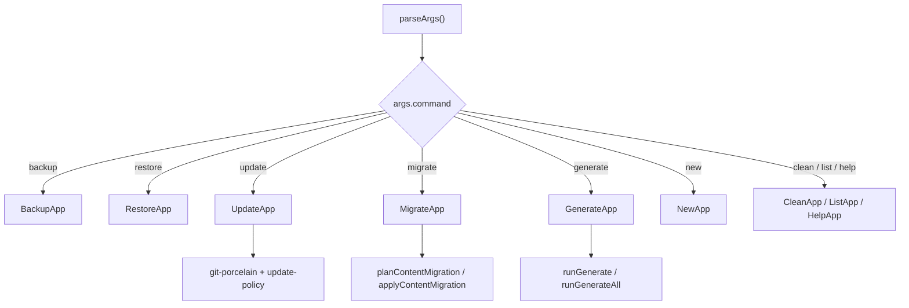
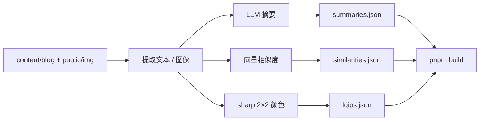
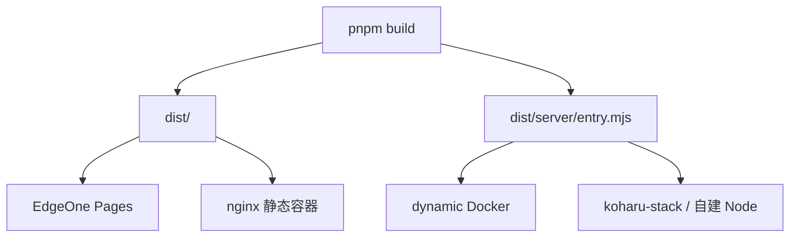
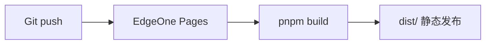

# 09 工具链、测试与部署

> 端到端的环境准备、开发/构建流程、写作室/CMS 启动、Moments 动态模式与启动排障见 [12 项目运行方式](./12-running-guide.md)；本章聚焦命令、生成脚本与部署细节。

## 1. 命令总览

### 1.1 开发与质量

| 命令 | 作用 | 备注 |
| --- | --- | --- |
| `pnpm dev` | 启动开发服务器 `http://localhost:4321` | 先执行 `koharu migrate --check` |
| `pnpm build` | 生产构建到 `dist/` | 先执行 `koharu migrate --check` |
| `pnpm preview` | 预览构建产物 | Astro preview |
| `pnpm check` | Astro 类型检查 | 提交前必跑 |
| `pnpm lint` | Biome 检查 | 不写入 |
| `pnpm lint:fix` | Biome 检查并修复 | 提交前必跑 |
| `pnpm lint-md` | Markdown 规范检查 | 仅 `src/content/**/*.{md,mdx}` |
| `pnpm test` | 全部 `node:test` 套件 | 见第 4 节 |
| `pnpm knip` | 查找未使用文件/依赖 | 注意 `knip.json` 中的入口 |
| `pnpm change` | 用 git-cliff 生成 CHANGELOG | `cliff.toml` 配置 |
| `pnpm prepare` | 安装 Husky hooks | 安装依赖时自动执行 |

### 1.2 内容资产

| 命令 | 输出 | 说明 |
| --- | --- | --- |
| `pnpm generate:lqips` | `src/assets/lqips.json` | 图片占位色 |
| `pnpm generate:similarities` | `src/assets/similarities.json` | 语义相似度 Top 5 |
| `pnpm generate:similarities:gpu` | 同上 | 使用 GPU 设备 |
| `pnpm generate:summaries` | `src/assets/summaries.json` | 增量生成 AI 摘要 |
| `pnpm generate:summaries:force` | 同上 | 忽略缓存全量重生成 |
| `pnpm generate:all` | 三个文件 | 顺序：LQIP → 摘要 → 相似度 |

### 1.3 写作与 CMS

| 命令 | 作用 |
| --- | --- |
| `pnpm koharu` | 交互式 CLI 主菜单 |
| `pnpm koharu new post` | 新建文章 |
| `pnpm koharu new friend` | 新建友链 |
| `pnpm save-slugs` | 把当前 CMS 文章的旧 slug 写入 frontmatter `link` |
| `pnpm cms:install` | 安装 `cms/` 依赖（首次） |
| `pnpm cms` | 启动本地 CMS `http://localhost:4322` |

### 1.4 Docker

| 命令 | 模式 |
| --- | --- |
| `pnpm docker:up` | 静态 nginx 容器，端口 `BLOG_PORT` |
| `pnpm docker:down` | 停止静态容器 |
| `pnpm docker:logs` | 跟随日志 |
| `pnpm docker:rebuild` | 重建镜像 |
| `pnpm docker:up:dynamic` | Node standalone 动态模式 |
| `pnpm docker:down:dynamic` | 停止动态容器 |
| `pnpm docker:logs:dynamic` | 动态日志 |

## 2. koharu CLI

CLI 使用 Ink（React for CLI）实现，入口 `scripts/koharu.tsx`，子命令在 `scripts/koharu/`。

```text
scripts/
├── koharu.tsx               # 参数解析、主菜单、命令分发
├── koharu/
│   ├── backup.tsx           # 备份
│   ├── restore.tsx          # 还原
│   ├── update.tsx           # 主题升级
│   ├── migrate.tsx          # 旧文章迁移
│   ├── generate.tsx         # 内容资产
│   ├── clean.tsx            # 清理旧备份
│   ├── list.tsx             # 列出备份
│   ├── new.tsx              # 新建文章/友链
│   ├── help.tsx
│   ├── components/          # CycleSelect / MultiSelect / StepFlow
│   ├── constants/           # 路径、备份清单、更新常量、生成任务
│   ├── creators/            # post-creator / friend-creator
│   ├── hooks/               # useStepFlow / usePressAnyKey / useRetimer
│   └── utils/               # git、备份、迁移、生成、策略状态机
└── save-slugs.ts
```



### 2.1 命令表

| 命令 | 关键选项 | 行为 |
| --- | --- | --- |
| `koharu` | — | 交互式主菜单 |
| `koharu new` | `post` / `friend` | 交互式新建内容 |
| `koharu backup` | `--full` | 生成 `.tar.gz` 备份到 `backups/` |
| `koharu restore` | `--latest`、`--dry-run`、`--force` | 从备份恢复 |
| `koharu update` | `--check`、`--skip-backup`、`--force`、`--tag`、`--rebase`、`--clean`、`--dry-run` | 基于 git 合并上游主题 |
| `koharu clean` | `--keep N` | 保留最近 N 个备份，删除其余 |
| `koharu list` | — | 列出所有备份 |
| `koharu generate` | `lqips` / `similarities` / `summaries` / `all`、`--model`、`--force` | 调用 `src/scripts/*` |
| `koharu migrate` | `--check`、`--dry-run`、`--force` | 旧文章链接迁移 |

CLI 关键函数：

| 函数 | 文件 | 作用 |
| --- | --- | --- |
| `parseArgs()` | `scripts/koharu/utils/args.ts` | 解析命令与选项 |
| `getBackupList()` | `scripts/koharu/utils/backup.ts` | 读取备份目录 |
| `runBackup(full)` | `scripts/koharu/utils/backup-operations.ts` | 创建备份归档 |
| `planContentMigration()` | `scripts/koharu/utils/migration-operations.ts` | 扫描旧字段并生成迁移计划 |
| `applyContentMigration(plan)` | 同上 | 应用迁移计划 |
| `runGenerate(type, options)` | `scripts/koharu/utils/generate-operations.ts` | 调用 `src/scripts/*.ts` |
| `runGenerateAll(options)` | 同上 | 顺序执行全部生成任务 |
| `checkGitStatus()` | `scripts/koharu/utils/update-operations.ts` | 检查工作区状态 |
| `getPackageManagerInstallCommand(packageManager)` | 同上 | 用精确 pnpm 版本安装依赖 |

### 2.2 备份内容

`scripts/koharu/constants/backup.ts` 定义备份清单：

| 项 | 基础备份 | 完整备份 | 还原策略 |
| --- | --- | --- | --- |
| `src/content/blog` | ✅ | ✅ | 还原前清空目标，避免混合快照 |
| `config/` | ✅ | ✅ | 覆盖 |
| `src/pages/*.md` | ✅ | ✅ | 覆盖 |
| `public/img` | ✅ | ✅ | 还原前清空目标 |
| `.env` | ✅ | ✅ | 覆盖 |
| `public/favicon.ico` | — | ✅ | 覆盖 |
| `src/assets/lqips.json` | — | ✅ | 覆盖 |
| `src/assets/similarities.json` | — | ✅ | 覆盖 |
| `src/assets/summaries.json` | — | ✅ | 覆盖 |

备份目录：`backups/`（已在 `.gitignore` 中忽略）。备份格式为 `.tar.gz`，带 manifest，schema 版本 2，兼容历史布局。

### 2.3 主题升级

- 上游仓库：`https://github.com/cosZone/astro-koharu.git`，远程名 `upstream`，主分支 `main`。
- 流程：检查 Git 状态 → 可选备份 → fetch → 预览更新 → 合并 → 安装依赖。
- 模式：
  - 默认 merge。
  - `--rebase`：重放本地提交，强制备份。
  - `--clean`：尽量替换主题文件、还原用户内容，强制备份。
- 工作区不干净时会提示/中断；升级前应提交本地改动。
- 安装依赖使用 `package.json` 中精确的 `packageManager`：`npx --yes pnpm@10.28.2 install`，避免回落到旧 pnpm。
- 冲突时保留 `MergeResult`，列出冲突文件，可中止 merge/rebase。

### 2.4 迁移

`koharu migrate` 处理旧文章数据：

| 动作 | 含义 |
| --- | --- |
| `add-link` | 为缺少 `link` 的文章补充永久链接 |
| `rename-slug` | 把旧 `slug` 改为 `link` |
| `remove-slug` | 移除冗余 `slug` |

- `--check`：只扫描；有需要迁移的内容时进程退出码为 1，用于 `dev`/`build` 前置门禁。
- `--dry-run`：打印计划，不写文件。
- `--force`：跳过确认。
- 真正写入前会自动备份；备份后重新扫描，若发现错误则不改文件。

## 3. 内容资产生成



### 3.1 LQIP

`src/scripts/generateLqips.ts`：

1. 扫描 `public/img/**/*.{webp,jpg,jpeg,png}`。
2. 用 `sharp` 缩放到 2×2。
3. 读取左上、右上、右下三个像素颜色。
4. 输出紧凑的 3 段十六进制串到 `src/assets/lqips.json`。
5. 键为相对 `/img/` 的路径。

### 3.2 语义相似度

`src/scripts/generateSimilarities.ts`：

| 项 | 值 |
| --- | --- |
| 模型 | `sentence-transformers/all-MiniLM-L6-v2` |
| 运行库 | `@huggingface/transformers` |
| 设备 | 默认 `cpu`，可用 `--device gpu` 或 `pnpm generate:similarities:gpu` |
| 模型缓存 | `.cache/transformers` |
| 文本 | 标题 + 描述；`USE_AI_SUMMARY = true` 时优先使用 AI 摘要；默认不包含正文 |
| 相似度 | 向量 L2 归一化后点积 = 余弦相似度 |
| 输出 | 每篇 Top 5，写入 `src/assets/similarities.json` |
| 语言 | 通过 `getNonDefaultLocaleGlobs()` 排除非默认语言译文，避免同 slug 重复 |

### 3.3 AI 摘要

`src/scripts/generateSummaries.ts`：

| 项 | 值 |
| --- | --- |
| 接口 | 火山方舟 Responses API `https://ark.cn-beijing.volces.com/api/v3/responses` |
| 模型 | `doubao-seed-evolving` |
| 密钥 | `AI_API_KEY` |
| 思考 | 开启，`reasoning.effort: 'high'` |
| 输出上限 | `max_output_tokens: 3000`，避免思考占满 |
| 超时 | 180 秒 |
| 请求间隔 | `SUMMARY_INTERVAL_MS`，默认 1500ms |
| 重试 | 429/5xx 最多 5 次，退避 `15s × 2^n`，基数可由 `SUMMARY_RETRY_BASE_MS` 覆盖 |
| 残句重生成 | 等待 `SUMMARY_REGEN_DELAY_MS`，默认跟随退避基数 |
| 缓存 | `.cache/summaries-cache.json`，版本 + 模型 + 内容哈希 |
| 输出 | `src/assets/summaries.json` |
| 跳过 | `excludeFromSummary: true`、非默认语言文件、缓存命中 |

缓存键包含模型名；切换模型后需要重新生成。失败的文章不写入缓存，下次运行只补缺口。

## 4. 测试

### 4.1 `node:test` 套件

`pnpm test` 依次运行：

| 套件 | 命令 | 覆盖 |
| --- | --- | --- |
| workspace | `node --test tests/workspace.test.mjs` | 仓库结构/工作区 |
| config | `tsx --test src/lib/config/*.test.ts` | normalizer 默认值、校验、边界 |
| markdown | `tsx --test src/lib/markdown/*.test.ts` | Ruby、Spoiler、OG 缓存、链接卡、Shiki |
| meting | `tsx --test src/lib/meting.test.ts src/lib/music-cover.test.ts` | 音乐数据兼容 |
| umami | `tsx --test src/lib/umami-stats.test.ts` | 统计配置 |
| toc | `tsx --test src/lib/toc.test.ts src/lib/toc-ribbon.test.ts` | 目录树与滚动 |
| lightbox | `tsx --test src/lib/lightbox-flip.test.ts src/lib/lightbox-gestures.test.ts` | 灯箱手势 |
| glide | `tsx --test src/lib/glide.test.ts` | 滑动指示 |
| drawer | `tsx --test src/lib/drawer-gesture.test.ts src/lib/series-rail.test.ts` | 抽屉/侧轨 |
| diagram | `tsx --test src/lib/diagram-sizing.test.ts src/lib/mermaid-source.test.ts src/lib/zoom-pan.test.ts` | 图表尺寸/缩放 |
| migrate | `tsx --test scripts/koharu/utils/*.test.ts` | CLI 迁移/更新策略 |
| moments | `tsx --test src/lib/config/moments.test.ts tests/moments/*.test.ts` | 路由/数据/分组/RSS |
| motion | `node --import tsx --test src/lib/motion-level.test.ts src/lib/sakura/petal-burst.test.ts src/lib/client-panel.test.ts` | 动效等级/花瓣/面板 |
| index | `tsx --test src/lib/content/*.test.ts` | 首页分组、分类、标签、系列期号、落款、源码可见性 |

### 4.2 额外测试脚本

| 命令 | 类型 | 范围 |
| --- | --- | --- |
| `pnpm test:editor` | node:test | 编辑器文档/存储/渲染/导入/链接/OG/CMS source |
| `pnpm test:search:browser` | `.mjs` | 搜索 portal 与 CSS |
| `pnpm test:diagram:browser` | `.mjs` | Mermaid 浏览器渲染 |
| `pnpm test:motion:browser` | Playwright | 动效、全屏、雪花、视口 |
| `pnpm test:settings-panel` | `.mjs` | 设置面板动画 |
| `pnpm test:bgm-panel` | `.mjs` | BGM 面板加载 |
| `pnpm test:moments:smoke` | shell | Moments 冒烟 |
| `pnpm test:moments:docker` | shell | 动态 Docker 冒烟 |

`tests/` 还包含：

- `tests/toc/`、`tests/lightbox/`、`tests/motion/` 的 Playwright 配置与规格。
- `tests/editor/*.browser.mjs`：编辑器工作台、移动端、属性、链接、CMS 保存竞态。
- `tests/series-test-patches/`：系列测试补丁样例。

### 4.3 测试策略

- **高优先级**：纯函数、内容查询、配置归一化、构建脚本、迁移策略。
- **中优先级**：复杂 Hooks、状态管理。
- **低优先级**：纯展示组件（以人工/浏览器测试为主）。
- 浏览器行为优先用真实页面 + Playwright，而不是大量 mock。

## 5. 构建产物

```text
dist/
├── index.html
├── post/.../index.html
├── en/...
├── rss.xml
├── rss/feed.xsl
├── sitemap-index.xml
├── sitemap-*.xml
├── robots.txt
├── pagefind/            # 全文搜索索引
├── _astro/              # 带 hash 的 JS/CSS
├── img/                 # public 资源
└── server/entry.mjs     # 仅动态模式
```

构建配置要点：

- `compressHTML: true`。
- CSS 小于 8KB 内联，减少请求。
- `cssTarget` 固定到 `chrome111/edge111/firefox128/safari16.4`，避免 `animation-timeline` 被错误合并。
- `react-runtime` / `motion-runtime` 单独分 chunk。
- `ANALYZE=true` 时启用 Sonda sourcemap 分析。

## 6. 部署



### 6.1 EdgeOne Pages（当前站点）

| 配置 | 值 |
| --- | --- |
| 构建命令 | `pnpm build` |
| 输出目录 | `dist` |
| Node | `>= 22.20` |
| 包管理器 | pnpm |
| 环境变量 | 静态模式不需要 |
| 动态模式 | 不适用（Moments 需要 Node 常驻） |



### 6.2 静态 Docker（nginx）

`docker/Dockerfile` 多阶段构建：

| 阶段 | 基础镜像 | 内容 |
| --- | --- | --- |
| `builder` | `node:22-alpine` | 安装 pnpm、依赖、`pnpm build` |
| `dynamic` | `node:22-alpine` | 仅生产依赖 + `dist/client` + `dist/server`，`CMD node dist/server/entry.mjs`，端口 4321 |
| `static` | `nginx:alpine` | `dist/` 拷入 `/usr/share/nginx/html`，端口 80 |
| `production` | `static` 别名 | 保持历史默认 target |

`docker/nginx/default.conf`：

- `try_files $uri $uri/index.html =404`，匹配 Astro 输出。
- 静态资源 1 年 immutable 缓存。
- HTML 1 小时 `must-revalidate`。
- `/pagefind/` 1 天缓存。
- `rss.xml` 强制 `application/rss+xml`。
- 安全头：`X-Frame-Options`、`X-Content-Type-Options`、`Referrer-Policy`。

静态 compose（`docker/docker-compose.yml`）：

```yaml
ports:
  - "${BLOG_PORT:-4321}:80"
restart: unless-stopped
healthcheck: wget http://127.0.0.1/
```

### 6.3 动态 Docker（Moments）

`docker/docker-compose.dynamic.yml`：

- target `dynamic`。
- 构建参数 `KOHARU_SUITE_URL`。
- 端口 `4321`。
- 健康检查访问 `http://127.0.0.1:4321/`。
- 必须配置 `KOHARU_SUITE_URL`，否则 compose 直接报错。

### 6.4 koharu-stack（Moments 完整栈）

`deploy/koharu-stack/` 提供单机基线：

```text
Telegram 公开频道
      │
      ▼
koharu-suite worker ──► PostgreSQL 18
      │
      ▼
suite server ──► Caddy ──► astro-koharu
```

组成：

| 服务 | 作用 |
| --- | --- |
| `postgres` | PostgreSQL 18，数据卷持久化 |
| `suite-migrate` | 运行 `node dist/cli.js migrate`，一次性任务 |
| `suite-server` | `node dist/cli.js serve`，端口 3000，仅 Docker 网络内 |
| `astro-koharu` | 博客 + `/moments` |
| `caddy` | 自动 HTTPS，暴露 80/443 |

要求：

- 两个子域名分别指向博客与 Suite。
- 只暴露 80/443；不要公开 3000/4321/5432。
- 使用精确 Release tag 镜像，不使用浮动 tag。
- `deploy/koharu-stack/.env` 权限 600，包含数据库密码、Better Auth secret、Telegram Bot Token。

### 6.5 写作室 OG 服务独立部署

`deploy/editor/` 适合“静态博客 + 独立 OG 元数据服务”：

| 服务 | 说明 |
| --- | --- |
| `blog` | 静态 nginx 镜像，挂载自定义 `nginx.conf` |
| `editor-og` | `deploy/editor/Dockerfile`，端口 4323，只暴露给 blog |

安全加固：

- `read_only: true` + `/tmp` tmpfs。
- `cap_drop: ALL`。
- `no-new-privileges`。
- 内存 256MB、PID 64。
- 健康检查访问 `/api/editor/og`，期望 400（缺少参数视为服务正常）。

## 7. 环境变量与运行前提

| 变量 | 适用场景 | 说明 |
| --- | --- | --- |
| `KOHARU_SUITE_URL` | Moments 构建/运行 | 必须是纯 origin |
| `AI_API_KEY` | 摘要生成 | 火山方舟密钥 |
| `SUMMARY_INTERVAL_MS` | 摘要生成 | 默认 1500 |
| `SUMMARY_RETRY_BASE_MS` | 摘要生成 | 默认 15000 |
| `SUMMARY_REGEN_DELAY_MS` | 摘要生成 | 默认 15000 |
| `ANALYZE` | 构建分析 | `true` 启用 Sonda |
| `BLOG_PORT` | Docker/编辑器部署 | 宿主机端口映射，不改变 Astro dev 端口 |
| `PUBLIC_EDITOR_OG_ENDPOINT` | 写作室 | 覆盖 OG 端点 |
| `CMS_API_KEY` | CMS | 可选 Bearer Token |

## 8. 仓库约定与现状

| 项 | 说明 |
| --- | --- |
| Node / pnpm | `>=22.20.0` / `10.28.2`，`packageManager` 精确锁定 |
| Workspace | 根项目 + `cms` |
| 格式化 | Biome，行宽 128、单引号、尾逗号 |
| 提交钩子 | Husky + lint-staged：TS/JS/JSON/Astro 走 Biome，Markdown 走 lint-md |
| 变更日志 | `cliff.toml` + `pnpm change` |
| 许可 | AGPL-3.0 |
| CI | 当前仓库 `.github/` 只有 `FUNDING.yml` 与 PR 图片资源，未包含 GitHub Actions workflow；验证依赖本地命令 |
| acceptance 脚本 | `package.json` 定义了 `acceptance` / `acceptance:report` / `acceptance:open`，但当前检出的仓库根目录未包含 `acceptance/` 目录；执行前需确认该目录来源 |

## 9. 排障手册

| 现象 | 根因 | 处理 |
| --- | --- | --- |
| 修改 `site.yaml` 不生效 | 配置在启动时缓存 | 重启 dev server 或重新构建 |
| 依赖请求 504、按钮无响应 | dev server 运行过久，Vite 预构建缓存失效 | 重启 dev server |
| 新目录文章不出现 | dev server 未监听新目录 | 重启 dev server |
| 构建失败提示缺少 `.md` 端点 | 文章加密/草稿导致源码路由为空 | 正常行为；检查 `postActions` 与加密状态 |
| 加密文章没有 `.md` | `isPostSourcePublic` 拒绝 | 设计如此 |
| 歌单为空 | Meting API 字段不兼容或歌单本身为空 | 检查 `title/author` 兼容映射与歌单 |
| 公告更新后不显示 | 公告 `id` 未变化，访客已读 | 更换新 `id` |
| 摘要生成被限流 | 请求过快 | 增大 `SUMMARY_INTERVAL_MS` 或调大退避基数 |
| 摘要为空 | `max_output_tokens` 被思考耗尽 | 保持 3000+，确认 `reasoning.effort: high` |
| 相似度生成失败 | 模型下载超时 | 配置镜像/重试；该功能可跳过，不影响构建 |
| `similarities.json` 触发 Biome 报错 | 文件末尾缺换行 | `pnpm lint:fix` |
| `dist/` 仍有已删除文章 | 旧构建残留 | 重新 `pnpm build` |
| Moments 部署到静态平台失败 | 需要 Node 常驻 | 改用 dynamic Docker/Node 服务器 |
| 写作室链接预览不可用 | OG 服务不可达或 HTTPS 混用 | 检查 `editor-og` 服务与端点协议 |
| CMS 拒绝写入 | 非 localhost、Origin 不符、缺少 `CMS_API_KEY` | 检查访问地址与鉴权配置 |
| 保存冲突 409 | 文件在编辑期间被外部修改 | 重新从 CMS 打开原文再保存 |
