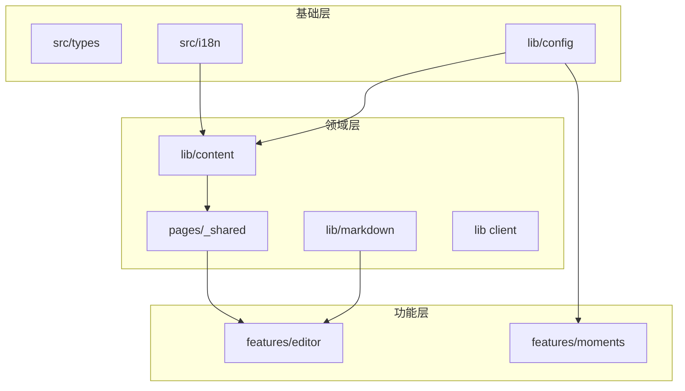

# 10 关键 API 参考

本页只列出跨模块消费、或承担核心职责的导出符号。签名做了类型简化，完整类型以源码为准。

| 层级 | 目录 | 关键文件 | 对应章节 |
| --- | --- | --- | --- |
| 基础 | `src/types`、`src/lib/config`、`src/i18n` | `blog.ts`、`site.ts`、`utils.ts` | 1、2 |
| 领域 | `src/lib/content`、`lib/markdown`、`pages/_shared` | `posts.ts`、`shoka-preprocessor.ts`、`routes.ts` | 3、4、5 |
| 客户端 | `src/lib` 顶层 | `toc.ts`、`lightbox-*.ts`、`glide.ts` | 6 |
| 交互 | `src/hooks`、`src/store` | `useTocController.ts`、`settings.ts` | 7 |
| 功能 | `src/features/editor`、`features/moments` | `Editor.tsx`、`data.ts` | 8、9 |
| 类型与常量 | `src/types`、`src/constants` | `BlogSchema`、`PAGINATION` | 10、11 |

## 1. i18n（`src/i18n/`）

| 符号 | 文件 | 签名/说明 |
| --- | --- | --- |
| `defaultLocale` | `config.ts` | `string`，来自 `i18n.defaultLocale` |
| `localeList` | `config.ts` | 已启用语言代码数组 |
| `localeEntries` | `config.ts` | `{ code, label }[]` |
| `isI18nEnabled` | `config.ts` | `localeList.length > 1` |
| `getLocaleLabel(code)` | `config.ts` | 语言显示名，找不到回退 code |
| `t(locale, key, params?)` | `utils.ts` | UI 文案翻译；目标语言 → 默认语言 → 返回 key |
| `localizedPath(path, locale?)` | `utils.ts` | 默认语言无前缀，其他语言 `/<locale>/...` |
| `stripLocaleFromPath(pathname)` | `utils.ts` | 去掉已启用语言前缀 |
| `getLocaleFromUrl(pathname)` | `utils.ts` | 从首段路径推断 locale |
| `getAlternateUrl(pathname, targetLocale)` | `utils.ts` | 语言切换 URL |
| `getHtmlLang(locale)` | `utils.ts` | `zh → zh-CN`，其余原样 |
| `resolveNavName(nameKey, fallbackName, locale)` | `utils.ts` | 导航文案，`nameKey` 优先 |

## 2. 配置（`src/lib/config/`）

### 2.1 已归一化配置（`site.ts`）

| 符号 | 类型/说明 |
| --- | --- |
| `siteConfig` | `ResolvedSiteConfig`：站点基本信息 + `featuredCategories` + `featuredSeries` |
| `categoryMap` | `Record<string, string>`，分类名 → slug |
| `friendGroups` | `FriendGroup[]` |
| `featuredSeriesList` | `FeaturedSeriesItem[]` |
| `enabledSeriesSlugList` | 启用系列的 slug 数组 |
| `i18nConfig` | `{ defaultLocale, locales }` |
| `enabledLocaleCodes` | 启用语言代码数组 |
| `contentConfig` | `ResolvedContentConfig` |
| `motionConfig` | `ResolvedMotionConfig` |
| `editorConfig` | `{ enabled: boolean }` |
| `colophonConfig` | `ResolvedColophonConfig` |
| `postActionsConfig` | `ResolvedPostActionsConfig` |
| `siteTimezone` | IANA 时区字符串 |

### 2.2 Normalizer

| 符号 | 签名 | 说明 |
| --- | --- | --- |
| `normalizeContentConfig(raw?)` | `Partial<ContentConfig> \| null → ResolvedContentConfig` | 逐字段回退 |
| `normalizeMotionConfig(raw?)` | `Partial<MotionConfig> \| null → ResolvedMotionConfig` | 非法 level 回退 lively |
| `normalizeEditorConfig(raw?)` | `WritingRoomConfig \| undefined → Required<WritingRoomConfig>` | 默认关闭 |
| `resolveEditorNavigation(items, config)` | `RouterItem[] → RouterItem[]` | 关闭时移除 `/editor` |
| `normalizeFeaturedSeries(raw, context?)` | `unknown → FeaturedSeriesItem[]` | slug 校验/保留路由/重复检查 |
| `enabledFeaturedSeriesSlugs(series)` | `readonly FeaturedSeriesItem[] → string[]` | 启用 slug |
| `normalizeFriendGroups(raw)` | `unknown → FriendGroup[]` | id 唯一、禁止 `all/ungrouped` |
| `groupFriendLinks(friends, groups)` | `FriendLink[], FriendGroup[] → FriendSection[]` | 未分组兜底 |
| `normalizeMomentsConfig(raw, context?)` | `MomentsConfig \| undefined → NormalizedMomentsConfig` | 路径/别名/OG 校验 |
| `resolveMomentsChannels(config, suiteChannels, context)` | → `ResolvedMomentsChannel[]` | 合并配置与 Suite 频道 |
| `resolveMomentsNavigation(items, config)` | `RouterItem[] → RouterItem[]` | 注入/替换 Moments 导航 |
| `normalizeColophonConfig(raw)` | `unknown → ResolvedColophonConfig` | 字典校验 |
| `assertBundledIcon(icon, where)` | `void` | 图标集合校验，非法抛错 |
| `normalizePlacement(value, where)` | `unknown → ColophonPlacement[] \| undefined` | placement 校验 |
| `normalizeTone(value, where)` | `unknown → ColophonTone` | tone 校验 |
| `normalizePostActionsConfig(raw)` | `unknown → ResolvedPostActionsConfig` | `openInEditor` 枚举校验 |
| `isOpenInEditorAvailable(config, editorEnabled, isDev)` | `boolean` | 是否显示“在写作室打开” |

### 2.3 组装层（`src/constants/site-config.ts`）

| 符号 | 说明 |
| --- | --- |
| `siteConfig`、`contentConfig`、`editorConfig`、`i18nConfig`、`motionConfig` | re-export |
| `socialConfig` | 社交链接 |
| `icpConfig`、`policeConfig` | 备案信息 |
| `seoConfig` | `{ title, description, keywords, url }` |
| `defaultCoverList` | 内置 21 张封面或自定义 |
| `commentConfig`、`analyticsConfig` | 评论/统计 |
| `umamiSiteStatsConfig` | 全站统计配置或 `null` |
| `createArticleStatsConfig(href)` | 文章统计配置或 `null` |
| `christmasConfig` | 圣诞配置（含默认值） |
| `bgmConfig` | `{ enabled, metingApi, audio }` |
| `bangumiConfig` | 配置对象或 `null` |
| `momentsConfig` | 归一化 Moments 配置 |
| `routers` | 最终导航项 |
| `devConfig` | 本地编辑器配置 |
| `configuredSeriesSlugs`、`enabledSeriesSlugs` | `Set<string>` |

## 3. 内容（`src/lib/content/`）

### 3.1 文章

| 符号 | 签名 | 说明 |
| --- | --- | --- |
| `getSortedPosts(locale?)` | `→ Promise<BlogPost[]>` | 生产过滤草稿、日期降序、locale 过滤、memoize |
| `getPostById(id, locale?)` | `→ Promise<BlogPost \| undefined>` | id→Map O(1) |
| `getPostCount(locale?)` | `→ Promise<number>` | 复用缓存 |
| `getPostsBySticky(locale?)` | `→ Promise<{stickyPosts, nonStickyPosts}>` | 置顶拆分 |
| `getPostsByCategory(name, locale?)` | `→ Promise<BlogPost[]>` | 只看 `categories[0]` |
| `getPostLastCategory(post)` | `→ { link, name }` | 最深分类 |
| `getRandomPosts(count?, locale?)` | `→ Promise<BlogPost[]>` | Fisher-Yates |
| `getSeriesPosts(post, locale?)` | `→ Promise<BlogPost[]>` | 同最深分类 |
| `getAdjacentSeriesPosts(post, locale?)` | `→ Promise<{prevPost, nextPost}>` | 系列上一篇/下一篇 |
| `getEnabledSeries()` | `→ FeaturedSeriesItem[]` | 启用系列 |
| `getSeriesBySlug(slug)` | `→ FeaturedSeriesItem \| undefined` | slug 查找 |
| `getPostsBySeriesSlug(slug, locale?)` | `→ Promise<BlogPost[]>` | 系列文章 |
| `getFeaturedCategoryNames()` | `→ string[]` | 系列分类名 |
| `getNonFeaturedPosts(locale?)` | `→ Promise<BlogPost[]>` | 排除系列 |
| `getHomePagePosts(locale?)` | `→ Promise<{highlightedPosts, stickyPosts, regularPosts}>` | 首页单次遍历 |
| `getPostReadingTime(post)` | `→ { words, text, minutes }` | WeakMap 缓存 |
| `getPostDescription(post, locale?, maxLength?)` | `→ string` | description → 加密文案 → 正文 |
| `getPostSummary(slug)` | `→ string \| null` | AI 摘要 |
| `getPostDescriptionWithSummary(post, locale?, maxLength?)` | `→ string` | 增加摘要兜底 |

### 3.2 语言与 Slug

| 符号 | 签名 | 说明 |
| --- | --- | --- |
| `getSlugLocaleInfo(slug)` | `→ { locale, localeFreeSlug }` | 目录前缀检测 |
| `getPostLocale(post)` | `→ string` | 文章语言 |
| `getPostSlug(post)` | `→ string` | `link` 优先，否则转写 |
| `filterPostsByLocale(posts, locale?)` | `→ BlogPost[]` | 非默认语言带兜底 |
| `transliterateSlug(slug)` | `→ string` | CJK → 拼音/罗马字，受配置控制 |
| `encodeSlug(slug)` | `→ string` | 逐段 `encodeURIComponent`，保留 `/` |

### 3.3 分类与标签

| 符号 | 签名 | 说明 |
| --- | --- | --- |
| `getCategoryList(locale?)` | `→ Promise<{categories, countMap}>` | 分类树与计数 |
| `addCategoryRecursively(root, parentNames, name)` | `void` | 逐级创建分类 |
| `getCategoryLinks(categories?, parentLink?)` | `→ string[]` | 所有分类 URL |
| `getCategoryNameByLink(link)` | `→ string` | URL 末段反查 |
| `getCategoryByLink(categories, link?)` | `→ Category \| null` | 树中查找 |
| `getParentCategory(category, categories)` | `→ Category \| null` | 父分类 |
| `buildCategoryPath(names)` | `→ string` | `/categories/...` |
| `getCategoryArr(categories?)` | `→ string[]` | 分类名数组 |
| `translateCategoryName(name, locale)` | `→ string` | 分类名翻译 |
| `translateSeriesField(slug, field, fallback, locale)` | `→ string` | 系列翻译 |
| `translateFeaturedCategoryField(link, field, fallback, locale)` | `→ string` | 精选分类翻译 |
| `normalizeTag(tag)` | `→ string` | 小写 |
| `tagToSlug(tag)` | `→ string` | `/ → -` 后编码 |
| `buildTagPath(tag)` | `→ string` | `/tags/<slug>` |
| `getAllTags(posts)` | `→ Record<string, number>` | 标签计数 |

### 3.4 归档、系列期号、落款

| 符号 | 签名 | 说明 |
| --- | --- | --- |
| `bucketPostsByMonth(posts, timezone)` | `→ {key, year, month, posts}[]` | 月份分桶 |
| `groupPostsByYear(posts, timezone)` | `→ {year, posts}[]` | 年份分组 |
| `monthIntensity(count, peak)` | `→ 0–4` | 对数热度 |
| `parseIssueTitle(title)` | `→ { number, headline }` | `Vol./No./#/第 N 期` |
| `resolvePostColophon(entries, config)` | `→ { items, warnings }` | 文章落款解析 |
| `colophonItemsAt(items, placement)` | `→ ColophonItem[]` | 按位置过滤 |
| `colophonMarkIds(items)` | `→ string[]` | 可筛选 id |
| `colophonSealRows(items)` | `→ ColophonSealRow[]` | 文末分行 |
| `colophonFilterChips(marks, ids)` | `→ ColophonFilterChip[]` | 筛选 chips |
| `resolveMarkFilter(param, available)` | `→ string` | 解析 `?mark=` |
| `rowHasMark(rowMarks, mark)` | `→ boolean` | 筛选判断 |
| `getColophonConfig(locale)` | `→ ResolvedColophonConfig` | 合并翻译 |
| `getPostColophon(post, locale)` | `→ ColophonItem[]` | 文章级解析 |

### 3.5 相关文章、源码、缓存

| 符号 | 签名 | 说明 |
| --- | --- | --- |
| `getRelatedPostSlugs(currentSlug, count?)` | `→ SimilarPost[]` | 相似度数据 |
| `getRelatedPosts(currentPost, allPosts, count?)` | `→ BlogPost[]` | 映射为文章 |
| `hasSimilarityData()` | `→ boolean` | 是否有数据 |
| `isPostSourceEnabled(config, editorEnabled, isDev)` | `→ boolean` | 是否需要 `.md` 端点 |
| `isPostSourcePublic(data, body, isProd)` | `→ boolean` | 加密/草稿过滤 |
| `getPostSourcePath(path)` | `→ string` | 追加 `.md` |
| `getPostSourceFilename(slug)` | `→ string` | 安全下载名 |
| `getLocalEditorHref(editor, dev, relativePath)` | `→ string` | 本地编辑器深链 |
| `memoize(namespace, key, fn)` | `→ Promise<T>` | 构建期缓存 |
| `pickPost(post, keys, locale?)` | `→ 子集对象` | 字段投影 |
| `toPostRef(post)` | `→ PostRef` | 最小引用 |
| `toPostCardDataList(posts, locale?)` | `→ PostCardData[]` | 卡片数据 |

## 4. Markdown 与加密

| 符号 | 文件 | 说明 |
| --- | --- | --- |
| `preprocessShokaSyntax(source, options?)` | `shoka-preprocessor.ts` | 块级/行内 Shoka 语法预处理 |
| `remarkShokaPreprocess(options?)` | `remark-shoka-preprocess.ts` | remark 包装，必要时重解析 |
| `remarkShokaRuby()` | `remark-shoka-ruby.ts` | Ruby/注音 |
| `remarkShokaSpoiler()` | `remark-shoka-spoiler.ts` | `!!spoiler!!` |
| `remarkIns` / `remarkMark` | `remark-shoka-effects.ts` | `++ins++` / `==mark==` |
| `remarkEncryptedDirective` | `remark-encrypted-directive.ts` | `:::encrypted` |
| `remarkLinkEmbed(options)` | `remark-link-embed.ts` | 链接卡/Tweet/CodePen |
| `rehypeShokaAttrs` | `rehype-shoka-attrs.ts` | `[text]{attrs}` |
| `rehypeImagePlaceholder` | `rehype-image-placeholder.ts` | LQIP |
| `rehypeEncryptedBlock()` | `rehype-encrypted-block.ts` | 局部加密 |
| `rehypeEncryptedPost()` | `rehype-encrypted-post.ts` | 整篇加密 |
| `shokaMetaTransformer()` | `shiki-meta-transformer.ts` | 代码 meta |
| `collapsibleCodeTransformer()` | `shiki-collapsible-transformer.ts` | 代码折叠 |
| `encryptContent(plaintext, password)` | `crypto/encrypt.ts` | `→ { cipher, iv, salt }` |
| `decryptContent(...)` | `crypto/decrypt.ts` | 客户端解密 |
| `classifyLink(url)` | `link-utils.ts` | 链接类型 |
| `isStandaloneLinkParagraph(node)` | `link-utils.ts` | 是否独立链接段 |
| `escapeHtml(text)` | `shoka-renderers.ts` | HTML 转义 |
| `renderFriendLinks(items)` / `renderAudioMedia` / `renderVideoMedia` | `shoka-renderers.ts` | 块级 HTML |
| `readMermaidSource(pre)` | `lib/mermaid-source.ts` | 读取 Mermaid 源 |

## 5. 路由

| 符号 | 文件 | 说明 |
| --- | --- | --- |
| `localePaths(enumerate)` | `pages/_shared/utils.ts` | `→ { root, mirror }` |
| `getLocaleStaticPaths` | 同上 | 静态页镜像 `getStaticPaths` |
| `assertLocaleMirrorsComplete()` | 同上 | 构建期镜像完整性断言 |
| `postRoute` / `postSourceRoute` | `pages/_shared/routes.ts` | 文章/源码参数空间 |
| `tagRoute` / `categoryRoute` | 同上 | 标签/分类 |
| `seriesRoute` / `postListRoute` | 同上 | 系列/分页 |
| `RESERVED_ROUTES` | `lib/config/reserved-routes.ts` | 保留路由集合 |
| `Routes` / `DEFAULT_ROUTERS` / `getSeriesPath(slug)` | `constants/router.ts` | 路由枚举与默认导航 |

## 6. 客户端逻辑库（`src/lib/`）

| 符号 | 文件 | 说明 |
| --- | --- | --- |
| `buildHeadingTree(flat)` | `toc.ts` | 扁平标题 → 树 |
| `findHeadingById` / `getParentIds` / `getSiblingIds` | `toc.ts` | 标题定位 |
| `revealPath(headings, targetId, expanded)` | `toc.ts` | 展开目标路径 |
| `collectExpandableIds` / `flattenHeadings` | `toc.ts` | 目录遍历 |
| `tocNumberLabel(numberPath)` / `stripRepeatedOrdinal` | `toc.ts` | 目录编号 |
| `chapterIndexOf` / `readingLineAt` / `locateReading` | `toc.ts` | 阅读位置 |
| `containBox` / `flipFromOrigin` / `intersectsViewport` | `lightbox-flip.ts` | FLIP 动画几何 |
| `clampLightboxScale` / `lightboxPanBounds` / `boundLightboxTransform` | `lightbox-gestures.ts` | 灯箱缩放/平移 |
| `resolveLightboxSwipe` | `lightbox-gestures.ts` | 滑动导航/关闭 |
| `glideAt` / `stepGlide` / `isGlideAtRest` / `glideSpan` | `glide.ts` | 滑动指示弹簧 |
| `resolveDragAxis` / `dragOffset` / `dragVelocity` / `resolveDrawerRelease` | `drawer-gesture.ts` | 抽屉手势 |
| `getScaleRange` / `clampScale` / `stepScale` | `diagram-sizing.ts` | 图表缩放 |
| `railWaveScale` / `nearestTick` / `railWindowStart` | `series-rail.ts` | 系列侧轨 |
| `parseMusicUrl` / `fetchMeting` / `resolvePlaylist` | `meting.ts` | Meting 数据 |
| `getPageviews` / `createUmamiStatsConfig` | `umami-stats.ts` | Umami 统计 |
| `getSiteStats()` | `stats.ts` | 站点统计 |
| `extractLanguage` / `extractCode` / `extractCodeHTML` | `content-enhancer-utils.ts` | 代码块提取 |
| `scanPreElements` / `scanQuizElements` / `scanFriendLinks` / `scanAudioPlayers` / `scanVideoPlayers` / `scanNoteBlocks` / `scanEncryptedPosts` / `scanEncryptedBlocks` | `content-scanner.ts` | 正文增强扫描 |
| `setupArrivalRender` / `setupScrollReveal` / `setupScrollbarActivity` / `setupTouchPrefetch` | 同名文件 | 全局客户端初始化 |
| `setupPetalBurst` | `sakura/petal-burst.ts` | 点击花瓣 |
| `setupCategoryFilter` / `setupColophonFilter` | `category-filter.ts` / `colophon-filter.ts` | 索引页筛选 |
| `enhanceLinkPreviews(container)` | `link-preview-enhancer.ts` | 链接预览增强 |
| `quoteCssString(value)` | `css-string.ts` | CSS 字符串安全 |

## 7. Hooks 与 Stores

### 7.1 Hooks（`src/hooks/`）

| Hook | 作用 |
| --- | --- |
| `useTranslation()` | 读取当前 locale + `t` |
| `useMediaQuery(query)` | 媒体查询 |
| `useIsMounted()` | 客户端挂载状态，避免水合差异 |
| `useRetainedValue(value)` | 退出动画期间保留旧值 |
| `useElementVisibility` | 元素可见性 |
| `useTocController` / `useTocGlide` / `useGlideIndicator` | 目录控制与滑动指示 |
| `useHeadingTree` / `useCurrentHeading` / `useActiveHeading` | 标题树/当前标题 |
| `useHeadingClickHandler` | 标题点击滚动 |
| `useReadingProgress` | 阅读进度 |
| `useAudioPlayer` / `useVideoPlayer` / `useMediaPlayer` | 媒体播放 |
| `usePlaybackTime` | 播放时间同步 |
| `useZoomPan` / `useDiagramScale` | 图表缩放/平移 |
| `useImageLightboxGestures` | 灯箱手势 |
| `useFloatingUI` | 浮动定位 |
| `useControlledState` / `useExpandedState` | 受控/展开状态 |
| `useCopyToClipboard` | 复制 |
| `useKeyboardShortcut` | 快捷键 |
| `useScrollTrigger` / `useRetimer` | 滚动触发/延迟器 |
| `useMotionLevel` / `useIsDarkTheme` | 动效等级/主题 |
| `useBangumiData` | 追番数据 |

### 7.2 Stores（`src/store/`）

| Store | 作用 |
| --- | --- |
| `locale` | 当前语言，供 React 岛同步 |
| `settings` | 设置面板偏好 |
| `settings-constants` | 设置项常量 |
| `player` / `bgm` | 播放器与全局 BGM |
| `announcement` | 公告已读与弹窗 |
| `modal` | 全局模态层 |
| `christmas` | 圣诞效果开关 |
| `app` | 应用级 UI 状态 |

## 8. 写作室 API

| 符号 | 文件 | 说明 |
| --- | --- | --- |
| `Editor` | `Editor.tsx` | 主 React 组件（default export） |
| `listDrafts(storage)` / `readDraft` / `writeDraft` / `activeDraft` / `removeDraft` | `storage.ts` | 草稿 CRUD |
| `parseEditorDocument(source)` | `document.ts` | frontmatter + body |
| `updateEditorProperty(source, key, value)` | `document.ts` | 无损改属性 |
| `updateEditorList(source, key, edit)` | `document.ts` | 无损改列表 |
| `documentTitle(source)` / `markdownFilename(source)` / `createEditorSource()` | `document.ts` | 标题/文件名/模板 |
| `renderEditorMarkdown(...)` | `render.ts` | 预览渲染 |
| `fetchMarkdownSource` / `parseImportSource` / `findImportedDraft` | `import-source.ts` | 导入 |
| `normalizeOGEndpoint` / `readOGEndpoint` / `saveOGEndpoint` | `link-service.ts` | OG 服务配置 |
| `editorIntegration()` | `integration.ts` | Astro 路由注入 |
| `handleEditorOGRequest` | `server/http.ts` | 开发期 OG 端点 |

## 9. Moments API

| 符号 | 文件 | 说明 |
| --- | --- | --- |
| `momentsRoutes(config)` | `integration/momentsRoutes.ts` | 注入路由/别名并检查冲突 |
| `getMomentsChannels()` | `lib/data.ts` | `{ all, visible, primary }` |
| `findChannel(channels, slug)` | `lib/data.ts` | 查找频道 |
| `listChannelMessages(channelId, cursor?, limit?)` | `lib/data.ts` | 消息分页 |
| `latestMessages(channelIds, limit?)` | `lib/data.ts` | 最新消息 |
| `getMessageContext(messageId)` | `lib/data.ts` | 消息上下文 |
| `searchMessages(options)` | `lib/data.ts` | 消息搜索 |
| `getKoharuClient()` / `requestKoharu()` | `lib/runtime.ts` | Suite 客户端 |
| `toMomentsHttpError(error)` | `lib/runtime.ts` | 错误 → HTTP 状态 |
| `readKoharuSuiteUrl()` | `lib/runtime.ts` | 校验 Suite origin |

## 10. 关键类型

| 类型 | 文件 | 说明 |
| --- | --- | --- |
| `BlogSchema` | `types/blog.ts` | frontmatter 输出类型 |
| `BlogSchemaInput` | `types/blog.ts` | 输入类型（date 可为字符串） |
| `BlogPost` | `types/blog.ts` | `CollectionEntry<'blog'>` |
| `PostRef` / `PostRefWithCategory` | `types/blog.ts` | 轻量文章引用 |
| `PostCardData` / `PostCardMark` | `types/blog.ts` | 卡片数据 |
| `Category` / `CategoryListResult` | `lib/content/types.ts` | 分类树/计数 |
| `FeaturedSeriesItem` | `lib/config/types.ts` | 系列配置 |
| `FeaturedCategory` | `lib/config/types.ts` | 首页精选分类 |
| `FriendLink` / `FriendGroup` / `FriendsConfig` | `lib/config/types.ts` | 友链 |
| `AnnouncementConfig` | `lib/config/types.ts` | 公告 |
| `ContentConfig` / `ResolvedContentConfig` | `lib/config/types.ts` | 内容开关 |
| `ResolvedSiteConfig` | `lib/config/types.ts` | 站点配置 |
| `ResolvedColophonConfig` / `ColophonMark` / `ColophonGroup` | `lib/config/colophon.ts` | 落款字典 |
| `ColophonEntry` / `ColophonItem` | `lib/content/colophon.ts` | 文章落款 |
| `EditorDraft` / `DraftSummary` | `features/editor/storage.ts` | 草稿 |
| `NormalizedMomentsConfig` / `ResolvedMomentsChannel` | `lib/config/moments.ts` | Moments |
| `PageMeta` / `PageMetaProps` | `layouts/page-meta.ts` | SEO 元数据契约 |
| `Locale` / `TranslationKey` / `TranslationParams` | `src/i18n/types.ts` | 翻译类型 |

## 11. 常量

| 常量 | 文件 | 值/说明 |
| --- | --- | --- |
| `PAGINATION.pageSize` | `constants/layout.ts` | `10` |
| `MAX_WIDTH.content` | `constants/layout.ts` | `max-w-7xl` |
| `CONTENT_PADDING` | `constants/layout.ts` | standard/normal/compact |
| `RESERVED_ROUTES` | `lib/config/reserved-routes.ts` | 保留路由集合 |
| `BUNDLED_ICON_SETS` | `lib/config/icon-sets.ts` | `gg`、`fa6-regular`、`fa6-solid`、`ri` |
| `PBKDF2_ITERATIONS` | `lib/crypto/constants.ts` | `100000` |
| `BLOG_CONTENT_GLOB_PATTERN` | `lib/content/glob.ts` | 内容 glob |
| `MOTION_DEFAULTS` | `lib/config/motion.ts` | lively / heroPetals / clickBurst |
| `CONTENT_DEFAULTS` | `lib/config/content.ts` | 20+ 内容开关默认值 |
| `DEFAULT_COLOPHON_PLACEMENT` | `lib/config/colophon.ts` | `['meta', 'seal']` |
| `FALLBACK_COLOPHON_ICON` | `lib/content/colophon.ts` | `ri:bookmark-line` |
