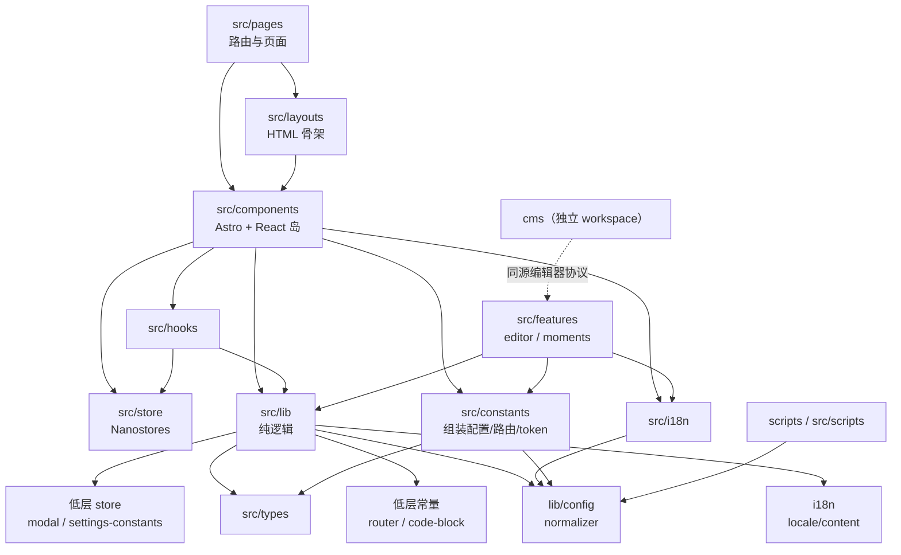
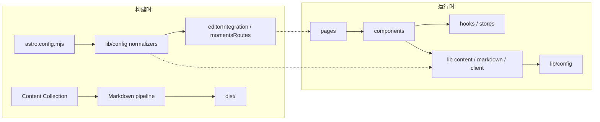

# 11 依赖关系图

## 1. 依赖方向

项目不是严格的“单向分层”，而是“展示层 → 逻辑层 → 配置层/类型层”为主，允许少量经过审查的低层依赖。核心规则如下：

| 规则 | 内容 |
| --- | --- |
| **禁止反向依赖组装层** | `src/lib/**` 不得导入 `@constants/site-config`；应使用 `@lib/config/site` 或具体 normalizer |
| **允许的低层常量** | `src/lib` 可以导入 `@constants/router`、`@constants/code-block` 等不依赖业务配置的常量 |
| **允许的低层状态** | `src/lib/image-enhancer.ts` 导入 `@store/modal`，`src/lib/motion-level.ts` 导入 `@store/settings-constants`，属于客户端行为的必要耦合 |
| **页面不直接读集合** | 页面通过 `src/lib/content` 查询，不直接 `getCollection('blog')` |
| **组件不读 `Astro.url`** | 页面把 `locale`/数据通过 props 传入客户端组件 |
| **配置单向流** | `config/site.yaml → lib/config → constants/site-config → pages/components` |

## 2. 各层导入关系

| 模块 | 允许导入 | 不应导入 |
| --- | --- | --- |
| `src/pages/**` | `layouts`、`components`、`lib`、`constants`、`i18n`、`features` 页面 | 深层 DOM/浏览器 API（应放客户端库） |
| `src/layouts/**` | `components`、`lib`、`constants`、`i18n`、`store` | 内容查询之外的重业务逻辑 |
| `src/components/**` | `hooks`、`store`、`lib`、`constants`、`i18n`、同域子组件 | 直接读取 Content Collection |
| `src/hooks/**` | `lib`、`store`、`i18n`、React | 页面路由、Astro 全局 |
| `src/store/**` | `lib`（少量）、Nanostores | React 组件 |
| `src/features/**` | `lib`、`constants`、`i18n`、自身模块、`components` | 其它 feature 的内部实现 |
| `src/lib/**` | `lib/config`、`i18n`、`types`、低层常量/store、`assets` | `@constants/site-config`、`src/components`、`src/pages` |
| `src/i18n/**` | `lib/config/site`、自身 translations | `components`、`pages` |
| `src/constants/**` | `lib/config`、`types`、YAML | `components`、`pages` |
| `src/scripts/**` | `lib/utils`、Node 内置、生成依赖 | 浏览器组件 |
| `scripts/koharu/**` | 自身 utils、Node 内置、Ink | 站点运行时代码（除通过 `npx tsx` 调用生成脚本） |
| `cms/**` | 自身 `src/`、Hono、Vite、React | 主站 `src/`（仅通过 HTTP/postMessage 协作） |

## 3. 关键模块依赖明细

| 模块 | 依赖 | 说明 |
| --- | --- | --- |
| `lib/config/site.ts` | `config/site.yaml`、各 normalizer、`timezone` | 唯一 YAML 解析/归一化入口 |
| `constants/site-config.ts` | `lib/config/site`、`lib/config/moments`、`lib/umami-stats`、YAML、`constants/router` | 组装层；`lib` 不可反向依赖 |
| `i18n/config.ts` | `lib/config/site` | 读取 `i18nConfig` |
| `i18n/utils.ts` | `i18n/config`、`i18n/translations` | 纯函数 |
| `lib/content/posts.ts` | `lib/config/site`、`assets/summaries.json`、`i18n`、`sanitize`、`cache`、`category-path`、`locale` | 内容查询核心 |
| `lib/content/categories.ts` | `lib/config/site`、`i18n/content`、`url`、`cache`、`posts` | 分类树；`posts` 只依赖 `category-path` 以避免循环 |
| `lib/content/category-path.ts` | `lib/config/site`、`url` | 为打破 `posts → categories → posts` 而抽出 |
| `lib/content/locale.ts` | `i18n/config`、`slug` | 内容语言检测 |
| `lib/content/post-source.ts` | `lib/config/post-actions`、`lib/config/types` | 源码端点可见性 |
| `lib/content/colophon.ts` | `lib/config/colophon` | 文章落款解析 |
| `lib/content/post-colophon.ts` | `lib/config/colophon`、`lib/config/site`、`i18n/content` | 站点级 + 翻译 |
| `lib/route.ts` | `constants/router`、`lib/content/locale`、`lib/url` | 路由构造；`Routes` 是低层常量 |
| `lib/image-enhancer.ts` | `store/modal` | 灯箱入口 |
| `lib/motion-level.ts` | `lib/config/motion`、`store/settings-constants` | 动效等级读写 |
| `lib/markdown/rehype-encrypted-*` | `lib/crypto/encrypt` | 构建期加密 |
| `lib/markdown/shiki-collapsible-transformer.ts` | `constants/code-block` | 折叠阈值常量 |
| `lib/seo/og-image.ts` | `lib/config/site` | OG 图片回退 |
| `pages/_shared/routes.ts` | `constants/layout`、`lib/config/site`、`lib/content`、`post-source` | 参数空间 |
| `pages/_shared/utils.ts` | `i18n/config` | locale 路由原语 |
| `layouts/Layout.astro` | `components/analytics`、`constants`、`i18n`、`AppShell`、`BootScripts`、`HeadMeta` | HTML 骨架 |
| `layouts/AppShell.astro` | `components/*`、`constants/site-config`、`lib/*`、`store/modal` | 全局岛与客户端初始化 |
| `features/editor/render.ts` | `lib/config/content`、`lib/markdown/*`、`shiki、unified` | 复用主站 Markdown 管线 |
| `features/editor/pages/index.astro` | `lib/config/site`、`colophon-dictionary`、`Editor` | 写作室入口 |
| `features/moments/lib/data.ts` | `constants/site-config`、`constants/router`、`lib/config/moments`、`@coszone/koharu-astro` | Moments 数据 |
| `features/moments/integration/momentsRoutes.ts` | `lib/config/moments`、Astro | 路由注入 |
| `cms/server.ts` | 自身 `src/api`、Hono、Vite、`js-yaml` | 独立服务 |
| `cms/src/api/source.ts` | 自身路径/校验工具、Hono、zod | 原子写文件 |

跨层函数依赖：

| 调用方 | 被调用方 | 代表函数/符号 | 约束 |
| --- | --- | --- | --- |
| `src/pages/**` | `lib/content` | `getSortedPosts`、`getPostById` | 页面不直接 `getCollection('blog')` |
| `pages/_shared/routes.ts` | `lib/content` | `getCategoryLinks`、`getEnabledSeries` | 动态路由参数空间 |
| `lib/content/**` | `lib/config` | `siteConfig`、`categoryMap`、`postActionsConfig` | 禁止导入 `@constants/site-config` |
| `lib/content/**` | `i18n` | `t`、`getContentCategoryName`、`getContentSeriesField` | 文案缺失回退原文 |
| `components/**` | `hooks` | `useTocController`、`useReadingProgress`、`useBangumiData` | 不直接操作 DOM 全局 |
| `components/**` | `store` | `$settings`、`$bgm`、`$locale` | 跨岛状态单一来源 |
| `astro.config.mjs` | `lib/config` | `normalizeContentConfig`、`normalizeMomentsConfig` | 构建期纯函数 |
| `features/editor` | `lib/markdown` | `preprocessShokaSyntax`、`remarkLinkEmbed` | 预览复用主站管线 |
| `features/moments` | `constants/site-config` | `momentsConfig`、`i18nConfig` | 仅运行时动态页面使用 |
| `cms/` | `features/editor` | `koharu-cms-open` / `koharu-cms-result` | 仅通过 postMessage/HTTP 协作 |

## 4. 路径别名

`tsconfig.json` 定义：

| 别名 | 指向 |
| --- | --- |
| `@/*` | `src/*` |
| `@assets/*` | `src/assets/*` |
| `@components/*` | `src/components/*` |
| `@content/*` | `src/content/*` |
| `@layouts/*` | `src/layouts/*` |
| `@pages/*` | `src/pages/*` |
| `@styles/*` | `src/styles/*` |
| `@lib/*` | `src/lib/*` |
| `@constants/*` | `src/constants/*` |
| `@hooks/*` | `src/hooks/*` |
| `@store/*` | `src/store/*` |
| `@scripts/*` | `src/scripts/*` |
| `@types/*` | `src/types/*` |

> `@lib/content` 指向**文件** `src/lib/content.ts`（barrel），不是目录 `src/lib/content/`。目录内的具体模块用 `@lib/content/posts` 等路径导入。

## 5. 外部依赖分类

### 5.1 框架与构建

| 依赖 | 用途 |
| --- | --- |
| `astro`、`@astrojs/react`、`@astrojs/node` | 框架、React 集成、动态 adapter |
| `@astrojs/markdown-remark`、`unified`、`remark-*`、`rehype-*` | Markdown 管线 |
| `@astrojs/rss`、`@astrojs/sitemap`、`astro-robots-txt`、`astro-seo` | RSS/Sitemap/robots/SEO |
| `astro-pagefind` | 静态搜索 |
| `astro-icon` + `@iconify-json/{ri,fa6-solid,fa6-regular,gg}` | 图标 |
| `astro-mermaid`、`mermaid` | 图表 |
| `@tailwindcss/vite`、`tailwindcss`、`@tailwindcss/typography`、`@tailwindcss/container-queries`、`tailwindcss-animate` | 样式 |
| `vite`、`@rollup/plugin-yaml`、`vite-plugin-svgr`、`sonda` | Vite 插件与构建分析 |

### 5.2 UI 与交互

| 依赖 | 用途 |
| --- | --- |
| `react`、`react-dom` | 交互岛 |
| `@radix-ui/react-*`、`class-variance-authority`、`clsx`、`tailwind-merge` | shadcn 体系 |
| `motion` | 动画 |
| `nanostores`、`@nanostores/react` | 全局状态 |
| `@floating-ui/react`、`@tanstack/react-virtual` | 浮层/虚拟列表 |
| `sonner` | Toast |
| `react-error-boundary` | 错误边界 |
| `react-hook-form`、`@hookform/resolvers`、`zod` | 表单与校验 |
| `@codemirror/*`、`codemirror` | 写作室编辑器 |
| `@antv/infographic` | 信息图 |
| `three`、`@react-three/fiber` | 雪花/3D 效果（按需） |
| `spoilerjs` | 隐藏文字 Web Component |

### 5.3 内容与媒体

| 依赖 | 用途 |
| --- | --- |
| `marked`、`sanitize-html`、`dompurify` | 预览/清洗 |
| `js-yaml`、`yaml`、`gray-matter` | YAML/frontmatter |
| `date-fns`、`date-fns-tz` | 日期与时区 |
| `reading-time`、`es-toolkit`、`transliteration` | 阅读时长、工具、slug 转写 |
| `hast-util-to-html`、`unist-util-visit`、`vfile` | AST/HTML |
| `metascraper*`、`undici` | 链接 OG 抓取 |
| `react-tweet`、`twikoo`、`@waline/client`、`@giscus/react` | 嵌入与评论 |
| `@coszone/koharu-astro` | Moments Suite 客户端 |

### 5.4 工具链（devDependencies）

| 依赖 | 用途 |
| --- | --- |
| `typescript`、`@astrojs/check` | 类型检查 |
| `@biomejs/biome` | lint/format |
| `husky`、`lint-staged` | Git hooks |
| `knip` | 死代码 |
| `@lint-md/cli` | Markdown 规范 |
| `tsx` | 运行 TS 脚本 |
| `sharp` | LQIP |
| `@huggingface/transformers` | 相似度 |
| `@xsai/generate-text` | 摘要 |
| `ink`、`@inkjs/ui`、`chalk` | CLI |
| `glob`、`strip-markdown`、`remark` | 生成脚本 |
| `@playwright/test` | 浏览器测试 |
| `vite-plugin-svgr`、`@rollup/plugin-yaml`、`sonda` | 构建 |

## 6. 循环依赖治理

| 风险 | 处理 |
| --- | --- |
| `posts → categories → posts` | 抽出 `category-path.ts`，`posts` 只依赖它，不依赖 `categories` |
| `lib → constants/site-config → lib` | 把 `RESERVED_ROUTES` 放到 `lib/config/reserved-routes.ts`；`lib` 只依赖 `lib/config` |
| `i18n → lib/content` 与 `lib/content → i18n` | `i18n/config` 只依赖 `lib/config/site`；`lib/content` 依赖 `i18n/content`，不形成回边 |
| `@lib/content` 解析 | 使用根文件 `src/lib/content.ts` 作为 barrel，避免目录 `index.ts` 歧义 |
| 功能互相引用 | `editor` 与 `moments` 不互相导入；共享能力下沉到 `src/lib` |
| CMS 与主站 | CMS 是独立 workspace，只通过 HTTP API 与 postMessage 通信 |

## 7. 打包与性能依赖

| 技术 | 位置 | 作用 |
| --- | --- | --- |
| `conditionalSnowfall()` | `astro.config.mjs` | 圣诞关闭时用空组件替换 `SnowfallCanvas`，避免打包 Three.js |
| `codeSplitting.groups` | `astro.config.mjs` | `react-runtime` 与 `motion-runtime` 独立共享 chunk |
| `assetsInlineLimit` | `astro.config.mjs` | CSS < 8KB 内联 |
| `cssTarget` | `astro.config.mjs` | 固定浏览器下限，避免 CSS 压缩破坏 `animation-timeline` |
| `noExternal: ['react-tweet']` | `astro.config.mjs` | 让 react-tweet 走 Vite 处理 |
| `optimizeDeps.include` | `astro.config.mjs` | 预构建 `@antv/infographic`、`@floating-ui/react`、`@tanstack/react-virtual`、表单依赖 |
| `lazyMermaid()` | `astro.config.mjs` | Mermaid 仅可见时渲染 |
| `client:content` / `client:panel` | 自定义指令 | 正文增强/面板按需加载 |
| `dynamic import('@assets/similarities.json')` | `lib/content/similarities.ts` | 数据缺失时不影响构建 |
| `WeakMap` / `memoize` | `lib/content` | 构建期与运行期缓存 |

## 8. 新增模块时的依赖检查

| 步骤 | 检查 |
| --- | --- |
| 1 | 新逻辑应放 `src/lib` 还是 `src/features`？可复用的纯逻辑放 `lib`，完整功能放 `features` |
| 2 | 是否从 `src/lib` 导入了 `@constants/site-config`？改为 `@lib/config/*` |
| 3 | 是否从组件直接读取 `getCollection`？改为 `lib/content` 查询 |
| 4 | 是否把大对象传给客户端岛？改为预计算小字段 |
| 5 | 是否新增了 `@/*` 别名？同步 `tsconfig.json` 与文档 |
| 6 | 是否引入重型依赖（>100KB）？使用动态 import 或条件打包 |
| 7 | 是否新增可注入路由？在 Integration 中检查冲突，并处理 locale 镜像 |
| 8 | 是否新增配置段？在 `lib/config` 加 normalizer + 测试，再在 `constants/site-config` 组装 |
| 9 | 是否新增内容资产？在 `src/scripts` 生成并注册到 CLI |
| 10 | 是否形成循环依赖？运行 `pnpm check` / `pnpm knip`，必要时抽出共享模块 |

## 9. 依赖相关常见问题

| 问题 | 原因 | 处理 |
| --- | --- | --- |
| `Cannot find module '@lib/content'` | 误以为它是目录索引 | 使用 `@lib/content`（文件）或 `@lib/content/posts`（子模块） |
| 构建时 `site.yaml` 未被解析 | 在 Vite 插件可用前读取 | `astro.config.mjs` 用 `fs`；运行时代码靠 `@rollup/plugin-yaml` |
| `lib` 中导入 `siteConfig` 报循环 | 从 `@constants/site-config` 导入 | 改用 `@lib/config/site` |
| 客户端组件拿到巨大的 props | 传了 `post.body`/完整数组 | 预计算并只传必要字段 |
| 首屏包含 Three.js | 圣诞功能开启或未启用 `conditionalSnowfall` | 检查 `christmas.enabled` 与 Vite 插件 |
| Dev server 预构建 504 | 长时间运行导致缓存失效 | 重启 dev server |
| CMS 与主站样式不一致 | CM 使用独立依赖版本 | 保持 `cms/` 依赖与主站编辑器兼容，避免跨 workspace 导入 |
