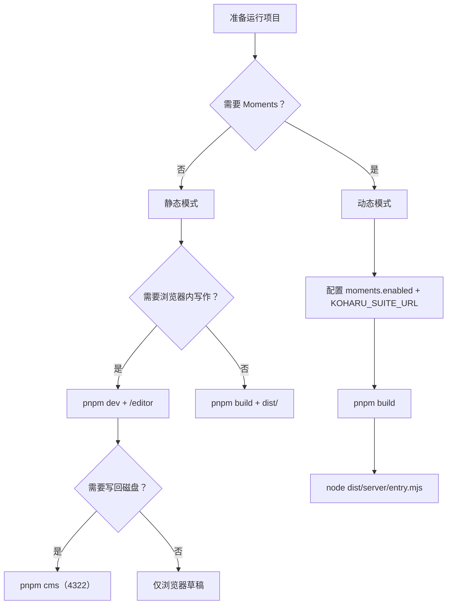
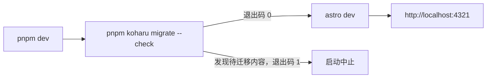
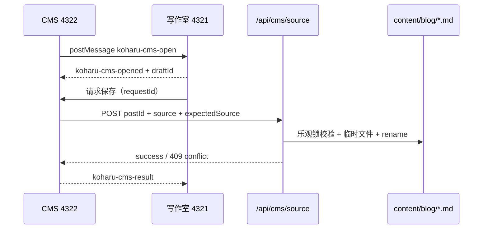
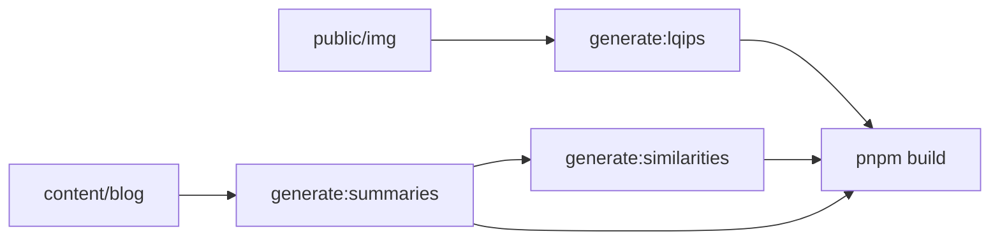
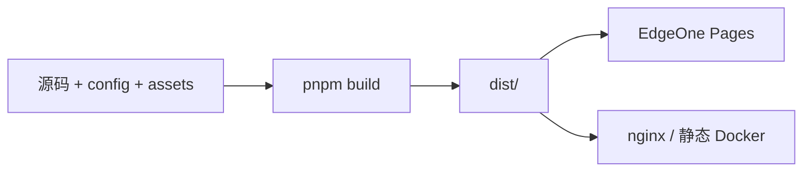
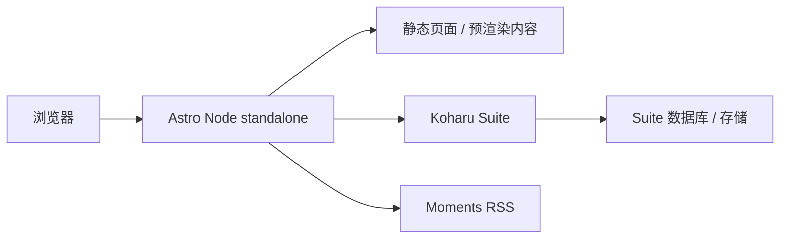
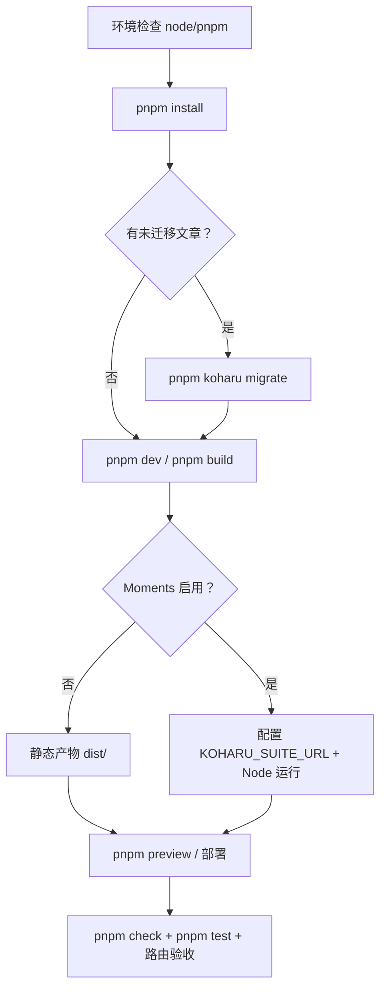

# 12 项目运行方式

本章是端到端运行指南：从环境准备、本地开发、写作室与 CMS，到静态构建、Moments 动态模式、Docker 运行与启动排障。命令细节与部署配置的完整清单见 [09 工具与部署](./09-tooling-and-deployment.md)。

## 1. 运行模式选择

项目不是单一运行模式，而是由配置决定三条路径：

| 场景 | 模式 | 必需条件 | 入口/产物 |
| --- | --- | --- | --- |
| 本地写作、调页面 | 开发服务器 | Node、pnpm | `pnpm dev` → `http://localhost:4321` |
| 静态博客 | 静态构建 | 无额外服务 | `pnpm build` → `dist/` |
| 写作室 | 静态页面 + 浏览器编辑 | `editor.enabled: true` | `/editor` |
| 本地 CMS | 独立 Node 服务 | `editor.enabled: true` | `pnpm cms` → `http://localhost:4322` |
| 碎碎念 Moments | Node standalone | `moments.enabled: true` + `KOHARU_SUITE_URL` | `dist/server/entry.mjs` |
| 静态 Docker | nginx 容器 | Docker | `pnpm docker:up` |
| 动态 Docker | Node 容器 | Docker + Suite URL | `pnpm docker:up:dynamic` |



判断规则：

- **默认选择静态模式**：`moments.enabled` 缺失或为 `false`，构建产物是纯静态文件。
- **只有需要碎碎念才切动态**：启用后 Astro 使用 `@astrojs/node` 的 `standalone` 适配器，不能再部署到 EdgeOne 等纯静态平台。
- **写作室不要求动态**：`/editor` 是预渲染页面，编辑内容保存在浏览器 localStorage；只有需要写回 `.md` 文件时才需要 CMS。

## 2. 环境准备

| 项 | 要求 | 检查命令 |
| --- | --- | --- |
| Node.js | `>= 22.20.0` | `node -v` |
| pnpm | `10.28.2` | `pnpm -v` |
| 浏览器 | 支持 ES2022、Web Crypto、IntersectionObserver | — |
| 磁盘 | 依赖安装 + `dist/` + 可选模型缓存 | — |
| 网络 | 安装依赖、链接卡片 OG 抓取、AI 摘要/相似度生成 | — |

首次安装：

```bash
corepack enable
corepack prepare pnpm@10.28.2 --activate
pnpm install
```

可选环境文件：

```bash
cp .env.example .env
```

`.env` 已被 `.gitignore` 忽略，不要提交。静态构建不强制需要 `.env`；只有 AI 摘要、Moments 等能力需要对应变量。

### 2.1 端口

| 端口 | 用途 | 说明 |
| --- | --- | --- |
| `4321` | Astro 开发/预览、动态 Node 服务 | 默认端口 |
| `4322` | 本地 CMS | `api/cms` 仅允许 localhost |
| `4323` | 独立 editor-og 服务 | 可选，部署 `deploy/editor/` 时使用 |
| `80` | 静态 Docker 容器内 nginx | 宿主端口由 `BLOG_PORT` 映射 |
| `443` | koharu-stack 的 Caddy | 自动 HTTPS |

`BLOG_PORT` 只影响 Docker/编辑器部署的宿主机端口映射，不会自动改变 `pnpm dev` 的 4321。

## 3. 本地开发启动

```bash
pnpm dev
```

实际执行链：



说明：

- `migrate --check` 扫描旧文章字段（`slug`/`link`），有需要迁移的内容会以非零退出码阻止启动。
- 需要迁移时执行 `pnpm koharu migrate`，按提示确认；写入前会自动备份。
- 启动成功后访问 `http://localhost:4321/`；首次加载会构建 Vite 预构建缓存。
- 修改 `config/site.yaml` 后必须重启 dev server，单纯刷新浏览器不会重新读取配置。
- 长时间运行的 dev server 可能出现 Vite 预构建缓存失效（依赖请求 504），此时重启 dev server。

### 3.1 启动前检查

| 检查项 | 原因 |
| --- | --- |
| `src/assets/summaries.json` 存在 | `posts.ts` 静态导入该文件；缺失会导致构建/页面加载失败 |
| `config/site.yaml` YAML 合法 | 缩进错误会直接阻断 Astro 启动 |
| `src/pages/[lang]/` 镜像完整 | `assertLocaleMirrorsComplete()` 会在模块加载时抛错 |
| `editor.enabled` 符合预期 | 关闭后 `/editor` 不注入，导航入口也会被移除 |
| 端口 4321 未被占用 | 避免启动冲突 |

### 3.2 开发期验证路由

| 路由 | 预期 |
| --- | --- |
| `/` | 首页、文章列表、分类卡片 |
| `/posts`、`/posts/2` | 非系列文章分页 |
| `/post/<slug>` | 文章详情、目录、评论、文章操作 |
| `/en/`、`/en/post/<slug>` | 英文站与中文兜底 |
| `/categories`、`/tags`、`/archives` | 索引页 |
| `/rss.xml` | 默认语言 RSS |
| `/editor` | 写作室（需 `editor.enabled: true`） |

## 4. 写作室与本地 CMS

### 4.1 写作室

前置条件：

```yaml
editor:
  enabled: true
```

启动 `pnpm dev` 后访问 `http://localhost:4321/editor`。

| 能力 | 运行方式 |
| --- | --- |
| 编辑 Markdown | CodeMirror，浏览器内完成 |
| 实时预览 | `render.ts` / `render.worker.ts`，复用主站 Markdown 管线 |
| 草稿 | localStorage，自动保存 + `pagehide` 落盘 |
| 导入本站文章 | `/editor?from=/post/<slug>.md` |
| 链接预览 | 开发期 `/api/editor/og`；生产可配置 `PUBLIC_EDITOR_OG_ENDPOINT` |
| 写回博客文件 | 需要本地 CMS |

写作室本身不直接写磁盘；浏览器草稿与博客文件是两套数据。

### 4.2 本地 CMS

首次安装并启动：

```bash
pnpm cms:install
pnpm cms
```

访问 `http://localhost:4322`。

| 条件 | 说明 |
| --- | --- |
| `editor.enabled: true` | CMS 复用写作室编辑文章 |
| 访问地址为 localhost | API 校验 `Host`，非本机访问返回 403 |
| 可选 `CMS_API_KEY` | 设置后请求需带 `Authorization: Bearer <key>` |
| 来源校验 | 源码接口只接受 `http://localhost:4322` / `http://127.0.0.1:4322` |

保存链路：



保存冲突（409）表示文件在编辑期间被外部修改，应重新从 CMS 打开原文再保存。

## 5. 内容资产准备

内容资产是构建输入，不是构建产物；部署前应提交到仓库。

| 命令 | 前置 | 输出 | 说明 |
| --- | --- | --- | --- |
| `pnpm generate:lqips` | `public/img/` 有图片 | `src/assets/lqips.json` | 2×2 采样生成 3 段占位色 |
| `pnpm generate:summaries` | `.env` 中 `AI_API_KEY` | `src/assets/summaries.json` | 默认语言文章 AI 摘要，增量缓存 |
| `pnpm generate:summaries:force` | 同上 | 同上 | 忽略缓存全量重生成 |
| `pnpm generate:similarities` | 可下载模型 | `src/assets/similarities.json` | 语义相似度 Top 5，首次需下载模型 |
| `pnpm generate:all` | 以上条件 | 三个 JSON | 顺序：LQIP → 摘要 → 相似度 |

运行顺序建议：



注意：

- `summaries.json` 被 `posts.ts` 静态导入，缺失会阻断构建；`similarities.json` 缺失只会告警并返回空相关文章。
- 摘要与相似度默认跳过非默认语言译文，避免同 slug 重复。
- 相似度生成不是必需步骤；模型下载失败可跳过，已有文件可继续使用。
- 生成结果需要随文章一起提交，EdgeOne 构建阶段不会自动执行生成脚本。

## 6. 生产构建与静态部署

### 6.1 构建前验证

```bash
pnpm check       # Astro 类型检查
pnpm lint:fix    # Biome 格式化/修复
pnpm test        # node:test 套件
pnpm build       # 生产构建
pnpm preview     # 预览 dist/
```

`pnpm build` 同样先执行 `koharu migrate --check`；有未迁移内容会中止构建。

### 6.2 静态产物

静态模式（`moments.enabled` 未开启）输出：

```text
dist/
├── index.html
├── post/.../index.html
├── en/...
├── rss.xml
├── sitemap-index.xml
├── robots.txt
├── pagefind/
└── _astro/
```

部署方式：

| 平台 | 配置 |
| --- | --- |
| EdgeOne Pages | 构建命令 `pnpm build`，输出目录 `dist`，Node `>=22.20`，pnpm，无需环境变量 |
| nginx / 静态 Docker | 将 `dist/` 作为站点根目录；`pnpm docker:up` |
| 任意静态托管 | 上传 `dist/`，确保 SPA 回退不会覆盖 404 语义 |



### 6.3 构建后验收

| 检查 | 方法 |
| --- | --- |
| 首页/文章页 | `pnpm preview` 后访问 `/`、`/post/<slug>` |
| 英文站 | `/en/`、`/en/post/<slug>` |
| 搜索索引 | `dist/pagefind/` 存在，页面搜索可用 |
| RSS/Sitemap | `/rss.xml`、`/sitemap-index.xml`、`/robots.txt` |
| 写作室 | 若启用，访问 `/editor` |
| 加密文章 | 页面提示输入密码，且无 `.md` 下载按钮 |
| 评论/统计 | 对应第三方配置生效 |

## 7. Moments 动态模式

### 7.1 配置

```yaml
moments:
  enabled: true
  path: moments
  title: 碎碎念
  description: 记录频道中的日常消息
```

环境变量：

```bash
KOHARU_SUITE_URL=https://suite.example.com
```

要求：

- 必须是纯 HTTP(S) origin，不能带凭据、查询参数或 fragment。
- 构建期校验，缺失会直接失败。
- Suite 必须能被 Astro Node 容器与浏览器访问。

### 7.2 构建与启动

```bash
pnpm build
HOST=0.0.0.0 PORT=4321 node dist/server/entry.mjs
```

此时 `dist/` 同时包含静态页面与 `dist/server/entry.mjs`。动态模式的运行链路：



注意：

- 不能部署到 EdgeOne 等纯静态托管；`/moments` 路由是 `prerender: false`。
- 页面使用 `Astro.cache`（首页 300s / SWR 30s）；Suite 不可用时返回 503/429 等状态。
- 动态模式仍需静态构建，搜索索引、RSS、Sitemap 照常生成。

### 7.3 动态 Docker

```bash
pnpm docker:up:dynamic
pnpm docker:logs:dynamic
pnpm docker:down:dynamic
```

需要在 `.env` 中提供 `KOHARU_SUITE_URL`；容器内监听 4321，宿主端口由 `BLOG_PORT` 映射。

## 8. Docker 运行

### 8.1 静态模式

```bash
cp .env.example .env       # 可选
pnpm docker:up             # 构建并启动 nginx 容器
pnpm docker:logs
pnpm docker:down
```

| 项 | 值 |
| --- | --- |
| 镜像 target | `static` |
| 容器端口 | `80` |
| 宿主端口 | `${BLOG_PORT:-4321}` |
| 运行命令 | `nginx -g 'daemon off;'` |
| 健康检查 | `wget http://127.0.0.1/` |

更新配置后：

```bash
pnpm docker:rebuild
```

### 8.2 动态模式

```bash
pnpm docker:up:dynamic
```

| 项 | 值 |
| --- | --- |
| 镜像 target | `dynamic` |
| 容器端口 | `4321` |
| 启动命令 | `node dist/server/entry.mjs` |
| 必需变量 | `KOHARU_SUITE_URL` |

### 8.3 独立 editor-og 服务

静态博客如果需要在生产使用写作室链接预览，可部署 `deploy/editor/`：

```bash
docker compose -f deploy/editor/compose.yaml up -d --build
```

- 博客静态容器 + `editor-og` 侧车（4323）。
- 写作室通过 `PUBLIC_EDITOR_OG_ENDPOINT` 指向该服务。
- 侧车只读文件系统、`cap_drop: ALL`，仅暴露给博客容器。

## 9. 环境变量总表

| 变量 | 何时需要 | 作用 |
| --- | --- | --- |
| `KOHARU_SUITE_URL` | `moments.enabled: true` | 外部 Suite origin，构建/运行必需 |
| `AI_API_KEY` | 生成 AI 摘要 | 火山方舟 API Key |
| `SUMMARY_INTERVAL_MS` | 摘要生成调优 | 请求间隔，默认 1500 |
| `SUMMARY_RETRY_BASE_MS` | 摘要生成调优 | 退避基数，默认 15000 |
| `SUMMARY_REGEN_DELAY_MS` | 摘要生成调优 | 残句重生成等待 |
| `ANALYZE` | 构建分析 | `true` 启用 Sonda |
| `BLOG_PORT` | Docker/编辑器部署 | 宿主机端口映射，不改变 Astro dev 端口 |
| `PUBLIC_EDITOR_OG_ENDPOINT` | 生产写作室链接预览 | 覆盖 `/api/editor/og` |
| `CMS_API_KEY` | CMS 安全加固 | 可选 Bearer Token |
| `HOST` / `PORT` | 动态 Node 启动 | standalone 监听地址/端口 |

## 10. 启动与验收流程



验收清单：

- [ ] `pnpm check` 通过
- [ ] `pnpm test` 通过（或至少相关套件）
- [ ] `pnpm build` 成功
- [ ] `/`、`/posts`、`/post/<slug>`、`/en/` 可访问
- [ ] `/rss.xml`、`/sitemap-index.xml`、`pagefind/` 存在
- [ ] `editor.enabled` 时 `/editor` 可访问
- [ ] `moments.enabled` 时 `/moments` 可访问且 Suite 连通
- [ ] 加密文章不暴露 `.md` 与明文
- [ ] 部署平台已包含 `src/assets/*.json`

## 11. 常见启动问题

| 现象 | 根因 | 处理 |
| --- | --- | --- |
| `ERR_PNPM_UNSUPPORTED_ENGINE` / 语法错误 | Node 版本过低 | 升级到 `>= 22.20.0` |
| `packageManager` 不匹配 | pnpm 版本不是 `10.28.2` | `corepack prepare pnpm@10.28.2 --activate` |
| 启动立刻退出，提示迁移 | `koharu migrate --check` 发现待迁移内容 | 执行 `pnpm koharu migrate` |
| YAML 解析错误 | `site.yaml` 缩进/注释格式错误 | 修正顶层键与同级缩进 |
| `Missing src/pages/[lang]/ mirror` | 根页面缺少语言镜像 | 补镜像或加入 `MIRROR_EXEMPT` |
| 构建报 `summaries.json` 相关错误 | 资产缺失 | `pnpm generate:summaries` 或恢复文件 |
| `EADDRINUSE` | 4321/4322 被占用 | 停止占用进程；CMS 使用 4322 |
| `/editor` 404 | `editor.enabled: false` | 设为 true 并重启 |
| CMS 403 / 401 | 非 localhost 或缺少/错误 `CMS_API_KEY` | 使用 localhost 访问并配置鉴权 |
| Moments 构建失败 | 缺少/非法 `KOHARU_SUITE_URL` | 配置纯 origin |
| Moments 页面 503 | Suite 不可达/限流 | 检查 Suite 与 `Retry-After` |
| 依赖请求 504、交互失效 | dev server 预构建缓存失效 | 重启 dev server |
| 配置修改不生效 | 构建期配置缓存 | 重启或重新 `pnpm build` |
| 新增目录文章不出现 | dev server 未监听新目录 | 重启 dev server |
| 相似度生成超时 | 模型下载失败 | 重试或跳过，已有文件可继续使用 |
| 静态平台 `/moments` 404 | 使用了纯静态部署 | 改用动态 Node/Docker |

## 12. 运行命令速查

| 目的 | 命令 |
| --- | --- |
| 安装依赖 | `pnpm install` |
| 本地开发 | `pnpm dev` |
| 生产构建 | `pnpm build` |
| 预览构建 | `pnpm preview` |
| 类型检查 | `pnpm check` |
| 测试 | `pnpm test` |
| 新建文章 | `pnpm koharu new post` |
| 迁移旧链接 | `pnpm koharu migrate` |
| 生成内容资产 | `pnpm generate:all` |
| 打开写作室 | `pnpm dev` → `/editor` |
| 启动 CMS | `pnpm cms:install` → `pnpm cms` |
| 静态 Docker | `pnpm docker:up` |
| 动态 Docker | `pnpm docker:up:dynamic` |
