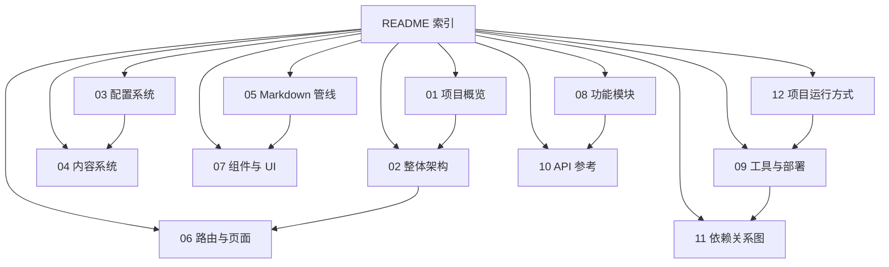

# astro-koharu Code Wiki

本目录是 `astro-koharu`（`秦超的博客`）的代码级文档集，目标是让新维护者在不逐文件通读源码的前提下，理解项目的整体架构、模块职责、关键函数、依赖关系与运行方式。

文档基于仓库当前检出状态（`astro-koharu@7.7.4`，2026-10-25）撰写，所有结论均来自对源码的直接阅读。文档中的路径均相对于仓库根目录。

## 1. 项目速览

| 项目 | 内容 |
| --- | --- |
| 项目名 | `astro-koharu` |
| 定位 | 由 Hexo/Shoka 博客迁移而来的 Astro 静态博客，并做了大量本地化定制 |
| 站点形态 | 默认纯静态输出；启用碎碎念（Moments）后切换为 Node 常驻服务 |
| 框架 | Astro 7.1.3 + React 19 |
| 样式 | Tailwind CSS 4.x + shadcn/ui（Radix Primitives + CVA） |
| 内容 | Astro Content Collections，Markdown/MDX |
| 搜索 | Pagefind（构建期生成索引） |
| 状态 | Nanostores（全局 UI 状态） |
| 动效 | Motion 12.x |
| 语言 | 中文（默认）/ English（内置支持 ja、ko 翻译文件） |
| Node | `>= 22.20.0` |
| 包管理器 | `pnpm@10.28.2`（Workspace 同时包含根项目与 `cms/`） |
| 部署 | EdgeOne Pages（静态）/ nginx + Docker / Astro Node standalone |

## 2. 文档地图

| 章节 | 内容 | 适合谁读 |
| --- | --- | --- |
| [01 项目概览](./01-overview.md) | 项目定位、功能全景、技术栈、设计原则 | 所有人 |
| [02 整体架构](./02-architecture.md) | 分层架构、构建/运行生命周期、目录职责、关键设计决策 | 架构师、新维护者 |
| [03 配置系统](./03-configuration.md) | `site.yaml` 全量配置段、normalizer、组装层、环境变量 | 站点定制者 |
| [04 内容系统](./04-content-system.md) | 内容集合 Schema、i18n 内容约定、查询 API、分类/标签/系列/落款 | 内容开发者 |
| [05 Markdown 管线](./05-markdown-pipeline.md) | remark/rehype/Shiki 插件链、自定义语法、加密、客户端增强 | Markdown/渲染开发者 |
| [06 路由与页面](./06-routing-and-pages.md) | 路由表、locale 镜像、布局层级、SEO/RSS/Sitemap、页面数据流 | 前端开发者 |
| [07 组件与 UI](./07-components-and-ui.md) | 组件目录职责、全局岛、设计系统、主题、Hooks、Stores | UI 开发者 |
| [08 功能模块](./08-features.md) | 写作室、CMS、碎碎念、搜索、评论、统计、音乐、公告、友链、Bangumi | 功能维护者 |
| [09 工具与部署](./09-tooling-and-deployment.md) | CLI、内容资产生成、测试、构建、Docker、部署与排障 | 运维、贡献者 |
| [10 关键 API 参考](./10-api-reference.md) | 按模块列出的关键函数、类型、常量 | 所有开发者 |
| [11 依赖关系图](./11-dependency-map.md) | 模块依赖方向、外部依赖分类、别名、循环依赖治理 | 架构师、评审者 |
| [12 项目运行方式](./12-running-guide.md) | 环境准备、开发/构建、写作室/CMS、Moments、Docker、启动排障 | 所有开发者、运维 |



核心模块与关键函数速查：

| 模块 | 入口 | 关键导出/命令 |
| --- | --- | --- |
| 配置解析 | `src/lib/config/site.ts` | `siteConfig`、`normalizeContentConfig`、`normalizeMomentsConfig` |
| 内容查询 | `src/lib/content.ts` | `getSortedPosts`、`getPostById`、`getHomePagePosts` |
| Markdown | `src/lib/markdown/` | `preprocessShokaSyntax`、`remarkShokaRuby`、`rehypeEncryptedPost` |
| 路由 | `src/pages/_shared/routes.ts` | `postRoute`、`tagRoute`、`categoryRoute`、`postListRoute` |
| i18n | `src/i18n/utils.ts` | `t`、`localizedPath`、`getLocaleFromUrl` |
| 写作室 | `src/features/editor/Editor.tsx` | `renderEditorMarkdown`、`listDrafts`、`writeDraft` |
| 碎碎念 | `src/features/moments/lib/data.ts` | `getMomentsChannels`、`listChannelMessages` |
| CLI | `scripts/koharu.tsx` | `pnpm koharu`、`koharu generate`、`koharu migrate` |
| CMS | `cms/server.ts` | `/api/cms/*`、`sourceReadHandler`、`sourceWriteHandler` |
| 部署 | `docker/Dockerfile`、`astro.config.mjs` | `pnpm build`、`output: static`、Node adapter |

推荐阅读顺序：

- **第一次接触项目**：01 → 02 → 12 → 06，先建立“项目是什么、怎么跑起来”的全局认知。
- **要启动或部署**：12 → 09 → 03。
- **要改页面或组件**：06 → 07 → 05。
- **要写文章或改内容逻辑**：04 → 03 → 05。
- **要改配置或部署**：03 → 12 → 09 → 11。
- **要做代码评审**：02 → 10 → 11。

## 3. 仓库目录总览

```text
.
├── astro.config.mjs          # Astro 构建入口：插件链、集成、Vite、i18n、adapter
├── config/
│   ├── site.yaml             # 站点唯一主配置（21 个顶层配置段）
│   └── i18n-content.yaml     # 内容级多语言文案（分类/系列/精选分类/落款）
├── src/
│   ├── pages/                # 文件路由 + [lang]/ 语言镜像
│   ├── layouts/              # HTML 骨架与页面布局
│   ├── components/           # Astro 静态组件 + React 交互岛
│   ├── features/             # 可注入功能模块（editor、moments）
│   ├── lib/                  # 纯逻辑层：配置、内容、Markdown、客户端增强
│   ├── hooks/                # 可复用 React Hooks
│   ├── store/                # Nanostores 全局状态
│   ├── i18n/                 # UI 文案、locale 配置、路由工具
│   ├── constants/            # 路由、布局、设计 token、组装后的配置
│   ├── content/blog/         # Markdown 内容（en/ 等语言子目录）
│   ├── assets/               # 生成的 JSON 资产与静态 SVG
│   ├── scripts/              # LQIP / 相似度 / AI 摘要生成脚本
│   ├── styles/               # 全局、主题、组件样式
│   └── content.config.ts     # Content Collection 定义
├── scripts/                  # koharu CLI（Ink TUI）
├── cms/                      # 本地 CMS（Hono + Vite + React）
├── tests/                    # 浏览器/集成测试
├── docker/                   # 静态与动态 Docker 构建
├── deploy/                   # koharu-stack / editor 部署样例
├── docs/                     # 上游文档与本文档集
└── public/                   # 原样映射的静态资源
```

## 4. 快速运行

前置条件：Node.js `>= 22.20.0`、pnpm `10.28.2`。

```bash
pnpm install
pnpm dev        # http://localhost:4321
```

首次启动会先执行 `koharu migrate --check`，检查是否存在需要迁移的旧文章链接。生产构建：

```bash
pnpm build      # 输出 dist/
pnpm preview    # 预览构建结果
```

| 目标 | 命令/配置 | 入口或产物 |
| --- | --- | --- |
| 本地开发 | `pnpm dev` | `http://localhost:4321` |
| 静态构建 | `pnpm build` | `dist/` |
| 写作室 | `editor.enabled: true` + `pnpm dev` | `/editor` |
| 本地 CMS | `pnpm cms:install` → `pnpm cms` | `http://localhost:4322` |
| 内容资产 | `pnpm generate:all` | `src/assets/*.json` |
| Moments | `moments.enabled: true` + `KOHARU_SUITE_URL` | Node standalone |
| 静态 Docker | `pnpm docker:up` | nginx 容器 |
| 动态 Docker | `pnpm docker:up:dynamic` | Node 容器 |

完整的运行模式、环境变量、验收清单与启动排障见 [12 项目运行方式](./12-running-guide.md)；命令与部署细节见 [09 工具与部署](./09-tooling-and-deployment.md)。

## 5. 常用命令

```bash
pnpm dev                 # 启动开发服务器 http://localhost:4321
pnpm build               # 生产构建，输出 dist/
pnpm preview             # 预览构建结果
pnpm check               # Astro 类型检查
pnpm test                # 全部 node:test 套件
pnpm lint:fix            # Biome 格式化与修复
pnpm knip                # 查找未使用文件/依赖

pnpm koharu              # 交互式 CLI（新建/备份/还原/更新/迁移/生成）
pnpm generate:lqips      # 生成图片占位色
pnpm generate:summaries  # 生成 AI 摘要（需 .env 中的 AI_API_KEY）
pnpm generate:similarities # 生成语义相似度
pnpm cms:install && pnpm cms # 本地 CMS http://localhost:4322
```

## 6. 文档约定

- **路径**：全部相对于仓库根目录；章节之间使用相对链接。
- **“关键函数”**：只列出被跨模块消费、或承担核心职责的导出符号；内部辅助函数不展开。
- **配置项**：以 `config/site.yaml` 的真实顶层键为准；未在 YAML 中出现的功能（如 `bangumi`）会明确标注为“按需启用/当前注释”。
- **代码事实**：表格中的默认值、文件路径、行为均来自源码；不对未实现的能力做推测。
- **术语**：
  - **默认语言**：`i18n.defaultLocale` 指定的语言，当前为 `zh`。
  - **镜像页**：`src/pages/[lang]/` 下与根页面同名的页面，服务所有非默认语言。
  - **内容资产**：`src/assets/*.json` 中由脚本生成的 LQIP、相似度、摘要数据。
  - **岛（Island）**：Astro 术语，指独立水合的客户端组件。

## 7. 文档维护

- 修改 `config/site.yaml` 的配置结构、`src/content.config.ts` 的 Schema、`astro.config.mjs` 的插件顺序、或新增可注入功能时，应同步更新本目录对应章节。
- 新增模块时优先更新 [02 整体架构](./02-architecture.md) 的目录职责表与 [11 依赖关系图](./11-dependency-map.md)。
- 本目录不替代源码注释：涉及“为什么这样写”的细节，以源码注释和 `AGENTS.md` 为准。

## 8. 范围说明

- 文档覆盖仓库内的 Astro 站点、`cms/`、`scripts/`、`src/features/`、测试与部署配置。
- 第三方托管服务的内部实现不在范围内（Waline、Twikoo、Giscus、Remark42、Umami、Bangumi、Meting、Koharu Suite），文档只说明集成点、配置与调用方式。
- `src/assets/*.json` 被描述为“生成的内容资产”，其数据由脚本产生，不在文档中逐条列举。
- 文档不包含密钥、Token、真实用户数据；示例配置均做了脱敏或使用占位值。
